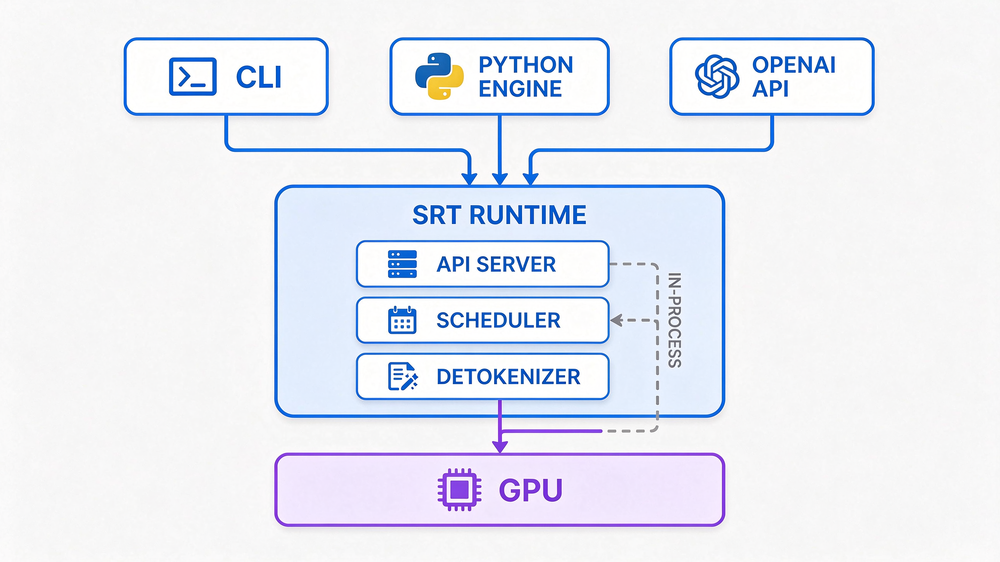
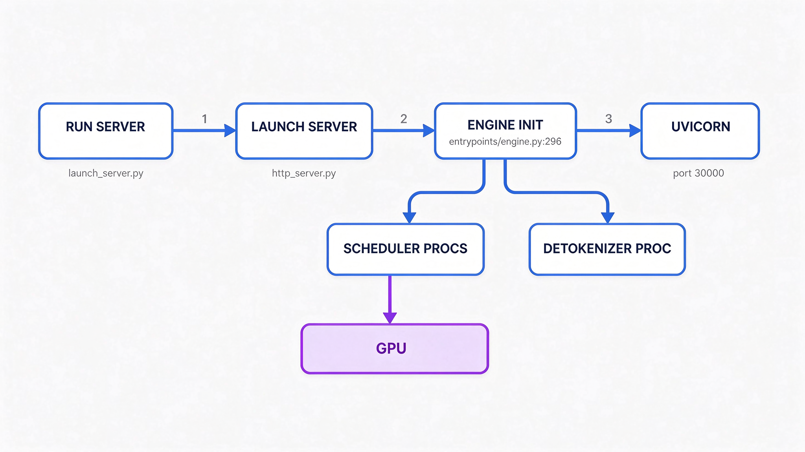

# LESSON 01 介绍、环境搭建与快速上手

> 本课目标：跑通三种调用方式，并且知道这三种方式在代码里分别落到哪个入口。跑不通就先别往下读。

## TL;DR

- SGLang 有三种用法：**CLI 起服务**、**Python Engine 离线调用**、**OpenAI 兼容 API**。三者底层是同一套 SRT 运行时。
- `sglang serve` 一条命令拉起三个进程：API Server、Scheduler、Detokenizer。第 03 课会逐段拆开。
- 离线 Engine 不经过 HTTP，但**进程拓扑完全一样**——它不是"简化版"，只是换了个入口。

## 考点地图

- SGLang 和 vLLM 的区别在哪？
- `sgl.Engine` 和 `sglang serve` 起的服务是同一套东西吗？
- 一条 `sglang serve` 命令到底启动了几个进程？
- 显存不够时先调哪个参数？
- OpenAI 兼容层是怎么接进来的？

## 1.1 SGLang 是什么

三句话：

1. **起点是"结构化 LLM 程序"**。多轮对话、分支、约束解码这类程序有大量重复前缀和可复用的中间状态，SGLang 最初的贡献是用 RadixAttention 把前缀 KV 复用做进调度器。
2. **现在是两套东西并存**。`python/sglang/lang` 是前端 DSL（第 02 课），`python/sglang/srt` 是高性能运行时（第 03 课起）。热路径在后者。
3. **差异点是缓存与调度的一体化**。Radix tree 直接管理 KV 池、调度器按前缀命中决定优先级，而不是把缓存当成外挂。

| 子目录 | 角色 | 对应课程 |
|---|---|---|
| `python/sglang/lang` | 前端 DSL、解释器、后端适配 | 02 |
| `python/sglang/srt` | 运行时：调度、KV、模型执行 | 03 起 |
| `python/sglang/cli` | `sglang serve` 等命令 | 01 |
| `python/sglang/kernels` | Triton / AOT kernel | 13 |

## 1.2 安装

官方推荐（`README.md:41`）：

```bash
uv pip install --prerelease=allow sglang
```

源码开发（`README.md:89`）：

```bash
git clone https://github.com/sgl-project/sglang.git
cd sglang
pip install -e "python"
```

`--prerelease=allow` 是必须的：依赖里有预发布版本的包，不加会解析失败。

## 1.3 三种用法

### 用法一：CLI 起服务

```bash
sglang serve --model-path Qwen/Qwen3-0.6B --port 30000
```

`python -m sglang.launch_server ...` 仍然可用，但会打印一条提示让你改用 `sglang serve`（`python/sglang/launch_server.py:55`）。

### 用法二：Engine 离线调用

```python
import sglang as sgl

llm = sgl.Engine(model_path="Qwen/Qwen3-0.6B")
out = llm.generate("用一句话解释 KV Cache", {"max_new_tokens": 32})
print(out["text"])
llm.shutdown()
```

`sgl.Engine` 是薄别名，直接转发到 `srt/entrypoints/engine.py:266` 的 `Engine`（`lang/api.py:42`）。参数与 `ServerArgs` 完全一致。

### 用法三：OpenAI 兼容 API

```python
from openai import OpenAI

client = OpenAI(base_url="http://127.0.0.1:30000/v1", api_key="EMPTY")
resp = client.chat.completions.create(
    model="Qwen/Qwen3-0.6B",
    messages=[{"role": "user", "content": "你好"}],
)
print(resp.choices[0].message.content)
```

对应路由在 `http_server.py:1901`（`/v1/chat/completions`）与 `http_server.py:2026`（`/v1/models`），实现类是 `OpenAIServingChat`（`openai/serving_chat.py:386`）。

### 三种方式怎么选

| 方式 | 适合 | 入口 | 有 HTTP | 流式 |
|---|---|---|---|---|
| CLI + OpenAI API | 多语言客户端、线上服务 | `python/sglang/launch_server.py:17` | 有 | 有 |
| Engine | 离线批处理、评测、单机脚本 | `srt/entrypoints/engine.py:266` | 无 | 有（异步生成器） |
| 前端 DSL | 结构化程序原型 | `lang/api.py:23` | 取决于后端 | 有 |

## 1.4 代码主线：一条 serve 命令之后发生了什么

```python
# python/sglang/launch_server.py:17
def run_server(server_args):
    server_args.resolve_once()
    cfg = resolving_view(server_args)
    if cfg.encoder_only:
        ...
    elif cfg.use_ray:
        ...
    else:
        from sglang.srt.entrypoints.http_server import launch_server
        launch_server(server_args)
```

然后 `srt/entrypoints/http_server.py:3290` 的 `launch_server` 构造 `Engine`，`Engine.__init__`（`srt/entrypoints/engine.py:296`）做三件事：

1. 解析 `ServerArgs`（不传就用 `Engine(...)` 的关键字参数构造）。
2. 拉起 Scheduler 进程组：`_launch_scheduler_processes`（`srt/entrypoints/engine.py:1285`）。
3. 拉起 Detokenizer 进程：`_launch_detokenizer_subprocesses`（`srt/entrypoints/engine.py:1398`）。

最后启动 Uvicorn，把 `/generate`、`/v1/chat/completions` 等路由挂上去。





**这就是第 03 课的起点**：Engine 是进程编排器，真正干活的是它拉起来的 Scheduler。

## 1.5 必知参数

| 参数 | 作用 | 什么时候调 |
|---|---|---|
| `--mem-fraction-static` | 静态显存占比：权重 + KV 池（`fields/schedule.py:27`） | OOM 时先调小 |
| `--tp-size` | 张量并行度 | 单卡放不下模型时 |
| `--context-length` | 最大上下文 | 显存紧张时调小 |
| `--max-running-requests` | 同时在跑的请求上限 | 想压延迟或稳显存 |
| `--chunked-prefill-size` | 单次 prefill 的 token 上限 | 长 prompt 拖慢 decode 时 |

参数名的生成规则是字段名把下划线换成短横线（`arg_utils.py:293`），所以源码里叫 `mem_fraction_static`，命令行就是 `--mem-fraction-static`。

## 1.6 动手验证

离线：

```bash
python -c "
import sglang as sgl
llm = sgl.Engine(model_path='Qwen/Qwen3-0.6B', log_level='error')
print(llm.generate('1+1=', {'max_new_tokens': 8})['text'])
llm.shutdown()
"
```

在线：

```bash
sglang serve --model-path Qwen/Qwen3-0.6B --port 30000 &
curl -s http://127.0.0.1:30000/v1/models | head -c 200
```

流式：

```bash
curl -N http://127.0.0.1:30000/generate \
  -H "Content-Type: application/json" \
  -d '{"text":"你好","stream":true}'
```

## 1.7 常见坑

1. **OOM 不一定是不够大，而是 `mem-fraction-static` 太高**。它同时覆盖权重和 KV 池，调小比换卡快。
2. **`pip install sglang` 不加 `--prerelease=allow` 会卡在依赖解析**，报错信息里看不出是这个原因。
3. **端口被占**时 Uvicorn 报的错在日志中段，不在开头；直接 `curl /health` 比看日志快。
4. **Engine 忘记 `shutdown()`** 会留下 Scheduler 子进程，下次启动抢占显存。

## 1.8 面试问答

**Q1：SGLang 和 vLLM 的区别？**

- 一句话：vLLM 以 PagedAttention 起家，SGLang 以 RadixAttention + 结构化程序执行为起点，现在都覆盖了完整运行时。
- 展开：SGLang 的缓存是 radix tree，天然支持任意长度前缀共享；调度器与缓存耦合更紧，能在组批阶段就用命中长度算优先级。
- 追问"谁更快"：取决于负载。前缀共享率高的场景（多轮、few-shot、agent）SGLang 优势明显；纯随机 prompt 差距不大。

**Q2：`sgl.Engine` 和 `sglang serve` 是同一套吗？**

- 一句话：同一套运行时，不同入口。
- 展开：两者都走 `Engine.__init__`，都拉起 Scheduler 与 Detokenizer 进程；差别只在前者没有 HTTP 层。
- 追问"离线能做流式吗"：能，`generate` 内部就是生成器，`stream=True` 时逐段返回。

**Q3：一条 `sglang serve` 起了几个进程？**

- 一句话：默认三个，TP>1 或 DP>1 时更多。
- 展开：API Server（含 TokenizerManager）、Scheduler（每个 TP rank 一个）、Detokenizer。
- 追问"为什么"：见第 03 课，GIL 与阻塞点隔离。

**Q4：显存不够先调什么？**

- 一句话：先 `--mem-fraction-static`，再 `--context-length`，最后才考虑 `--tp-size`。
- 展开：前者直接决定静态池大小，后者限制单请求长度；TP 会引入通信开销。
- 追问"KV 池多大怎么算"：第 05 课，`ModelConfig` 按剩余显存反推 token 数。

**Q5：OpenAI 兼容层在哪？**

- 一句话：`srt/entrypoints/openai/`，由 `http_server` 挂载。
- 展开：`OpenAIServingChat` 负责协议转换，内部仍调用 TokenizerManager 的 `generate_request`。
- 追问"和 /generate 有什么区别"：只是协议格式不同，走的链路完全一致。

## 1.9 一页速记

```
安装   uv pip install --prerelease=allow sglang
起服务 sglang serve --model-path <model> --port 30000
离线   sgl.Engine(model_path=...) → generate → shutdown
API    base_url=http://host:30000/v1
启动链 launch_server → http_server.launch_server → Engine.__init__
       → _launch_scheduler_processes + _launch_detokenizer_subprocesses → uvicorn
参数   mem-fraction-static / tp-size / context-length / max-running-requests / chunked-prefill-size
```

## 挂载点

本课只负责"跑起来"。接下来的 03 会打开 `Engine.__init__` 拉起的三个进程，解释每个进程在做什么。
