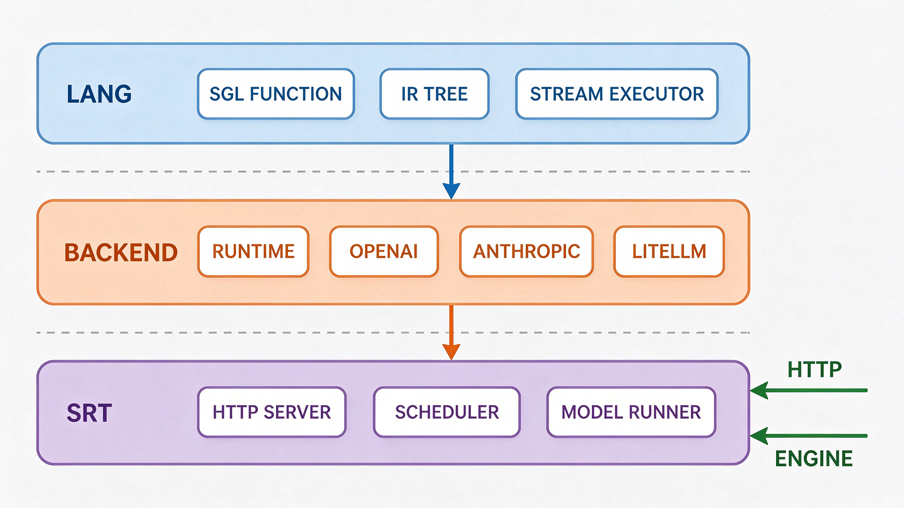
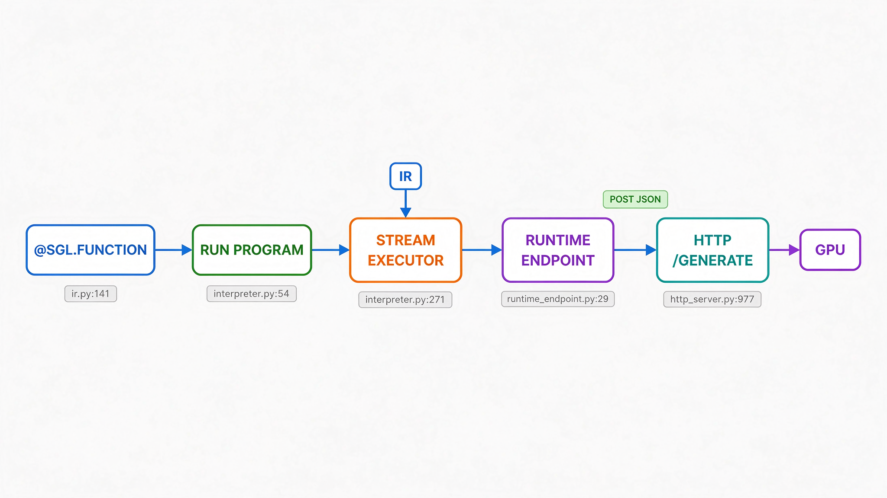

# LESSON 02 双层体系架构全景

> 这一课解决一个困惑：为什么仓库里既有 `sgl.function`，又有 `sgl.Engine`，还有 `sglang serve`？它们不是三个产品，是两层加两个入口。

## TL;DR

- **上层是表达层**：`sgl.function` 把 Python 函数编译成 IR，由 `StreamExecutor` 解释执行。
- **下层是运行时层**：SRT，负责调度、KV、模型执行。它只认 HTTP 或进程内调用。
- 两层之间是**适配器层**：`BaseBackend` 的若干子类，把 IR 的 `generate` 请求翻译成 HTTP 或第三方 API。
- 现实定位：**DSL 已不是主路径**，OpenAI 兼容 + Engine 才是。但 DSL 的 fork/select/lazy commit 设计，是理解 SGLang 结构化输出思路的入口。

## 考点地图

- SGLang 的"前端语言"具体指什么？
- `@sgl.function` 装饰之后发生了什么？
- `SglGen` / `SglSelect` / `SglFork` 分别对应什么控制流？
- Backend 适配器有哪几种，RuntimeEndpoint 特殊在哪？
- 为什么说 DSL 不是热路径？

## 2.1 三层视图

| 层 | 位置 | 输入 | 输出 |
|---|---|---|---|
| 表达层 | `python/sglang/lang` | Python 函数 + `sgl.gen` | IR（`SglExpr` 树） |
| 适配层 | `lang/backend` | IR 的 generate 调用 | HTTP 请求 / 第三方 API 调用 |
| 运行时层 | `python/sglang/srt` | HTTP 或进程内调用 | token、文本 |



关键点：**表达层不碰 GPU，运行时层不认识 IR**。两层靠适配器解耦，所以 DSL 可以接 OpenAI、Anthropic，也可以接本地 SRT。

## 2.2 表达层：从函数到 IR

```python
import sglang as sgl

@sgl.function
def few_shot(s, question):
    s += "Q: 1+1=?\nA: 2\n"
    s += "Q: " + question + "\nA: " + sgl.gen("answer", max_tokens=16)
```

`@sgl.function` 返回的不是普通函数，而是 `SglFunction`（`lang/ir.py:141`）。它做的事只有一件：把函数体和参数**留到运行时再展开**。

```python
# lang/ir.py:164
def run(self, *args, max_new_tokens=128, ...):
    from sglang.lang.interpreter import run_program
    ...
```

`run_program`（`lang/interpreter.py:54`）创建 `StreamExecutor`（`lang/interpreter.py:271`）和 `ProgramState`（`lang/interpreter.py:849`），然后执行函数体。函数体里的每一个 `s += ...` 和 `sgl.gen(...)` 都是一次 `submit`（`lang/interpreter.py:339`），把表达式节点推进 IR 树。

| IR 节点 | 行号 | 语义 |
|---|---|---|
| `SglGen` | `ir.py:451` | 一次生成，可带 sampling params |
| `SglSelect` | `ir.py:533` | 从若干候选中按概率选一个 |
| `SglFork` | `ir.py:551` | 复制当前状态，并行跑多条分支 |
| `SglCommitLazy` | `ir.py:610` | 把惰性操作真正提交 |

## 2.3 为什么要 IR，而不是直接调 API

三个理由，面试可以按这个顺序答：

1. **可 fork**。`SglFork` 需要复制"当前已生成的前缀"，只有把程序表示成树才能做到。
2. **可重放**。同一个 `SglFunction` 可以用不同参数跑多次，IR 是模板。
3. **可延迟提交**。`commit_lazy_operations` 允许把多个操作攒起来一次发，减少往返。

代价是调试困难：报错栈里全是解释器帧，看不到用户函数的行号。

## 2.4 适配层：Backend 家族

`BaseBackend`（`lang/backend/base_backend.py:9`）定义了统一接口：`generate`、`generate_stream`、`fork_program`、`cache_prefix` 等。

| 适配器 | 文件 | 对接对象 |
|---|---|---|
| `RuntimeEndpoint` | `runtime_endpoint.py:29` | 本地/远端 SGLang HTTP 服务 |
| `OpenAI` | `openai.py:56` | OpenAI API |
| `Anthropic` | `anthropic.py:12` | Anthropic API |
| `LiteLLM` | `litellm.py:15` | LiteLLM 代理 |
| `VertexAI` | `vertexai.py:20` | GCP Vertex |
| `Crusoe` | `crusoe.py:10` | Crusoe 托管推理（OpenAI 兼容的薄封装） |

`RuntimeEndpoint` 是唯一能把 DSL 接到 SRT 上的适配器：它构造时先请求 `/get_model_info` 拿模型信息（`runtime_endpoint.py:46`），之后每次 `generate` 都转成一次 HTTP 调用。



## 2.5 运行时层：只认两个入口

SRT 不关心调用方是 DSL、OpenAI SDK 还是 curl。它只有两个入口：

```python
# 入口一：HTTP
POST /generate                 # http_server.py:977
POST /v1/chat/completions      # http_server.py:1901

# 入口二：进程内
Engine.generate(...)           # engine.py:431
```

这两条入口在第 03 课汇合到同一个 `TokenizerManager.generate_request`。所以**读源码时不要在入口层纠结，直接从 03 的主线开始**。

## 2.6 现实定位：DSL 为什么不是主路径

三个原因：

1. **生态在 OpenAI 协议上**。客户端、SDK、评测框架都按 `/v1/chat/completions` 写，DSL 要重新教育用户。
2. **约束解码下沉了**。早期 DSL 承担结构化输出，现在 `srt/constrained` 直接在运行时做，不需要上层语言。
3. **性能路径不在这一层**。DSL 的 fork/select 会放大请求数，生产环境更常用显式批处理。

但仍值得读：`SglSelect` 的按概率选择、`SglFork` 的状态复制，是"程序级推测执行"的早期形态，和第 14 课的推测解码是同一类思想。

## 2.7 对比表

| 维度 | 前端 DSL | Engine | OpenAI API |
|---|---|---|---|
| 表达力 | 高（分支、fork、select） | 中（单次调用） | 中（消息数组） |
| 调试成本 | 高（解释器栈） | 低 | 低 |
| 生态兼容 | 低 | 中 | 高 |
| 性能上限 | 中（请求放大） | 高 | 高 |
| 适合 | 原型、研究 | 离线批处理 | 线上服务 |

## 2.8 动手验证

把 DSL 接到本地服务：

```bash
sglang serve --model-path Qwen/Qwen3-0.6B --port 30000 &
```

```python
import sglang as sgl

backend = sgl.RuntimeEndpoint("http://127.0.0.1:30000")
sgl.set_default_backend(backend)

@sgl.function
def hello(s, name):
    s += "你好，" + name + "！请用一句话介绍自己。"

print(hello.run(name="小明").text())
```

观察两次调用之间的前缀复用：第二次把 name 换掉，日志里 `cached_tokens` 会明显大于 0。

## 2.9 面试问答

**Q1：SGLang 的前端语言指什么？**

- 一句话：`python/sglang/lang`，一套把 Python 函数编译成 IR 再解释执行的 DSL。
- 展开：`@sgl.function` → `SglFunction` → `run_program` → `StreamExecutor` 逐节点执行。
- 追问"和 LangChain 的区别"：LangChain 编排的是调用，SGLang DSL 编排的是 token 级生成，能做 fork 和前缀复用。

**Q2：为什么要先建 IR 再执行？**

- 一句话：为了 fork、重放和延迟提交。
- 展开：`SglFork` 需要复制状态，`SglCommitLazy` 需要合并操作，直接调 API 做不到。
- 追问"代价"：解释器栈难调试，且容易放大请求数。

**Q3：RuntimeEndpoint 做了什么？**

- 一句话：把 DSL 的 generate 翻译成 SGLang HTTP 请求。
- 展开：构造时拉 `/get_model_info`，之后每次生成都走 `/generate`；流式则逐块读 SSE。
- 追问"和直接 requests 的区别"：它维护 chat template、sampling 参数映射和前缀缓存句柄。

**Q4：DSL 现在还有人用吗？**

- 一句话：研究和小规模原型还在用，生产主路径是 OpenAI 协议。
- 展开：结构化输出下沉到 `srt/constrained`，性能优化集中在调度器。
- 追问"那为什么要学"：它的 fork/select 是理解推测执行与分支生成的捷径。

**Q5：两层架构的好处？**

- 一句话：表达与执行解耦，DSL 可以换后端，运行时可以换入口。
- 展开：同一份 `SglFunction` 能跑在 OpenAI、Anthropic 或本地 SRT 上。
- 追问"坏处"：多一层抽象，出错时定位链路变长。

## 2.10 一页速记

```
表达层  @sgl.function → SglFunction(ir.py:141) → run_program(interpreter.py:54)
        → StreamExecutor(271) → submit(339) 逐节点执行
IR      SglGen(451) / SglSelect(533) / SglFork(551) / SglCommitLazy(610)
适配层  BaseBackend(9) → RuntimeEndpoint(29) / OpenAI(56) / Anthropic(12) / LiteLLM(15)
运行时  /generate(977) 或 /v1/chat/completions(1901) 或 Engine.generate(431)
汇合点  TokenizerManager.generate_request（第 03 课）
```

## 挂载点

- 03 会把本课提到的两条入口汇合成一条主线。
- 14 的推测解码与 `SglFork` 是同一类"分支 + 验证"思想。
