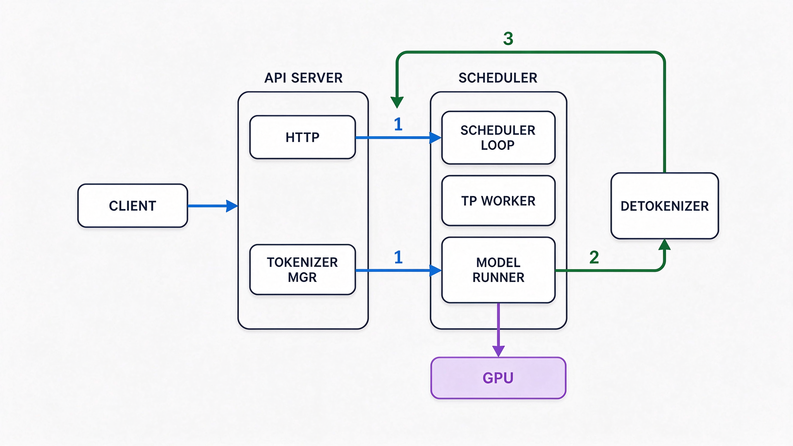
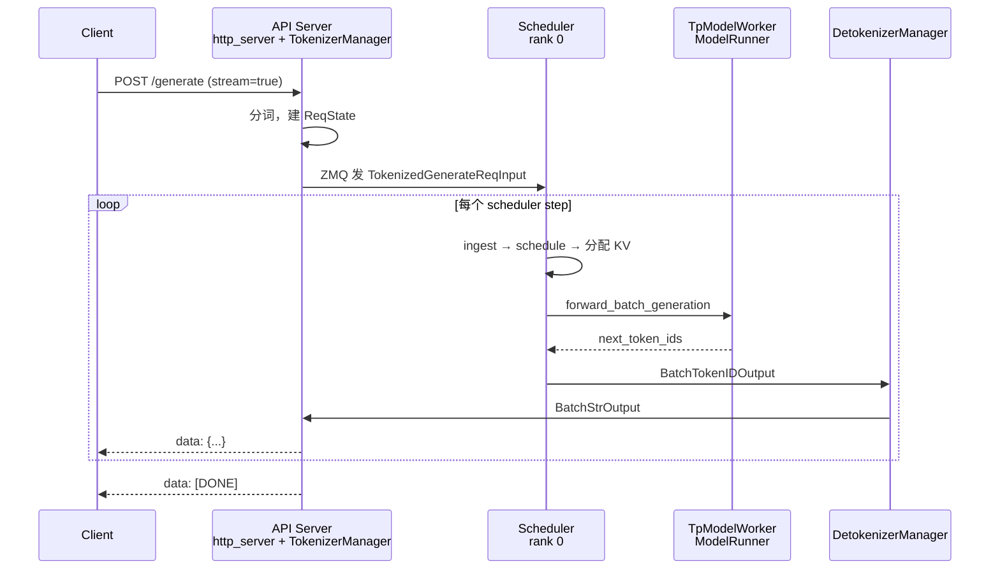
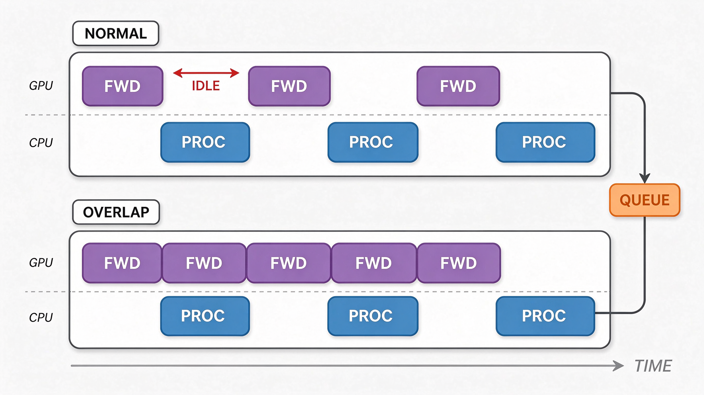
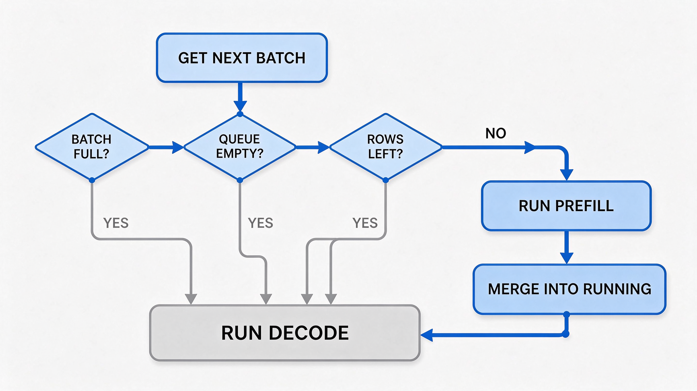
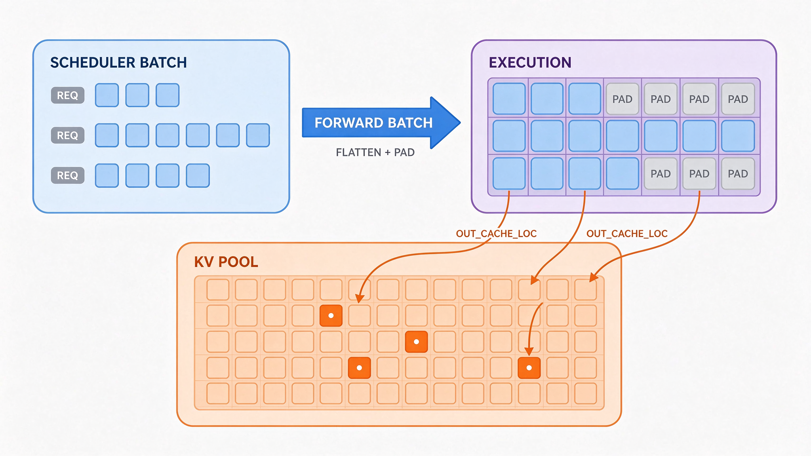
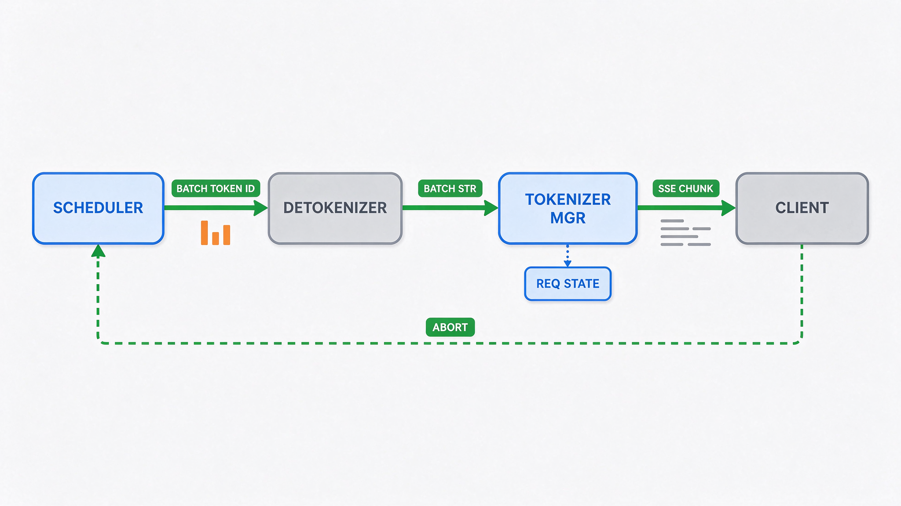

# LESSON 03 请求端到端生命周期

> 本课是全书主干。01/04/06/07/11/14 都是本课某一步的展开，读完这一课应该能在白板上画出下面这张图，并说出每一步的文件名。

## TL;DR

一次请求在 SGLang 里只经过 **4 类组件、3 条 ZMQ 通道、2 个循环**：

```
HTTP → TokenizerManager → (ZMQ: 请求) → Scheduler ─┬→ TpModelWorker → ModelRunner
                                                   └→ (ZMQ: token) → Detokenizer → (ZMQ: 文本) → TokenizerManager → HTTP
```

三个结论先记住：

1. **HTTP 层只做协议转换**，不碰模型、不碰 KV Cache。
2. **真正的状态机在 Scheduler**，它一个 step 只推进一次 forward，decode 阶段就是一个 token。
3. **TokenizerManager 不做模型计算**，它只负责分词、建请求状态、异步等待，是"IO + 状态表"的粘合层。

## 考点地图

本课覆盖的面试问法：

- 一次请求在 SGLang 里经过哪些组件？
- 为什么 tokenizer、scheduler、detokenizer 要拆成不同进程？
- normal 和 overlap 两种调度循环差在哪？overlap 到底重叠了什么？
- 流式输出为什么不会乱序？`[DONE]` 是谁加的？
- KV Cache 在链路里的哪一步分配？
- prefill 和 decode 在 Scheduler 里怎么二选一？

## 3.1 全景：进程与通道

先建立物理视图。默认配置（TP=1，无 DP）下是三个进程：

| 进程 | 主要类 | 职责 | 是否 GPU |
|---|---|---|---|
| API Server | `http_server` + `TokenizerManager` | HTTP/OpenAI 协议、分词、请求状态表 | 否 |
| Scheduler | `Scheduler` + `TpModelWorker` + `ModelRunner` | 组批、KV 分配、forward、采样 | 是 |
| Detokenizer | `DetokenizerManager` | token id → 文本 | 否 |



三条通道由 `PortArgs` 定义（`python/sglang/srt/server_args.py:826`）：

```python
class PortArgs:
    # tokenizer 从 detokenizer 收结果（zmq）
    tokenizer_ipc_name: str
    # scheduler rank0 从 tokenizer 收请求（zmq）
    scheduler_input_ipc_name: str
    # detokenizer 从 scheduler 收 token（zmq）
    detokenizer_ipc_name: str
```

传输实现是 ZeroMQ，序列化默认 msgpack，可通过开关切到 pickle（`managers/io_struct.py:3012`）：

```python
def sock_send(socket: zmq.Socket, obj: Any, flags: int = 0) -> None:
    if _USE_PICKLE_IPC:
        socket.send_pyobj(obj, flags=flags, protocol=pickle.HIGHEST_PROTOCOL)
        return
    socket.send(msgpack_encode(obj), flags=flags)
```

> **工程细节**：大对象（多模态特征）不走 msgpack 主通道，而是先写共享内存，再只传句柄（`wrap_shm_features`，见 `tokenizer_manager.py:2107`）。这是避免 IPC 拷贝打爆 CPU 的关键。

时序上：



**为什么拆三个进程？** 三个理由，面试能被追问三层：

1. **GIL**：分词/反分词是 CPU 密集，和调度循环抢 GIL 会直接抬高 TPOT。
2. **阻塞点隔离**：Scheduler 的循环必须严格按 step 推进；HTTP 的抖动、客户端断连都不应该进入这个循环。
3. **可批处理**：脱 token 化天然可以跨请求攒批，独立进程才能自己决定攒批窗口。

代价是三次跨进程拷贝和一套状态同步——这也是为什么 `ReqState` 只存在于 TokenizerManager，Scheduler 侧另有自己的 `Req`，两者靠 rid 关联，不共享内存。

## 3.2 入口：HTTP 只做协议转换

`python/sglang/srt/entrypoints/http_server.py:977`：

```python
@app.api_route("/generate", methods=["POST", "PUT"], response_class=SGLangORJSONResponse)
async def generate_request(obj: GenerateReqInput, request: Request):
    contract_error = generate_contract_error(await request.json())
    if contract_error is not None:
        return ORJSONResponse(status_code=400, content={"error": contract_error})
    request.__dict__.pop("_json", None)
    return await serve_generate_request(obj, request)
```

`serve_generate_request`（`http_server.py:989`）只做一件事：决定"流式还是非流式"。

```python
if obj.stream:
    async def stream_results():
        async for out in _global_state.tokenizer_manager.generate_request(obj, request):
            event = b"data: " + dumps_json(out) + b"\n\n"
            # 省略：命中 finish_reason 时在这里追加 data: [DONE]
            yield event
    return StreamingResponse(stream_results(), media_type="text/event-stream")
else:
    ret = await _global_state.tokenizer_manager.generate_request(obj, request).__anext__()
    return orjson_response(ret)
```

注意非流式分支：**它没有第二套实现**，只是从异步生成器里取第一个元素。SGLang 内部统一用"流式生成器"表达所有请求，非流式是流式的一个特例。

> 面试高频细节：`data: [DONE]` 是 **HTTP 层** 加的（`http_server.py:1015`），不是 TokenizerManager，也不是 Scheduler。所以用 Engine 离线调用时看不到 `[DONE]`。

## 3.3 分词与投递：TokenizedGenerateReqInput 是跨进程协议

`tokenizer_manager.py:1067` 的 `generate_request` 是一条直线：

```python
obj.normalize_batch_and_arguments()          # 单条/批量归一化
self._init_req_state(obj, request)           # 建 rid → ReqState
...
tokenized_obj = await self._tokenize_one_request(obj)
await self._send_one_request(tokenized_obj)
async for response in self._wait_one_response(obj, request):
    yield response
```

三个对象要分清：

| 对象 | 存在位置 | 作用 |
|---|---|---|
| `GenerateReqInput` | HTTP 层 | 用户协议，字段最全（text / input_ids / 多模态 / sampling_params） |
| `ReqState` | TokenizerManager | 单个请求的输出缓冲 `out_list` + 唤醒事件 `event` |
| `TokenizedGenerateReqInput` | 跨进程消息 | Scheduler 唯一认识的请求格式 |

`_tokenize_one_request`（`tokenizer_manager.py:1275`）负责三件事：分词、跑多模态 processor、校验长度。真正组装消息在 `_create_tokenized_object`（`tokenizer_manager.py:1825`），最终由 `_send_one_request`（`tokenizer_manager.py:2083`）投递：

```python
tokenized_obj = wrap_shm_features(tokenized_obj)
tokenized_obj.wrap_pickle_fields()
self._dispatch_to_scheduler(tokenized_obj)
```

`_dispatch_to_scheduler`（`tokenizer_manager.py:857`）就一行 `sock_send(self.send_to_scheduler, obj)`。

**关键设计**：TokenizerManager 发完请求就返回，不阻塞等待。它把 `ReqState` 挂到 `rid_to_state` 字典里，然后进入 `_wait_one_response` 等 `asyncio.Event`。这意味着 **单进程可以同时挂几千个未完成请求**，内存代价只是几个 list 和一个 Event。

## 3.4 调度循环：一个 step 只推进一步

Scheduler 是同步的 `while True`，不是 asyncio。两种循环：

```python
# event_loop_normal (scheduler.py:2221)
self.ingest_requests()
plan = self.get_next_batch_to_run(...)
if batch:
    result = self.run_batch(batch)
    self.process_batch_result(batch, result)
else:
    self.on_idle()
```

```python
# event_loop_overlap (scheduler.py:2256)
self.ingest_requests()
...
batch_result = self.run_batch(batch)          # 只 launch，不等结果
self.result_queue.append((batch.copy(), batch_result))
if self.last_batch:
    pop_and_process()                          # 处理上一步的结果
```



差别一句话：**normal 是"跑完再处理"，overlap 是"这一步处理上一步的结果"**。overlap 让 CPU 侧的 detokenize 准备、finish 判断、KV 释放和 GPU 上的 forward 并行，是 decode 吞吐的关键优化。代价是所有 batch 状态必须能"延迟一拍"使用，代码复杂度显著上升（`future_map`、`copy()`、WAR barrier 都是为它服务的）。

### get_next_batch_to_run：prefill 优先

`scheduler.py:4374` 是本课最该背下来的函数。它做两件事：先尝试组一个 prefill 批，组不出来再跑 decode。

```python
prefill_plan = self.get_new_batch_prefill(running_batch)
new_batch = prefill_plan.batch_to_run
...
if new_batch is not None:
    ret = new_batch                                  # 有 prefill 就跑 prefill
else:
    decode_batch = self.update_running_batch(running_batch)  # 否则跑 decode
    ret = decode_batch
```



这就是 **prefill 优先**策略：只要显存和 token 预算允许，新请求先插队做完 prefill，再回到 decode。它牺牲 decode 的尾延迟，换首 token 延迟（TTFT）和整体吞吐。

### 组 prefill 批的三道闸门

`_get_new_batch_prefill_raw`（`scheduler.py:4621`）在真正排序前先过三道闸门：

```python
if (running_batch.batch_is_full or len(self.waiting_queue) == 0) and self.chunked_req is None:
    return None, running_batch

...
running_bs = len(running_batch.reqs)
num_allocatable_reqs = self.get_num_allocatable_reqs(running_bs, running_batch=running_batch)
if num_allocatable_reqs <= 0 and self.chunked_req is None:
    running_batch.batch_is_full = True
    return None, running_batch
```

| 闸门 | 含义 | 触发后的现象 |
|---|---|---|
| `batch_is_full` | 当前 running batch 已经满 | 直接转 decode |
| `waiting_queue` 为空 | 没有新请求 | 直接转 decode |
| `num_allocatable_reqs <= 0` | 请求行池或 PP micro-batch 预算不足 | 标记 full，转 decode |

过了闸门才排序：`self.policy.calc_priority(...)`（`schedule_policy.py:279`），然后交给 `PrefillAdder`（`schedule_policy.py:1077`）逐个试放 `add_one_req`（`schedule_policy.py:2103`）。

`add_one_req` 里做了两件对本课至关重要的事：

1. **前缀匹配**：`match_kv_cache(req, tree_cache)`（`mem_cache/common.py:183`）→ `tree_cache.match_prefix(...)`，命中长度写进 `req.prefix_len`。这就是第 04 课的入口。
2. **token 预算**：按 `rem_input_tokens` / `rem_total_tokens` 判断放不放得下；放不下时，如果能切块就转 chunked，否则返回 `NO_TOKEN`。这就是第 07 课的入口。

### KV 在哪一步分配

不是 forward 时分配的，是**组批时**分配的：

```python
# scheduler.py:5031
new_batch.prepare_for_extend()
#   → schedule_batch.py:2396 prepare_for_extend
#     → mem_cache/allocation.py:363 alloc_for_extend
```

也就是说，Scheduler 在把请求放进 batch 的那一刻就确定了 `out_cache_loc`（KV 槽位）和 `req_pool_indices`（请求行号）。forward 只是拿着这些索引去读写 KV 池。

## 3.5 模型执行：ScheduleBatch 与 ForwardBatch 的分工

`run_batch`（`scheduler.py:5442`）最终调到 `model_worker.forward_batch_generation`（`managers/tp_worker.py:624`）：

```python
forward_batch = ForwardBatch.init_new(batch, self.model_runner, ...)
...
if self.pp_group.is_last_rank:
    out = self.model_runner.forward(forward_batch, pp_proxy_tensors=pp_proxy_tensors)
```

这里有两个"batch"，务必分清：

| 视图 | 类型 | 所在设备 | 内容 |
|---|---|---|---|
| 调度视图 | `ScheduleBatch` | CPU | `Req` 列表、token 预算、chunked 状态、finish 状态 |
| 执行视图 | `ForwardBatch` | CPU 元数据 + GPU 张量 | `input_ids`、`out_cache_loc`、`seq_lens`、attention 元数据 |



`ForwardBatch.init_new` 就是把调度状态"摊平"成 kernel 能吃的张量形状。**理解这一层分离，等于理解了 SGLang 为什么能同时支持 CUDA Graph、torch.compile 和多种 attention backend**——它们都只依赖 `ForwardBatch`，不关心调度逻辑。

然后 `ModelRunner.forward`（`model_runner.py:1908`）选执行器（eager / cuda graph，第 11 课），产出 logits；`sample`（`model_runner.py:2231`）产出 `next_token_ids`。

> PP 细节：只有 **last PP rank** 跑 `model_runner.forward`，前面 stage 只传 `PPProxyTensors`。所以 TP=8 时是 8 个进程同步执行同一次 forward，而不是"8 个进程各算一部分请求"——那是 DP。

## 3.6 回程：token → 文本 → HTTP



Scheduler 侧：

```python
# process_batch_result (scheduler.py:5932)
if batch.forward_mode.is_decode():
    self.batch_result_processor.process_batch_result_decode(batch, result)
elif batch.forward_mode.is_extend():
    self.batch_result_processor.process_batch_result_prefill(batch, result)
```

处理后交给 `output_streamer`，最终 `send_to_detokenizer.send_output(payload)`（`scheduler_components/output_streamer.py:353`）。payload 是 `BatchTokenIDOutput`（`io_struct.py:1830`），按行携带 rid、新增 token id、finish reason、logprob 等。

Detokenizer 侧是一个极简循环（`detokenizer_manager.py:164`）：

```python
while True:
    recv_obj = sock_recv(self.recv_from_scheduler)
    output = self._request_dispatcher(recv_obj)
    if output is not None:
        sock_send(self.send_to_tokenizer, output)
```

生成文本的关键一步在 `handle_batch_token_id_out`（`detokenizer_manager.py:406`）：把 `BatchTokenIDOutput` 转成 `BatchStrOutput`，并做停用词裁剪（`trim_matched_stop`）。

TokenizerManager 侧由 `handle_loop`（`tokenizer_manager.py:2926`）异步收包，`_handle_batch_output`（`tokenizer_manager.py:2941`）按 rid 分发到各自的 `ReqState`：

```python
state.out_list.append(out)
state.event.set()
```

`_stream_one_response`（`tokenizer_manager.py:2343`）被唤醒后 drain 整个 `out_list` 再 yield。

**顺序为什么有保证**：每个 rid 有独立 `ReqState` 和独立 `out_list`，同一请求的 token 只可能由 Scheduler 的连续 step 提交，天然串行。跨请求之间没有顺序约束，也不需要。

> 一个容易被忽略的性能点：非增量流式下，中间 chunk 的 `text` 置为 `None`，只在最终返回时拼一次，避免每步 O(n) 重建导致 O(n²)（见 `_stream_one_response` 里的注释）。

## 3.7 设计取舍表

| 决策 | SGLang 的选择 | 代价 | 替代方案 |
|---|---|---|---|
| 进程模型 | 三进程（API / Scheduler / Detokenizer） | 三次 IPC 拷贝、状态双份 | 单进程多线程，实现简单但 GIL 打架 |
| IPC 序列化 | msgpack 为主，pickle 兜底 | 需要处理自定义类型 | 全 pickle（不安全）、protobuf（要 schema） |
| 调度循环 | normal / overlap 二选一 | overlap 代码复杂度高 | 全部用 overlap（PP 不兼容） |
| prefill 与 decode | prefill 优先 | decode 尾延迟变大 | decode 优先（TTFT 变差） |
| 跨进程传 token | 传 id，不传文本 | Detokenizer 要维护增量状态 | 传文本（带宽爆炸） |
| 流式协议 | SSE，HTTP 层加 `[DONE]` | 与 Engine 路径不一致 | 统一 JSON 流 |

## 3.8 动手验证

启动一个最小服务（模型换成你本地任意一个）：

```bash
sglang serve --model-path Qwen/Qwen3-0.6B --port 30000
# 等价写法：python -m sglang.launch_server ...（仍支持，但会提示改用 sglang serve）
```

流式观察一次请求：

```bash
curl -N http://127.0.0.1:30000/generate \
  -H "Content-Type: application/json" \
  -d '{"text": "用一句话解释 KV Cache", "sampling_params": {"max_new_tokens": 32}, "stream": true}'
```

验证"decode 阶段一个 step 一个 token"：

```bash
# 找到 scheduler 进程
pgrep -af "sglang::scheduler"
# 抓一次栈：idle 时应停在 recv，忙时应停在 forward/sample
py-spy dump --pid <scheduler_pid>
```

验证 overlap 是否生效：启动时加 `--disable-overlap-schedule` 对比同一请求的 decode 吞吐。正常情况下去掉 overlap 会有明显下降。

## 3.9 面试问答

**Q1：一次请求在 SGLang 里经过哪些组件？**

- 一句话：HTTP → TokenizerManager → ZMQ → Scheduler → TpModelWorker → ModelRunner → Detokenizer → TokenizerManager → HTTP。
- 展开：HTTP 层只做协议转换；TokenizerManager 负责分词和 ReqState；Scheduler 负责组批、KV 分配和推进 step；ModelRunner 负责 forward 和采样；Detokenizer 负责 id→文本。
- 追问"哪一步最可能成为瓶颈"：decode 阶段是 Scheduler 的主循环，每步一个 token，所以 CPU 侧的调度开销会直接放大成 TPOT；这也是 overlap 模式存在的理由。

**Q2：为什么 tokenizer 和 scheduler 要拆进程？**

- 一句话：GIL 与阻塞点隔离。
- 展开：分词是 CPU 密集；Scheduler 的循环必须严格按 step 推进，不能被 HTTP 抖动或客户端断连打断。拆开后 Scheduler 可以是纯同步循环，好推理、好做图捕获。
- 追问"代价是什么"：三次 IPC 拷贝和状态双份（ReqState / Req 靠 rid 关联），所以大对象要走共享内存。

**Q3：overlap 模式重叠了什么？**

- 一句话：把"上一步的结果处理"和"这一步的 GPU forward"重叠。
- 展开：`run_batch` 只 launch 不等待，结果进 `result_queue`；下一轮循环先 `pop_and_process` 处理上一步，再 launch 新一步。CPU 的后处理因此藏在 GPU 计算时间里。
- 追问"为什么 PP 不兼容"：源码里明确 `FIXME: pp is not compatible with overlap`（`scheduler.py:5526`），多 stage 的流水节拍和"延迟一拍"冲突。

**Q4：流式输出为什么不会乱序？`[DONE]` 谁加的？**

- 一句话：每个 rid 独立 ReqState + 独立 out_list；`[DONE]` 由 HTTP 层加。
- 展开：Scheduler 的 step 对同一请求天然串行；TokenizerManager 按 rid 分发，不共享缓冲。
- 追问"客户端中途断开会怎样"：`_stream_one_response` 在等待时带超时轮询 `request.is_disconnected()`，断开就 `abort_request` 并抛异常终止协程。

**Q5：KV Cache 在链路哪一步分配？**

- 一句话：组批时，不在 forward 时。
- 展开：`Scheduler.get_new_batch_prefill` → `prepare_for_extend` → `alloc_for_extend`，产出 `out_cache_loc` 和 `req_pool_indices`；forward 只是拿着索引读写。
- 追问"显存不够怎么办"：`PrefillAdder` 先按 token 预算裁剪，裁不动就触发 preempt/evict（第 04、06 课）。

**Q6：prefill 和 decode 怎么二选一？**

- 一句话：prefill 优先，组不出 prefill 批才跑 decode。
- 展开：`get_next_batch_to_run` 先调 `get_new_batch_prefill`；返回非空就跑 prefill，否则 `update_running_batch` 跑 decode。
- 追问"这样对延迟公平吗"：不公平，牺牲 decode 尾延迟换 TTFT 和吞吐；需要严格 TPOT 时可调 chunked prefill 和调度策略。

## 3.10 一页速记

```
入口    http_server.generate_request → serve_generate_request（stream 分支）
分词    tokenizer_manager.generate_request → _tokenize_one_request → _create_tokenized_object
投递    _send_one_request → sock_send（ZMQ + msgpack）
调度    scheduler.event_loop_normal / event_loop_overlap
组批    get_next_batch_to_run → get_new_batch_prefill → PrefillAdder.add_one_req
缓存    match_kv_cache → tree_cache.match_prefix（04 课）
预算    rem_input_tokens / rem_total_tokens → chunked（07 课）
KV      prepare_for_extend → alloc_for_extend（组批时分配）
执行    tp_worker.forward_batch_generation → model_runner.forward → sample
回程    process_batch_result → output_streamer → detokenizer → handle_loop → ReqState.event
协议    [DONE] 在 HTTP 层加
```

## 挂载点

后续课程都挂在这条链的某一步上：

| 课程 | 挂载位置 |
|---|---|
| 04 RadixAttention | `PrefillAdder.add_one_req` 里的 `match_kv_cache` |
| 06 Scheduler | `get_next_batch_to_run` / `update_running_batch` |
| 07 Chunked Prefill | `PrefillAdder.add_chunked_req` 与 token 预算 |
| 11 CUDA Graph | `ModelRunner.forward` 里的 runner 选择 |
| 14 推测解码 | `run_batch` 里的 `spec_algorithm` 分支 |
| 15 分布式 | `TpModelWorker` 的 TP/PP group 与广播 |
