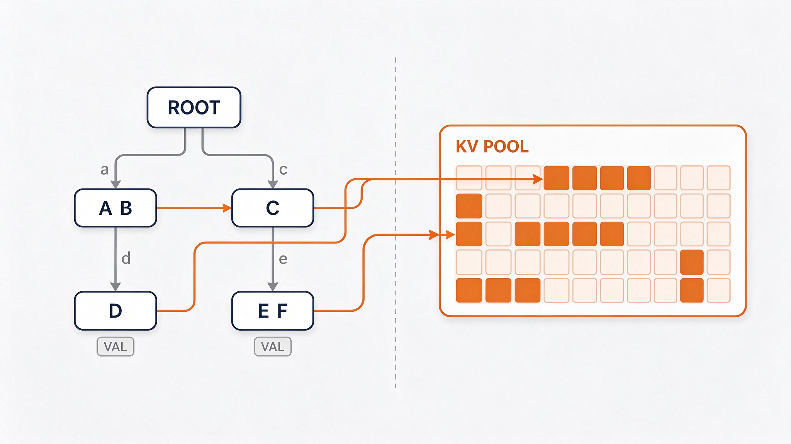

# LESSON 04 RadixAttention

> RadixAttention 不是一个 kernel，是一个数据结构加三套规则：怎么找、怎么插、怎么删。找和插都好懂，**真正决定性能的是删除与引用计数**。

## TL;DR

- 缓存单位是 **page**，不是 token。所有 key 在匹配前先按 `page_size` 对齐（`radix_cache.py:148`）。默认 `page_size=1`，此时等价于按 token 对齐；调大后尾部不足一页的 token 不再复用。
- 三个核心操作：`match_prefix`（找最长前缀）、`insert`（写入新分支）、`evict`（按叶子优先级淘汰）。
- **引用计数是唯一的保护机制**：`lock_ref > 0` 的节点及其祖先永远不会进 `evictable_leaves`。
- 命中会**分裂节点**（`_split_node`），这是 radix tree 与普通 trie 最大的实现差异。

## 考点地图

- RadixAttention 和 PagedAttention 的本质区别？
- 前缀匹配怎么做到 O(路径长度) 而不是 O(树大小)？
- 引用计数加在哪里、减在哪里？为什么加一次要沿路径加到根？
- 驱逐为什么只从叶子开始？父节点什么时候变成叶子？
- `page_size` 调大有什么后果？
- 命中率高的场景，KV 复用发生在请求生命周期的哪一步？

## 4.1 它解决什么问题

连续对话、few-shot、agent 多轮工具调用有一个共同特征：**请求之间有大量重复前缀**。如果没有前缀复用，每来一个请求都要把相同的 2000 token 重新 prefill 一遍。

两种朴素方案都不行：

| 方案 | 问题 |
|---|---|
| 按整句 hash 缓存 | 只有完全相同的 prompt 才能复用，差一个 token 就全 miss |
| 按 token 位置缓存 | 无法表达"前缀树"结构，也判断不出哪段能共享 |

Radix tree 的答案是：把 token 序列做成压缩 trie，**每个节点存一段连续 token 和这段 token 对应的 KV 槽位**。前缀相同的请求自然共享同一批节点。

## 4.2 数据结构

```python
# radix_cache.py:251
class TreeNode:
    def __init__(self, id=None, priority=0):
        self.children = defaultdict(TreeNode)
        self.parent = None
        self.key: RadixKey = None          # 本节点覆盖的 token 段
        self.value: torch.Tensor = None    # 这段 token 的 KV 槽位索引
        self.lock_ref = 0                  # 引用计数
        self.hit_count = 0
        self.last_access_time = time.monotonic()
        self.priority = priority
```

三个字段要理解透：

- `key` 不是单个 token，是**一段** token（压缩 trie）。这样才能把长 prompt 压成少数节点。
- `value` 是 KV 池里的槽位索引张量，长度与 `key` 一致。驱逐时 `free_segment(x.value)` 就是把它还回池子。
- `lock_ref` 记在每个节点上，加锁时沿路径**一路累加到根**——保护的是整条路径，不是路径末端那一个节点。



## 4.3 match_prefix：找最长前缀

```python
# radix_cache.py:369
def match_prefix(self, params: MatchPrefixParams) -> MatchResult:
    key = params.key
    key, _ = key.maybe_to_bigram_view(self.is_eagle)
    if self.disable or len(key) == 0:
        return self._empty_match_result
    key = key.page_aligned(self.page_size)
    if len(key) == 0:
        return self._empty_match_result
    value, last_node = self._match_prefix_helper(self.root_node, key)
    return MatchResult(
        device_prefix_len=sum(len(v) for v in value),
        last_device_node=last_node,
        last_host_node=last_node,
        best_match_node=last_node,
    )
```

关键在 `_match_prefix_helper`（`radix_cache.py:658`）：

```python
while len(key) > 0 and child_key in node.children.keys():
    child = node.children[child_key]
    prefix_len = child.key.match(key, page_size=self.page_size)
    if prefix_len < len(child.key):
        new_node = self._split_node(child.key, child, prefix_len)
        value.append(new_node.value)
        node = new_node
        break
    else:
        value.append(child.value)
        node = child
        key = key[prefix_len:]
```

两个细节决定复杂度：

1. **用 `child_key` 做字典查找**（`radix_cache.py:223`），取 key 的第一页作为分支索引，所以每层是 O(1)，不是遍历所有孩子。
2. **匹配到一半就分裂**。如果请求的前缀在某个节点中间结束，必须把该节点切开，让"精确边界"成为树上的真实节点。

分裂的代价是复制：`_split_node` 里对 `value` 做了两次 `.clone()`（`radix_cache.py:693,696`）。这是 radix tree 写放大的来源，也是 `page_size` 存在的理由——页越大，节点越少，分裂越少。

## 4.4 insert：写新分支

`insert`（`radix_cache.py:433`）做的事和匹配对称：沿着已有路径走，遇到分叉就分裂，走不下去就新建节点。

```python
# radix_cache.py:712
while len(key) > 0 and child_key in node.children.keys():
    node = node.children[child_key]
    prefix_len = node.key.match(key, page_size=self.page_size)
    total_prefix_length += prefix_len
    key = key[prefix_len:]
    value = value[prefix_len:]
    if prefix_len < len(node.key):
        new_node = self._split_node(node.key, node, prefix_len)
        node = new_node
    if total_prefix_length > inserted_len:
        self._inc_hit_count(node)
if len(key):
    new_node = TreeNode(priority=priority)
    new_node.parent = node
    new_node.key = key
    new_node.value = value.clone()
```

注意 `inserted_len`：本次请求自己已经插入过的长度不计入命中，避免"自己命中自己"把 `hit_count` 刷高。`hit_count` 后面会被驱逐策略用来判断"这个节点值不值得留"。

## 4.5 evict：只删叶子

```python
# radix_cache.py:559
leaves = list(self.evictable_leaves)
eviction_heap = [(self.eviction_strategy.get_priority(node), node) for node in leaves]
heapq.heapify(eviction_heap)
while num_evicted < num_tokens and len(eviction_heap):
    _priority, x = heapq.heappop(eviction_heap)
    self.token_to_kv_pool_allocator.free_segment(x.value, start_pos=0)
    num_evicted += len(x.value)
    self._delete_leaf(x)
    if len(x.parent.children) == 0 and x.parent.lock_ref == 0:
        heapq.heappush(eviction_heap, (new_priority, x.parent))
```

为什么只从叶子开始：删父节点会让整棵子树失效，而那些子节点可能正被别的请求引用。**删叶子等价于"从最不共享的分支开始回收"**，天然安全。

父节点只有在"孩子全被删光且自己没被锁"时才变成叶子，所以代码里删完叶子会检查 `x.parent` 并把它入堆（`radix_cache.py:579`）。这是一个自底向上的级联过程。

`_update_leaf_status`（`radix_cache.py:797`）维护 `evictable_leaves` 集合，判定条件只有三条：`value` 非空、`lock_ref == 0`、没有未驱逐的孩子。

## 4.6 引用计数：沿路径加减

```python
# radix_cache.py:589
def inc_lock_ref(self, node: TreeNode) -> IncLockRefResult:
    delta = 0
    while node != self.root_node:
        if node.lock_ref == 0:
            self.evictable_size_ -= len(node.key)
            self.protected_size_ += len(node.key)
            delta -= len(node.key)
        node.lock_ref += 1
        self._update_leaf_status(node)
        node = node.parent
```

三个结论：

1. **锁的是路径，不是节点**。请求用到某段前缀，它的所有祖先也必须保留，所以一路加到根。
2. **`evictable_size` 与 `protected_size` 是互补的两个计数器**，调度器靠它们算"还能腾出多少 KV"。第 06 课的 token 预算就依赖这两个数。
3. **0→1 和 1→0 是唯一的状态切换点**，中间值只是计数，不改变可驱逐性。

```python
# radix_cache.py:604
def dec_lock_ref(self, node, params=None):
    while node != self.root_node:
        if node.lock_ref == 1:
            self.evictable_size_ += len(node.key)
            self.protected_size_ -= len(node.key)
        node.lock_ref -= 1
        self._update_leaf_status(node)
        node = node.parent
```

> 易错点：`dec_lock_ref` 只减不加校验。请求结束时必须保证加减配对，否则节点会永久 protected，表现为"显存一直不释放但也没人用"。

## 4.7 page_size 的取舍

| page_size | 优点 | 代价 |
|---|---|---|
| 1 | 匹配最精细，命中长度最大 | 节点极多，分裂/克隆频繁，树操作开销大 |
| 16 / 32 | 树更浅，分裂更少 | 尾部不足一页的 token 无法复用 |
| 很大 | 近似块缓存 | 命中率下降，内部碎片严重 |

分页的本质是**用命中精度换树操作开销**。这也是为什么 `match_prefix` 第一步就做 `page_aligned`：不先把 key 对齐，后面的长度计算全部不成立。

## 4.8 设计取舍表

| 决策 | SGLang 的做法 | 代价 | 替代 |
|---|---|---|---|
| 缓存结构 | 压缩 radix tree | 分裂时克隆 value | 哈希表（无前缀复用） |
| 缓存单位 | page | 尾部碎片 | token（开销大） |
| 驱逐顺序 | 叶子优先 + 优先级堆 | 需要维护 leaf 集合 | 全局 LRU（不安全） |
| 保护机制 | 路径引用计数 | 加减必须配对 | 请求级 pin |
| 命中记录 | `hit_count` | 额外字段 | 不记录（策略退化） |

## 4.9 动手验证

观察命中：连续两次发送同一前缀，比较返回里的 `cached_tokens`。

```bash
sglang serve --model-path Qwen/Qwen3-0.6B --port 30000 &
for i in 1 2; do
  curl -s http://127.0.0.1:30000/generate \
    -H "Content-Type: application/json" \
    -d '{"text":"请把下面这句话翻译成英文：今天天气很好。","sampling_params":{"max_new_tokens":8}}' \
    | python -c "import sys,json; print(json.load(sys.stdin)['meta_info'].get('cached_tokens'))"
done
```

预期第二次明显大于 0。再调用 `/flush_cache`，第三次回到 0。

观察驱逐：把 `--mem-fraction-static` 调到很小，发长请求，日志里会出现 evict 相关计数（开 `--log-level info`）。

## 4.10 面试问答

**Q1：RadixAttention 和 PagedAttention 的区别？**

- 一句话：PagedAttention 解决"KV 怎么存"，RadixAttention 解决"KV 怎么共享"。
- 展开：前者是分页分配消除外部碎片；后者用 radix tree 记录 token 前缀与页的映射，让不同请求复用同一批页。
- 追问"能同时用吗"：能，SGLang 的 `value` 就是页粒度的槽位索引，底层仍是分页池。

**Q2：匹配为什么是 O(路径长度)？**

- 一句话：每层用首 token 做字典键，只走一条分支。
- 展开：`child_key` 取 key 的前 `page_size` 个 token 作为 dict key，所以不需要遍历兄弟节点。
- 追问"最坏情况"：树退化成链时路径长度等于序列长度，单次匹配 O(n)，但仍是线性的。

**Q3：为什么要分裂节点？**

- 一句话：让匹配边界成为真实节点，后续才能精确插入和驱逐。
- 展开：请求前缀在节点中间结束时，不分裂就无法表示"共享前一半、分叉后一半"。
- 追问"代价"：`value.clone()` 两次，写放大；`page_size` 越大分裂越少。

**Q4：引用计数为什么加到根？**

- 一句话：子节点被引用时，祖先的 KV 也必须保留，否则路径断了。
- 展开：`inc_lock_ref` 一路向上，0→1 时把长度从 evictable 移到 protected。
- 追问"漏减会怎样"：节点永久 protected，显存泄漏，最终 OOM。

**Q5：驱逐为什么从叶子开始？**

- 一句话：叶子是"最不共享"的部分，删它不影响任何人。
- 展开：`evictable_leaves` 只收 value 非空、未加锁、无未驱逐孩子的节点；删完叶子后父节点可能变成新叶子。
- 追问"优先级怎么定"：由 `eviction_strategy.get_priority` 决定，默认参考最近访问时间，也支持 priority-aware。

## 4.11 一页速记

```
结构   TreeNode{key: 一段 token, value: KV 槽位, lock_ref, hit_count}
对齐   match 前先 page_aligned(page_size)
匹配   child_key 做 dict 查找 → 逐层走 → 中途命中则 _split_node
插入   沿路径分裂 → 剩余部分建新节点 → 超出 inserted_len 才计 hit
驱逐   evictable_leaves + 优先级堆 → free_segment → 父节点可能变叶子
保护   inc/dec_lock_ref 沿路径加到根；0↔1 切换 evictable/protected
入口   PrefillAdder.add_one_req → match_kv_cache → match_prefix
```

## 挂载点

- 上游：第 03 课的 `PrefillAdder.add_one_req` 调用 `match_kv_cache`（`mem_cache/common.py:183`）。
- 下游：第 06 课用 `evictable_size` / `protected_size` 算 token 预算；第 07 课的 chunked prefill 会把一次匹配拆成多段。
- 扩展：HiCache / LMCache 在 `match_prefix` 外再套一层 host/远端存储，接口仍是 `BasePrefixCache`。
