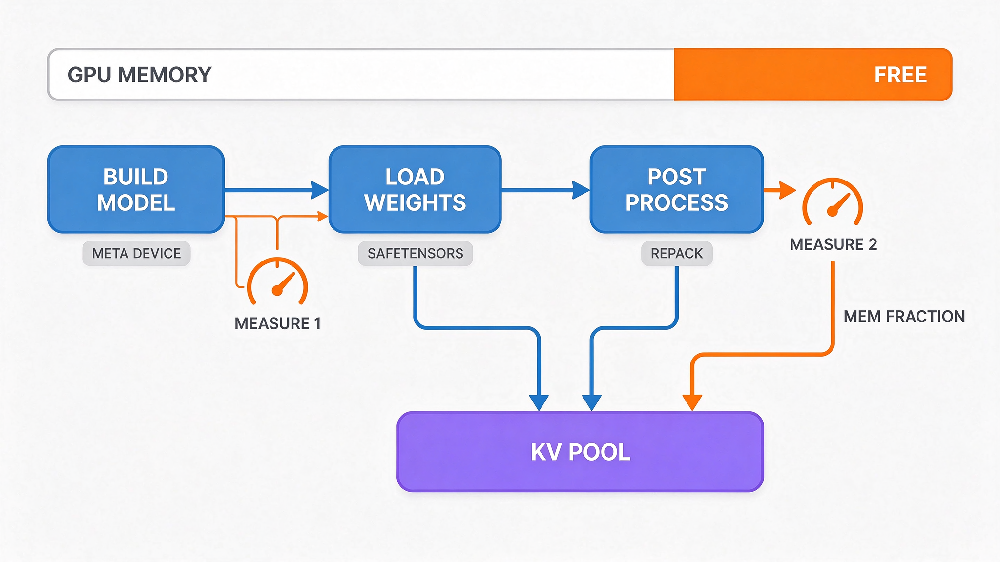

# LESSON 05 模型加载端到端详解

> 加载不是"读文件"这么简单。它分三段：**建结构 → 填权重 → 后处理**，三段之间还夹着两次显存测量。搞清楚顺序，才能解释"为什么改一个量化配置会 OOM"。

## TL;DR

- 入口在 `ModelRunner.initialize`（`model_runner.py:743`），它先 `load_model` 再初始化后处理，最后才交给 KV 池配置。
- 模型结构由 `_initialize_model`（`loader.py:301`）按 `architectures` 反射出来，权重由具体 loader 填。
- 量化不是加载完再做，而是**建结构时就把 `quant_config` 传进每一层**，加载后再 `process_weights_after_loading` 重排。
- KV 池大小由 `KVCacheConfigurator.configure`（`kv_cache_configurator.py:582`）在模型加载之后算，用的是"加载后剩余显存 × `mem_fraction_static`"。

## 考点地图

- 一个模型从 `--model-path` 到能 forward，中间有几步？
- `ModelConfig` 到底解析了什么？GQA 的 KV 头数怎么算？
- 权重量化在加载流程的哪一步生效？
- `mem-fraction-static` 作用在哪个时刻？
- 为什么量化模型加载后还要做一次 "post load transform"？
- TP=8 时权重是怎么切的？

## 5.1 全景：两次显存测量

```
ServerArgs
  ↓ ModelConfig（解析 hf_config、dtype、头数）
ModelRunner.initialize
  ↓ load_model                    ← 测量一：加载前可用显存
  ├─ get_model_architecture
  ├─ _initialize_model            ← 建空结构
  ├─ load_weights                 ← 填权重
  └─ process_weights_after_loading
  ↓ post-load transforms（量化 repack、MoE 重排、LoRA）
KVCacheConfigurator.configure      ← 测量二：剩余显存 → KV 池
```

两次测量很关键：模型权重吃掉的显存是**动态的**（量化格式、TP 切分、是否 CPU offload 都会改变），所以 KV 池只能在加载之后按实际剩余量算。



## 5.2 ModelConfig：把 hf_config 变成运行时参数

`ModelConfig.__init__`（`model_config.py:697`）做的事可以归成四类：

| 类别 | 例子 | 影响 |
|---|---|---|
| 结构 | `num_hidden_layers`、`hidden_size` | 决定模型类怎么建 |
| 注意力 | `num_attention_heads`、`num_key_value_heads` | 决定 KV 头数与 KV 池大小 |
| 词表 | `vocab_size`、`token_id_vocab_size` | 决定 logits 维度与采样越界检查 |
| 运行时 | `dtype`、`context_len` | 决定权重精度与最大序列 |

两个函数值得单独记：

```python
# model_config.py:1857
def get_total_num_kv_heads(self) -> int:
    # GQA/MQA 下取 num_key_value_heads，否则回退到 num_attention_heads
```

```python
# model_config.py:1931
def get_num_kv_heads(self, tensor_parallel_size: int, dcp_size: int = 1) -> int:
    # 每张卡上的 KV 头数 = 总头数 / TP / DCP
```

**为什么 KV 头数要除以 TP**：每个 rank 只存自己负责的那几个 KV 头。TP=8、模型 8 个 KV 头时，每卡 1 个头——这就是 GQA 模型在 TP 大时 KV 池反而更宽裕的原因。

## 5.3 建结构：反射 + 量化配置注入

```python
# loader.py:301
def _initialize_model(model_config, load_config, quant_config=None):
    model_class, _ = get_model_architecture(model_config)
    kwargs = {"config": model_config.hf_config, "quant_config": quant_config}
    ...
    model = model_class(**kwargs)
```

三个要点：

1. **按 `architectures` 字符串反射**，所以自定义模型必须注册到模型注册表，否则报 "architecture not supported"。
2. **`quant_config` 在建结构时就传进去**。每个 `Linear`/`MoE` 层在构造时决定自己用哪种 scheme（AWQ / FP8 / Marlin），不是加载完再替换。
3. 部分 loader 在 `torch.device("meta")` 下建结构（`loader.py:1177`），避免先分配一份真实显存再覆盖。

## 5.4 填权重：loader 家族

`load_model` 有多个实现（`loader.py:368` 是基类接口，后面 1049/1166/1552/1681 是不同格式）。共同点是：

- 按 `load_format` 选择：safetensors、pt、gguf、sharded state、remote 等。
- TP 切分在加载时完成：每个 rank 只读自己那一列/行。
- 加载完调用 `post_load_weights`（`loader.py:331`），触发模型自己的 `post_load_weights` 钩子。

## 5.5 后处理：真正决定性能的一步

后处理不是一个函数，是一串：

| 步骤 | 做什么 | 典型课程 |
|---|---|---|
| `process_weights_after_loading` | AWQ 反量化/重排、FP8 scale 折叠、Marlin repack | 09 |
| MoE 重排 | 专家权重按 EP/EPLB 布局重排 | 16、17 |
| LoRA 挂载 | 把 adapter 融进 base 层 | — |
| 量化 dtype 配置 | KV cache 是否 FP8 | 08 |

`ModelRunner.initialize` 里这些钩子是顺序执行的（`model_runner.py:743` 起），**顺序不能乱**：例如 EPLB 的专家重排必须发生在量化 repack 之后，否则重排的是未重排的权重。

## 5.6 KV 池：加载之后才算

```python
# kv_cache_configurator.py:582
def configure(self, *, pre_model_load_memory: int) -> KVCacheConfigResult:
    config = self._resolve_memory_pool_config(pre_model_load_memory)
    sizes = self._derive_pool_sizes(config=config)
    pools = self._init_pools(sizes=sizes, ...)
```

`pre_model_load_memory` 是加载前的可用显存。预算公式的核心在 `kv_cache_configurator.py:3319`：

```python
slack_gb = pre_model_load_memory * (1 - get_schedule().mem_fraction_static)
```

也就是说 `mem_fraction_static` 是**加载前显存的占比上限**，模型越重，留给 KV 的越少。这解释了一个常见困惑：

> 7B 模型设 `--mem-fraction-static 0.9` 能跑，70B 同样设 0.9 就 OOM——因为权重本身已经吃掉了大头，0.9 的绝对剩余量不同。

`MemoryPoolConfig`（`pool_configurator.py:101`）是这一步的产物，字段包括 `max_total_num_tokens`、`max_running_requests`、`swa_max_total_num_tokens` 等，后面调度器就用它做 token 预算。

## 5.7 设计取舍表

| 决策 | SGLang 的做法 | 代价 | 替代 |
|---|---|---|---|
| 结构来源 | `architectures` 反射 | 新模型必须注册 | 手写工厂 |
| 量化接入 | 建层时注入 `quant_config` | 层代码要感知量化 | 加载后替换模块（脆弱） |
| 建结构设备 | 部分走 meta device | loader 需处理 meta→cuda 拷贝 | 直接 cuda（峰值高） |
| 池大小 | 加载后按剩余显存算 | 需要一次显存测量 | 固定 token 数（易 OOM） |
| TP 切分 | 加载时切 | 每个 loader 都要实现 | 加载后切（峰值翻倍） |

## 5.8 动手验证

打印模型配置与池大小：

```bash
sglang serve --model-path Qwen/Qwen3-0.6B --port 30000 --log-level info 2>&1 \
  | grep -E "max_total_num_tokens|Load weight|avail mem" | head
```

改 `--mem-fraction-static` 观察 `max_total_num_tokens` 变化：

```bash
for f in 0.5 0.8; do
  sglang serve --model-path Qwen/Qwen3-0.6B --mem-fraction-static $f \
    --port 30000 2>&1 | grep max_total_num_tokens | head -1
done
```

预期：0.8 的 token 数明显更大。

## 5.9 面试问答

**Q1：模型加载分几步？**

- 一句话：建结构、填权重、后处理，最后算 KV 池。
- 展开：`_initialize_model` 反射出模型类并注入 quant_config；loader 按格式填权重；`process_weights_after_loading` 做 repack；`KVCacheConfigurator.configure` 按剩余显存定池。
- 追问"为什么要后处理"：量化格式在磁盘上和 kernel 需要的内存布局不一致，必须重排。

**Q2：`mem-fraction-static` 作用在哪一步？**

- 一句话：模型加载之后，决定 KV 池能占多少。
- 展开：它乘的是**加载前**可用显存，再减去权重实际占用，剩余部分按 dtype 换算成 token 数。
- 追问"为什么大模型同样比例会 OOM"：权重大头不同，比例相同不代表剩余量相同。

**Q3：GQA 的 KV 头数怎么算？**

- 一句话：`total_kv_heads / tp_size / dcp_size`。
- 展开：`get_total_num_kv_heads` 取 `num_key_value_heads`；`get_num_kv_heads` 做除法。
- 追问"TP 超过 KV 头数会怎样"：需要复制 KV 头（KV head 复制），显存不再线性下降。

**Q4：权重是怎么切到 TP rank 上的？**

- 一句话：加载时按列/行切，每个 rank 只读自己那份。
- 展开：QKV 的列并行、O 投影的行并行、MLP 的 gate/up 列并行 + down 行并行。
- 追问"切错了会怎样"：forward 不报错但结果错，属于最难查的一类 bug。

**Q5：加载阶段最容易踩的坑？**

- 一句话：量化配置与 checkpoint 不匹配。
- 展开：AWQ 权重用 FP8 配置加载，会在 `process_weights_after_loading` 里形状对不上。
- 追问"怎么排查"：先看 `quant_config` 的 `get_name`，再对 checkpoint 的 `quantization_config`。

## 5.10 一页速记

```
入口   ModelRunner.initialize(743) → load_model(1365)
结构   get_model_architecture(307) → _initialize_model(301) → model_class(**kwargs)
头数   get_total_num_kv_heads(1857) → get_num_kv_heads(1931) 除以 TP/DCP
权重   load_model 多实现 → post_load_weights(331)
后处理 process_weights_after_loading（量化 repack / MoE 重排 / LoRA）
KV 池  KVCacheConfigurator.configure(582) → MemoryPoolConfig(101)
预算   slack = pre_load_mem * (1 - mem_fraction_static)  (3319)
```

## 挂载点

- 上游：第 01 课的 `ServerArgs` 解析出 `model_path` 等参数。
- 关联：第 04 课的 radix tree 管理的正是这里算出的 KV 池；第 08/09 课的量化配置在加载阶段生效；第 16/17 课的专家重排挂在 post-load 之后。
