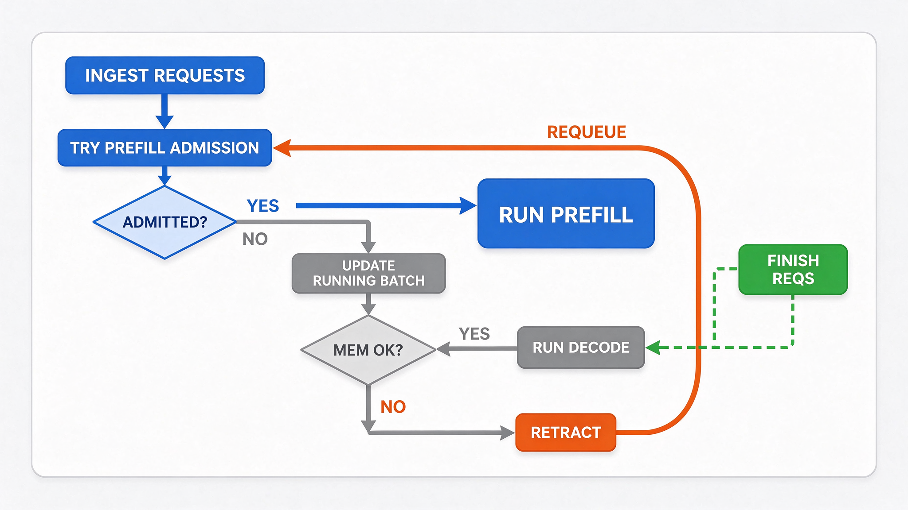

# LESSON 06 Scheduler 核心流程

> 调度器的本质是一个**每步重新决策**的状态机：这一步跑 prefill 还是 decode、跑哪些请求、KV 不够时牺牲谁。没有"批次"这个概念，只有"这一 step 的批"。

## TL;DR

- 每个 step 只做一次决策：`get_next_batch_to_run` → 有 prefill 就跑 prefill，否则跑 decode。
- prefill 侧靠 `PrefillAdder` 逐个试放，放不下的请求留在队列；decode 侧靠 `retract_decode` 在显存不足时把请求踢回队列。
- 策略分两类：**cache-aware**（看前缀命中）和 **cache-agnostic**（FCFS 等）。
- `new_token_ratio` 是自适应预算：retract 后自动下调，空闲时缓慢回升。

## 考点地图

- 连续批处理（continuous batching）在代码里到底体现在哪？
- 一个 step 里 prefill 和 decode 能同时跑吗？
- KV 不够时是驱逐缓存还是踢请求？两者什么关系？
- `calc_priority` 里 LPM 怎么用前缀命中长度？
- retract 之后请求会丢 token 吗？
- 为什么要有 `new_token_ratio`？

## 6.1 一个 step 的决策树

```python
# scheduler.py:4374
def get_next_batch_to_run(self, running_batch, last_batch):
    ...  # 合并上一轮 prefill 批到 running
    prefill_plan = self.get_new_batch_prefill(running_batch)
    new_batch = prefill_plan.batch_to_run
    if new_batch is not None:
        ret = new_batch                      # ① 能组出 prefill 就跑 prefill
    else:
        decode_batch = self.update_running_batch(running_batch)
        ret = decode_batch                   # ② 否则跑 decode
    ...
```

这个"二选一"是理解 SGLang 调度的第一把钥匙。它带来两个直接后果：

1. **prefill 优先**：新请求只要放得下就插队，TTFT 好，decode 的 TPOT 会被拉长。
2. **不会出现"prefill 和 decode 在同一 step 各跑各的"**：同一 step 只有一个 forward。混批（mixed batch）只在 chunked prefill 场景下出现（第 07 课）。



## 6.2 prefill 准入：三道闸门 + 逐个试放

`get_new_batch_prefill`（`scheduler.py:4541`）是薄壳，真正逻辑在 `_get_new_batch_prefill_raw`（`scheduler.py:4621`）：

```python
if (running_batch.batch_is_full or len(self.waiting_queue) == 0) and self.chunked_req is None:
    return None, running_batch
...
num_allocatable_reqs = self.get_num_allocatable_reqs(running_bs, running_batch=running_batch)
if num_allocatable_reqs <= 0 and self.chunked_req is None:
    running_batch.batch_is_full = True
    return None, running_batch
```

| 闸门 | 判定依据 | 失败后果 |
|---|---|---|
| `batch_is_full` | 上一次准入没放下 | 本 step 直接转 decode |
| 队列为空 | `waiting_queue` 长度 | 转 decode |
| 行数不足 | `req_to_token_pool.available_size()` 与 PP 预算取小 | 标记 full，转 decode |

过闸后 `policy.calc_priority`（`schedule_policy.py:279`）排序，再由 `PrefillAdder`（`schedule_policy.py:1077`）逐个 `add_one_req`（`schedule_policy.py:2103`）试放。试放失败返回 `NO_TOKEN`，请求留在队列，**不阻塞后面的请求**（除非策略是严格 FIFO 语义）。

## 6.3 优先级策略

```python
# schedule_policy.py:188
class CacheAwarePolicy(Enum):
    LPM = "lpm"                            # 最长前缀命中
    DFS_WEIGHT = "dfs-weight"
    HRRN = "hrrn"                          # 响应比优先，按 token 老化
    SHORTEST_PREFILL_FIRST = "shortest-prefill-first"
    UNIBOOST = "uniboost"

# schedule_policy.py:198
class CacheAgnosticPolicy(Enum):
    FCFS = "fcfs"
    LOF = "lof"                            # 最长输出优先
    RANDOM = "random"
    ROUTING_KEY = "routing-key"
```

区别一句话：**cache-aware 用 radix tree 的命中长度当排序依据**，cache-agnostic 完全不看缓存。

| 策略 | 优化目标 | 代价 |
|---|---|---|
| LPM | 前缀复用率、吞吐 | 冷请求可能饿死 |
| HRRN | 公平性 + 长请求不饿死 | 计算稍复杂 |
| SHORTEST_PREFILL_FIRST | 平均 TTFT | 长 prompt 延迟差 |
| FCFS | 可预测性 | 命中率低 |
| LOF | 输出长度优先 | 短请求体验差 |

默认是 `lpm`，这也是 SGLang 在多轮/agent 场景的优势来源。

## 6.4 decode 侧：先查显存，再决定踢谁

`update_running_batch`（`scheduler.py:5249`）的核心是三步：

```python
finishing_reqs = self._reqs_finishing_inflight(batch)
batch.filter_batch(reqs_to_exclude=finishing_reqs)
...
kv_full_retract_flag = not batch.check_decode_mem()
if kv_full_retract_flag:
    retracted_reqs, new_token_ratio, reqs_to_abort = batch.retract_decode(self.request_retirer)
    for req in retracted_reqs:
        self._add_request_to_queue(req, is_retracted=True)
```

| 步骤 | 函数 | 作用 |
|---|---|---|
| 过滤 | `filter_batch`（`schedule_batch.py:3376`） | 移除已完成的请求 |
| 查容量 | `check_decode_mem`（`schedule_batch.py:2995`） | 估算下一步 decode 需要多少 token |
| 降级 | `retract_decode`（`schedule_batch.py:3018`） | 挑一部分请求退回 waiting 队列 |

**retract 不丢 token**：请求的 `output_ids` 保留，KV 被释放，下次重新 prefill 时连同已生成部分一起重算。代价是算力浪费，收益是避免 OOM。

注意区分两个动作：

- **evict** 是 radix tree 回收**没人引用**的缓存（第 04 课）。
- **retract** 是调度器把**正在跑的请求**踢出 batch。

正常情况下先 evict，evict 不够才 retract。

## 6.5 new_token_ratio：自适应预算

`NewTokenRatioTracker`（`new_token_ratio_tracker.py:14`）维护一个比例，用来预估"每个请求下一步平均要多少新 token"。

- **retract 发生时下调**：说明之前的估计太乐观。
- **空闲时缓慢回升**：避免长期保守导致吞吐上不去。

这是个小的控制回路，但在长尾负载下影响很大：固定预算要么频繁 retract，要么浪费显存。

## 6.6 filter 与 merge 的语义

两个函数在 `ScheduleBatch` 上，容易被忽略但很关键：

```python
# schedule_batch.py:3376
def filter_batch(self, reqs_to_exclude=None):
    # 原地移除 reqs_to_exclude（已完成、被 retract、chunked 边界）
```

```python
# schedule_batch.py:3469
def merge_batch(self, other):
    # 把上一轮 prefill 批并入 running 批，供下一步 decode
```

`merge_batch` 是"prefill 完成后转 decode"的衔接点。如果合并时索引没对齐，会出现"decode 读了别人的 KV"这类静默错误。

## 6.7 设计取舍表

| 决策 | SGLang 的选择 | 代价 | 替代 |
|---|---|---|---|
| 每步决策 | 重新组批 | 调度开销每步固定 | 固定批次（吞吐差） |
| prefill/decode | 二选一，prefill 优先 | decode 尾延迟 | decode 优先（TTFT 差） |
| 显存不足 | 先 evict 再 retract | 重算浪费算力 | 直接拒绝请求 |
| 优先级 | 默认 LPM | 冷请求饥饿 | FCFS（可预测） |
| 预算 | 自适应 ratio | 需要调参 | 固定 token 预算 |

## 6.8 动手验证

切换策略看差异：

```bash
sglang serve --model-path Qwen/Qwen3-0.6B --schedule-policy fcfs --port 30000
```

开日志观察准入决策：

```bash
sglang serve --model-path Qwen/Qwen3-0.6B --log-level info 2>&1 \
  | grep -E "Schedule prefill|Retract" | head
```

构造前缀相同的一批请求，对比 `lpm` 与 `fcfs` 的 `cached_tokens` 总量。

## 6.9 面试问答

**Q1：连续批处理体现在哪？**

- 一句话：每个 step 重新决定这一批包含谁，而不是等整批结束。
- 展开：`get_next_batch_to_run` 每步都调，完成的请求被 `filter_batch` 移除，新请求随时插入。
- 追问"和静态批处理的区别"：静态批要等最长请求结束，短请求的槽位全程浪费。

**Q2：prefill 和 decode 能同 step 吗？**

- 一句话：默认不能，只有 chunked prefill 会产生混批。
- 展开：`get_next_batch_to_run` 二选一；chunked 时 chunked_req 与 decode 请求可以同批（第 07 课）。
- 追问"为什么默认不混"：混批会让 attention 的 seq_len 分布变宽，kernel 效率下降。

**Q3：显存不够时先 evict 还是先 retract？**

- 一句话：先 evict 无人引用的缓存，不够再 retract。
- 展开：`evict` 只回收 `lock_ref == 0` 的节点；`retract_decode` 动的是正在跑的请求。
- 追问"retract 会丢结果吗"：不会，只丢 KV，token 保留，下次重算。

**Q4：LPM 怎么算优先级？**

- 一句话：用请求在 radix tree 里的命中长度排序。
- 展开：`calc_priority` 里调用 `tree_cache.match_prefix`（或 waiting queue 的轻量树）拿到 `prefix_len`。
- 追问"冷请求会饿死吗"：会，除非开 HRRN 或 bounded LPM 做老化。

**Q5：new_token_ratio 干什么用？**

- 一句话：预估每请求下一步的 token 需求，决定 decode 批能放多少。
- 展开：retract 时下调，空闲时回升，避免频繁 OOM 或过度保守。
- 追问"调它的收益"：长尾负载下减少 retract 次数，稳定 TPOT。

## 6.10 一页速记

```
每步   get_next_batch_to_run(4374)
prefill get_new_batch_prefill(4541) → 三闸门 → calc_priority(279) → PrefillAdder(1077)
decode  update_running_batch(5249) → check_decode_mem(2995) → retract_decode(3018)
策略    cache-aware: lpm/dfs-weight/hrrn/shortest-prefill-first
        cache-agnostic: fcfs/lof/random/routing-key
批次    filter_batch(3376) 移除完成；merge_batch(3469) prefill 并入 running
预算    NewTokenRatioTracker：retract 下调，空闲回升
```

## 挂载点

- 上游：第 03 课的主循环；第 04 课的 `match_prefix` 在 `add_one_req` 里被调用。
- 下游：第 07 课展开 chunked prefill；第 11 课的 CUDA Graph 决定单 step 的固定开销；第 14 课的推测解码会改变 decode 的 token 数。
