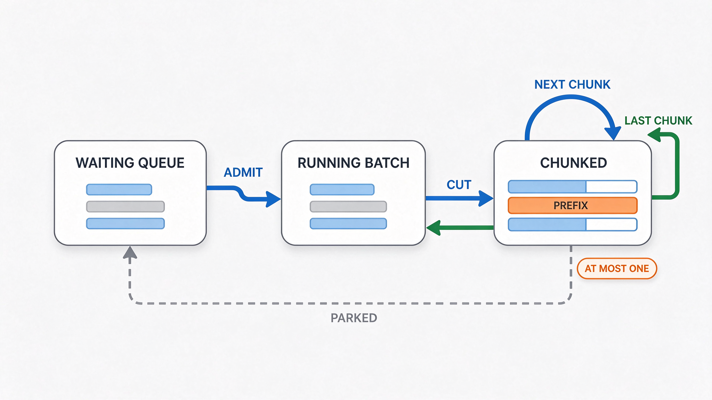

# LESSON 07 Chunked Prefill

> 一个 32k token 的 prompt 如果一次性 prefill，会让所有 decode 请求卡住几秒。chunked prefill 把它切成若干段，每段之间插一次 decode。代价是状态变复杂。

## TL;DR

- chunked 的本质是**让一个请求横跨多个 step**：它不在 `waiting_queue`，也不在 `running_batch`，而在 `chunked_reqs` 里。
- 每轮把它的下一段塞进 prefill 批，塞不下就"停靠"（`chunk_parked`），本轮不再准入新请求。
- chunk 大小不是固定值：由 `rem_chunk_tokens`、KV 余量、`dynamic_chunk_sizer` 共同决定。
- 混批（chunked prefill + decode）是唯一允许 prefill 与 decode 同 step 的场景。

## 考点地图

- chunked prefill 解决什么问题，代价是什么？
- 一个被 chunk 的请求在调度器里处于什么状态？
- chunk 大小由什么决定？为什么不固定？
- 为什么 chunked 时不能再准入别的 prefill？
- 和 CUDA Graph 有什么冲突？
- 首个 chunk 和中间 chunk 的输出有什么区别？

## 7.1 为什么需要

三个动机，按重要性排序：

1. **控制 decode 抖动**。一次性 prefill 32k token 会占满 GPU 几百毫秒到几秒，期间所有 decode 请求的 TPOT 出现尖刺。
2. **显存峰值**。长 prompt 的 KV 需求是突发的，chunk 之后峰值被摊平。
3. **提高混批效率**。把 prefill 的算力密集段和 decode 的访存密集段拼在一起，GPU 利用率更高。

代价：一个请求要被调度多次，状态管理复杂，首 token 延迟变长。

## 7.2 状态机：chunked_req 存在哪

```python
# scheduler.py:4255
@property
def chunked_req(self) -> Optional[Req]:
    return next(iter(self.chunked_reqs), None)
```

`chunked_reqs` 是一个独立的 `IndexedReqList`（`scheduler.py:1481`），**不在 waiting_queue，也不在 running_batch**。这解释了三个现象：

- 它不会被普通准入流程重复挑中。
- 它不参与 decode 的 batch size 统计。
- 它结束时必须显式从列表移除，否则会泄漏。

```
waiting_queue ──准入──> can_run_list ──chunk 未完成──> chunked_reqs
     ↑                                                      │
     └──────────── 完成 / abort ────────────────────────────┘
```



## 7.3 每轮如何续上下一段

`_get_new_batch_prefill_raw` 里，续 chunk 发生在准入循环之前（`scheduler.py:4754`）：

```python
resumed_req = self.chunked_req
if resumed_req is not None:
    resumed_req.init_next_round_input()
    adder.chunked_req_limit = self.policy.shortest_prefill_chunk_limit(...)
    if adder.add_chunked_req(resumed_req) is None:
        move([resumed_req], self.prefill_launched_reqs)
```

`add_chunked_req`（`schedule_policy.py:1737`）返回 `None` 表示"这一段已经排进去了"；返回 `req` 本身表示"没预算，先等着"。

等待时有一个关键约束（`scheduler.py:4800`）：

```python
chunk_parked = (
    self.chunked_req is not None and self.chunked_req not in adder.can_run_list
)
```

一旦 `chunk_parked`，本轮**不再准入任何新 prefill**。理由是防止"批次里带了一个不会执行的 chunked 请求"，那会让 `ScheduleBatch` 的索引和实际 forward 不一致。

## 7.4 chunk 大小由什么决定

`_add_chunked_req`（`schedule_policy.py:1745`）里有四层收缩：

| 层 | 来源 | 作用 |
|---|---|---|
| 1 | `memory_budget.available_chunk_tokens(rem_chunk_tokens)` | KV 池实际能给多少 |
| 2 | `chunked_req_limit` | 策略层的上限（shortest-prefill-first 会压得更小） |
| 3 | `kv_shard_granule` 对齐 | 让页落在同一 scratch 区 |
| 4 | `memory_budget.fit_chunk` | 扣掉 state slot / SWA / 新 token 预留 |

**为什么不固定**：固定 chunk 要么在显存紧时频繁停靠，要么在显存松时切得过碎。动态 sizing 让同一份代码在 24G 和 80G 卡上都能跑。

`dynamic_chunk_sizer`（`scheduler.py:4708`）会参考历史长度调整，长 prompt 更容易被切小。

## 7.5 与 CUDA Graph 的关系

prefill 的 CUDA Graph 需要固定形状，而 chunk 长度是变化的。SGLang 的处理是**按 chunk 变体捕获**：

```python
# prefill_cuda_graph_runner.py:207
def _chunked_prefix_variant(num_chunks: int) -> str:
    return f"chunked_prefix:{num_chunks}"
```

也就是说图的 key 里带上了"前缀被切成几段"这一维。段数变化会导致换图，这是 chunked prefill 下 graph 命中率下降的原因，也是 `chunk 大小尽量稳定` 的工程理由。

> 第 11 课会展开 graph 的分桶逻辑，这里只需要记住：**chunk 长度不稳定会打穿 prefill graph 的缓存**。

## 7.6 首 chunk 与中间 chunk 的区别

| 特征 | 首 chunk | 中间 chunk |
|---|---|---|
| `prefix_len` | 来自 radix 命中 | 等于已算长度 |
| 输出 token | 不采样（除非整段就是全部） | 同上，仅最后一段采样 |
| 日志 | 记 prefill | 记 chunk |
| 结束条件 | 长度不足则继续 | 最后一段才进 decode |

`process_batch_result_prefill` 里有 `is_middle_chunk = req is batch.chunked_req` 的判断：中间 chunk 不提交输出，避免把半截结果发给用户。

## 7.7 设计取舍表

| 决策 | SGLang 的做法 | 代价 | 替代 |
|---|---|---|---|
| 切分时机 | 组批时动态切 | 每轮要重算预算 | 请求进来就固定切 |
| chunk 大小 | 动态 | 行为不易预测 | 固定值（实现简单） |
| 与 decode 混批 | 允许 | attention 形状更杂 | 严格分开（GPU 利用率低） |
| 停靠策略 | 停靠时不再准入 | 吞吐短时下降 | 强行准入（索引错乱） |
| graph 适配 | 按段数做变体 | 命中率下降 | 关闭 prefill graph |

## 7.8 动手验证

发一个长 prompt，观察多次 prefill：

```bash
python - <<'PY'
import json, urllib.request
prompt = "请逐字复述下面内容：" + "测试" * 4000
req = urllib.request.Request(
    "http://127.0.0.1:30000/generate",
    data=json.dumps({"text": prompt, "sampling_params": {"max_new_tokens": 8}}).encode(),
    headers={"Content-Type": "application/json"},
)
print(urllib.request.urlopen(req).read()[:200])
PY
```

开 `--log-level info`，日志里应出现多次 prefill 记录，且 `max_total_num_tokens` 不变。

对比 `--chunked-prefill-size -1`（关闭）与默认值，观察首个 token 的返回时间差异。

## 7.9 面试问答

**Q1：chunked prefill 解决什么问题？**

- 一句话：把长 prefill 的显存和延迟尖刺摊平。
- 展开：切成多段，每段之间可以插入 decode，TPOT 更稳，KV 峰值更低。
- 追问"代价"：首 token 延迟增加，状态管理复杂，graph 命中率下降。

**Q2：被 chunk 的请求存在哪？**

- 一句话：`chunked_reqs`，既不在 waiting 也不在 running。
- 展开：`chunked_req` 是它的首个元素；每轮显式续段，结束后移出。
- 追问"为什么单独放"：避免被普通准入重复挑中，也避免污染 decode 的 batch 统计。

**Q3：chunk 大小怎么定？**

- 一句话：KV 余量、策略上限、页对齐、state 预留四层取小。
- 展开：`available_chunk_tokens` → `chunked_req_limit` → `kv_shard_granule` → `fit_chunk`。
- 追问"能固定吗"：能，但要么频繁停靠，要么切得过碎。

**Q4：停靠时为什么不再准入新请求？**

- 一句话：防止批次里带一个不会执行的 chunked 请求。
- 展开：`chunk_parked` 为真时，`can_run_list` 里没有它，但 batch 已按它算过索引，会错位。
- 追问"会死锁吗"：不会，下一轮显存释放后继续。

**Q5：chunked 和 CUDA Graph 冲突在哪？**

- 一句话：chunk 长度变化导致 graph 形状变化。
- 展开：prefill graph 的 key 带 `chunked_prefix:N` 变体，段数变了就换图。
- 追问"怎么缓解"：让 chunk 大小稳定，或对长 prompt 关闭 prefill graph。

## 7.10 一页速记

```
状态    chunked_reqs（不在 waiting/running）→ chunked_req 取首个
续段    init_next_round_input → shortest_prefill_chunk_limit → add_chunked_req
预算    available_chunk_tokens → chunked_req_limit → kv_shard_granule → fit_chunk
停靠    chunk_parked：本轮不再准入新 prefill
输出    中间 chunk 不提交，最后一段才进 decode
graph   prefill graph 按 chunked_prefix:N 变体捕获
```

## 挂载点

- 上游：第 06 课的准入流程；第 04 课的 `prefix_len` 决定首 chunk 从哪开始。
- 下游：第 11 课的 graph 变体与分桶；第 14 课的推测解码在 chunked 场景下需要额外协调。
