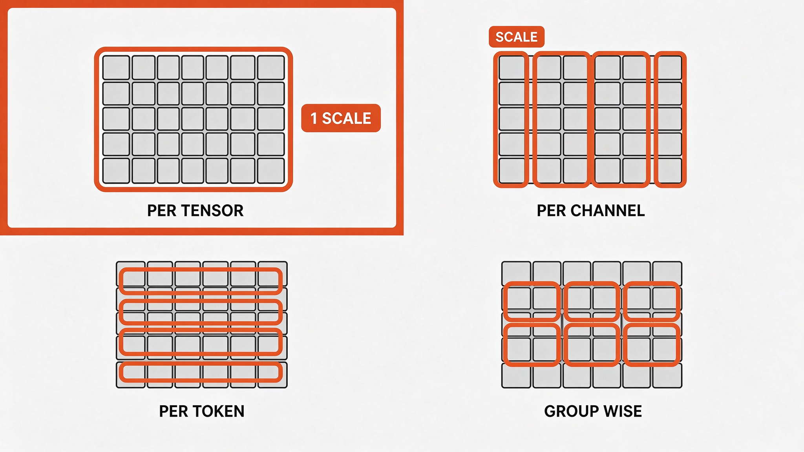

# LESSON 08 模型量化基础

> 量化不是"把 float 换成 int8"。它是三件事的组合：**用什么格式、按什么粒度、量化谁**。三者的组合决定显存、精度和 kernel 实现。

## TL;DR

- 格式决定动态范围与精度；粒度决定 scale 的共享范围；对象决定量化权重、激活还是 KV。
- SGLang 用四层抽象：`QuantizationConfig` → `LinearMethodBase` → `Scheme` → `Kernel`。
- 选哪套不是用户拍脑袋，而是 checkpoint 里的 `quantization_config` 决定，`from_config` 负责解析。
- FP8 是当前最实用的精度/显存折中；INT4 只有在 weight-only + 合适 kernel 下才划算。

## 考点地图

- FP16 / BF16 / FP8 / FP4 各自适合什么？
- per-tensor、per-channel、per-token、group-wise 的区别与代价？
- 对称量化与非对称量化的 zero-point 怎么用？
- W4A16 和 W8A8 的差别在哪？为什么激活量化更难？
- SGLang 里量化配置从哪来、装到哪去？
- KV Cache 也能量化吗？影响什么？

## 8.1 数值格式

| 格式 | 指数位 | 尾数位 | 动态范围 | 典型用途 |
|---|---|---|---|---|
| FP32 | 8 | 23 | 极大 | 训练、参考实现 |
| FP16 | 5 | 10 | 中，易溢出 | 推理基线 |
| BF16 | 8 | 7 | 大，不易溢出 | 推理默认 |
| FP8 E4M3 | 4 | 3 | ±448 | 权重/激活量化 |
| FP8 E5M2 | 5 | 2 | 更大，精度更低 | 梯度、极端值 |
| FP4 E2M1 | 2 | 1 | ±6 | 研究/新硬件 |

两个容易记错的点：

1. **BF16 的动态范围比 FP16 大，但精度更低**。所以 BF16 不需要 loss scaling，但小数值分辨力差。
2. **FP8 E4M3 的范围只有 ±448**，所以必须有 per-token 或 per-channel 的 scale，否则长尾激活直接饱和。

## 8.2 量化粒度

| 粒度 | scale 数量 | 精度 | 实现开销 |
|---|---|---|---|
| per-tensor | 1 | 最差 | 最低 |
| per-channel | 输出通道数 | 中 | 低 |
| per-token | 每个 token 一个 | 好（激活） | 中，需要动态算 |
| group-wise | 每 G 个元素一个 | 最好 | 高，kernel 要支持分组 |



经验规则：

- **权重量化用 per-channel 或 group-wise**（权重静态，离线算好）。
- **激活量化必须 per-token**（激活动态，离群值按 token 分布）。
- **KV Cache 量化通常 per-token 或 per-head**。

## 8.3 对称与非对称

```
对称:   q = round(x / s)                 反量化 x' = q * s
非对称: q = round(x / s) + z             反量化 x' = (q - z) * s
```

- 对称：零点固定为 0，实现简单，适合权重（近似零均值）。
- 非对称：多一个 zero-point，适合分布偏斜的激活（如 ReLU 之后）。

SGLang 的 AWQ 路径是**非对称**（checkpoint 里有 `qzeros`），FP8 路径是**对称**（只有 scale）。

## 8.4 量化对象：W / A / KV

| 方案 | 权重 | 激活 | KV | 显存收益 | 精度风险 |
|---|---|---|---|---|---|
| W4A16 | INT4 | FP16 | FP16 | 权重 4x | 中 |
| W8A8 | FP8 | FP8 | FP16 | 权重+激活 2x | 中 |
| W4A8 | INT4 | FP8 | FP16 | 更高 | 高 |
| KV8 | 原精度 | 原精度 | FP8 | KV 2x | 低-中 |

**为什么激活量化更难**：权重是静态的，可以离线统计分布；激活随输入变化，离群值不可控。这也是 AWQ 的核心动机（第 09 课）。

## 8.5 SGLang 的四层抽象

```
QuantizationConfig        读 config、决定每层用什么 method
    ↓ get_quant_method
LinearMethodBase          create_weights / apply
    ↓ 委托
BaseLinearScheme          create_weights / process_weights_after_loading / apply_weights
    ↓ 委托
Kernel                    真正的 GEMM / dequant / repack
```

```python
# base_config.py:163
class QuantizationConfig(ABC):
    def get_name(self) -> str: ...
    @classmethod
    def from_config(cls, config: Dict[str, Any]) -> "QuantizationConfig": ...
    def get_quant_method(self, layer, prefix) -> Optional[QuantizeMethodBase]: ...
```

```python
# base_config.py:275
def get_quant_method(self, layer: torch.nn.Module, prefix: str):
    # 按 layer 类型返回 LinearMethod / FusedMoEMethod / KVCacheMethod
```

**为什么分四层**：同一个量化算法要跑在不同硬件上（CUDA / ROCm / NPU / XPU），把 kernel 抽出来，算法层就能复用。第 09 课会看到 AWQ 的 CUDA 和 NPU 只换了 kernel。

## 8.6 配置从哪来

```python
# quantization/__init__.py:175
def get_quantization_config(quantization: str) -> Type[QuantizationConfig]:
    if quantization not in QUANTIZATION_METHODS:
        raise ValueError(...)
    ...
    return QUANTIZATION_METHODS[quantization]
```

`QUANTIZATION_METHODS` 是一个字符串到配置类的注册表。用户传 `--quantization fp8` 时查表；不传时由 checkpoint 的 `quantization_config` 字段推断。

这解释了两种常见报错：

- `Invalid quantization method`：名字不在表里（拼错或版本不支持）。
- 加载后 shape mismatch：config 说 AWQ，checkpoint 是 FP8。

## 8.7 FP8 的一个具体例子

`Fp8Config`（`fp8.py:269`）→ `Fp8LinearMethod`（`fp8.py:509`）→ `apply` 里做 `scaled_fp8_quant` + GEMM。KV Cache 的 FP8 是另一条路：`Fp8KVCacheMethod`（`fp8.py:3810`），只改 KV 的存储 dtype，不改权重。

```python
# fp8_utils.py:234
def quant_fp8_e8m0_128(x: torch.Tensor) -> Tuple[torch.Tensor, torch.Tensor]:
    # 每 128 个元素一个 e8m0 scale，DeepSeek 系列常用的块量化
```

**三个硬约束**（面试常问）：

| 约束 | 代码位置 | 后果 |
|---|---|---|
| block-wise 只能配 dynamic 激活 | `fp8.py:305` | 传 static 直接抛错 |
| KV Cache 量化只支持 per-tensor | `kv_cache.py:18` | 只有 k_scale / v_scale 两个标量 |
| AMD gfx94 的 FP8 是 e4m3fnuz（max 224） | `quantization/fp8_kernel.py:104` | 与 NVIDIA 的 e4m3fn（max 448）不通用 |

第一条最容易被问：block 量化的意义就是逐块自适应，静态 scale 与之矛盾，所以是非法组合而不是"效果差"。

## 8.8 设计取舍表

| 决策 | 常见选择 | 代价 | 替代 |
|---|---|---|---|
| 格式 | FP8 为主 | 需要硬件支持 | INT8（kernel 成熟） |
| 粒度 | 权重 group、激活 per-token | kernel 复杂 | per-tensor（精度差） |
| 对称性 | 权重对称、激活非对称 | 两套实现 | 全对称（简单） |
| 量化对象 | 先权重，再 KV，最后激活 | 收益递减 | 全量化（风险高） |
| 配置来源 | checkpoint 自带 | 与运行时可能不匹配 | 命令行强制（易错） |

## 8.9 动手验证

```bash
# 对比显存
sglang serve --model-path <model> --port 30000 &
nvidia-smi --query-gpu=memory.used --format=csv

sglang serve --model-path <fp8-checkpoint> --port 30001 &
nvidia-smi --query-gpu=memory.used --format=csv
```

看量化配置是否被识别：

```bash
sglang serve --model-path <model> --log-level info 2>&1 | grep -i quant | head
```

## 8.10 面试问答

**Q1：FP16 和 BF16 怎么选？**

- 一句话：推理默认 BF16，除非硬件/模型要求 FP16。
- 展开：BF16 动态范围大，不需要 loss scaling；FP16 尾数多，精度略高但易溢出。
- 追问"为什么量化基线常写 FP16"：历史原因，早期 kernel 对 FP16 优化更成熟。

**Q2：per-token 和 per-channel 的区别？**

- 一句话：per-channel 按输出通道共享 scale，per-token 按输入 token 共享。
- 展开：权重静态适合 per-channel；激活动态必须 per-token，否则离群 token 拉低整体精度。
- 追问"能同时用吗"：能，W per-channel + A per-token 是常见组合。

**Q3：W4A16 为什么比 W8A8 更常见？**

- 一句话：激活量化的精度风险远大于权重。
- 展开：4bit 权重只影响存储和反量化，激活仍是 FP16，数值稳定。
- 追问"W4A16 的瓶颈"：反量化开销，必须靠 Marlin 这类 fused kernel 才划算。

**Q4：KV Cache 量化影响什么？**

- 一句话：省 KV 显存，从而支持更长上下文或更大并发。
- 展开：`Fp8KVCacheMethod` 只改存储，attention 计算时反量化；per-token scale 是标配。
- 追问"精度影响"：通常很小，但长上下文下误差会累积。

**Q5：SGLang 的量化抽象为什么分四层？**

- 一句话：算法、层接口、scheme、kernel 解耦，便于跨硬件复用。
- 展开：`QuantizationConfig` 决定策略，`LinearMethodBase` 提供层接口，Scheme 组织三段式，Kernel 对接硬件。
- 追问"代价"：调用链长，调试要跨四层。

## 8.11 一页速记

```
格式   FP32 / FP16 / BF16 / FP8-E4M3(±448) / FP8-E5M2 / FP4-E2M1(±6)
粒度   per-tensor < per-channel < per-token < group-wise（精度递增，开销递增）
对称   权重对称；激活非对称；AWQ 带 zero-point，FP8 只有 scale
对象   W4A16 / W8A8 / KV8
抽象   QuantizationConfig(163) → LinearMethodBase(57) → Scheme(11) → Kernel
入口   get_quantization_config(175) 查表
```

## 挂载点

- 上游：第 05 课的 `load_model` 把 `quant_config` 注入每一层。
- 下游：第 09 课展开 AWQ；第 10 课的 MLA 常与 FP8 KV 一起用；第 16 课的 MoE 量化是另一条分支。
