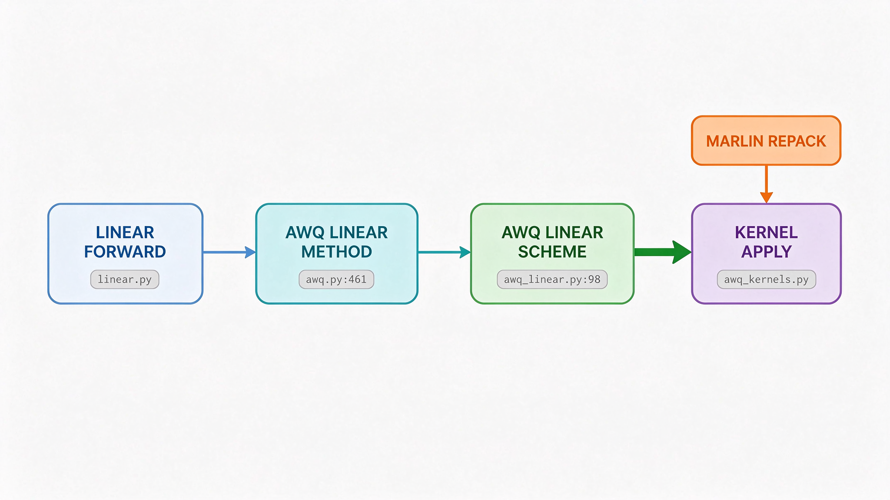

# LESSON 09 AWQ 量化深度解读

> AWQ 的一句话版本：**不是所有权重都一样重要，激活大的通道要保护**。代码上它是一套 4bit 非对称量化 + Marlin 重排，理解重点是三段式加载与布局转换。

## TL;DR

- AWQ = Activation-aware Weight Quantization：按**激活幅度**给每个通道选 scale，把显著权重挪到量化误差更小的区间。
- SGLang 里有两个配置类：`AWQConfig`（通用）和 `AWQMarlinConfig`（GPU 上走 Marlin kernel）。
- 三段式：`create_weights` 建 4bit 参数 → `process_weights_after_loading` 重排 → `apply` 调 kernel。
- `apply` 本身几乎不做事，只是 `layer.scheme.apply_weights(...)`，真正的计算在 kernel 里。

## 考点地图

- AWQ 的 "activation-aware" 到底 aware 在哪？
- 为什么 AWQ 不需要反向传播？
- `qweight` / `qzeros` / `scales` 三个参数分别是什么？
- 为什么加载后要做 repack？不做会怎样？
- Marlin 相比普通 dequant+GEMM 快在哪？
- AWQ 和 GPTQ 的区别？

## 9.1 原理：保护显著通道

量化误差可以近似写成"权重误差 × 激活幅度"。同样的 4bit 误差，如果某通道的激活很大，它对输出的影响就大。

AWQ 的做法是引入 per-channel scale `s`：

```
W' = W * s          （量化前放大显著通道）
X' = X / s          （计算时把激活缩回去）
```

放大后的权重在量化网格上占更多格点，相对误差变小；激活除以 `s` 后数值变小，但这一步在 FP16 里做，不损失精度。

关键点：**`s` 是通过激活统计搜索出来的，不训练**。所以 AWQ 的校准成本很低，只需要一批校准数据跑前向。

## 9.2 三个参数

| 参数 | 形状 | 含义 |
|---|---|---|
| `qweight` | 打包后的 4bit 权重 | 每字节存两个权重 |
| `qzeros` | 打包后的零点 | 非对称量化的 zero-point |
| `scales` | 每通道/每组一个 | 反量化系数 |

`AWQLinearScheme.create_weights`（`awq_linear.py:30`）负责注册这三个参数，并处理 TP 切分后的 `input_size_per_partition`。

## 9.3 配置与选择

```python
# awq.py:65
class AWQConfig(QuantizationConfig):
    def get_name(self) -> str:          # awq.py:102
        return "awq"

    def get_quant_method(self, layer, prefix):   # awq.py:136
        if isinstance(layer, LinearBase):
            layer.scheme = self.get_linear_scheme(layer)
            return AWQLinearMethod(self)
        return None
```

注意 `layer.scheme = ...` 这一行：**配置阶段就把 scheme 挂到层上**，后面 method 只是转发。这是 SGLang 量化重构后的标准模式。

`AWQMarlinConfig`（`awq.py:245`）是 GPU 路径：它要求 `weight_bits == 4`，并检查 `group_size` 是否被 Marlin 支持（`marlin_utils.py:55` 的 `MarlinLinearLayerConfig`）。

| 配置类 | 平台 | kernel |
|---|---|---|
| `AWQConfig` | 通用 | Triton dequant + GEMM |
| `AWQMarlinConfig` | NVIDIA GPU | Marlin fused kernel |
| `AWQCPUConfig` | CPU | CPU 实现 |
| `AWQXPUConfig` | Intel XPU | XPU 实现 |

**自动升级**：启动时 `AWQMarlinConfig.override_quantization_method`（`awq.py:333`）会检查当前权重能否转 Marlin，能就把 `quantization` 从 `awq` 改写成 `awq_marlin`。判定条件是 `is_awq_marlin_compatible`（`awq.py:402`）：CUDA、bits ∈ {4,8}、group/zp 齐全。

**逐层回退**：不是所有层都能走 Marlin（要求 `output % 64 == 0`、`input % 128 == 0`、group ∈ {-1,32,64,128}）。不满足的层会回退到普通 AWQ（`awq.py:368`），MoE 层回退到 `MoeWNA16Config`。所以一个模型里可能同时存在两种 kernel。

## 9.4 三段式

```python
# awq.py:427
class AWQLinearMethod(LinearMethodBase):
    def create_weights(self, layer, ...):
        layer.scheme.create_weights(layer=layer, ...)

    def process_weights_after_loading(self, layer):
        layer.scheme.process_weights_after_loading(layer)

    def apply(self, layer, x, bias=None):      # awq.py:461
        return layer.scheme.apply_weights(layer, x, bias)
```

```python
# awq_linear.py:98
def apply_weights(self, layer, x, bias):
    return self.kernel.apply(layer, x, bias)
```

所以真正的调用链是：

```
Linear.forward → quant_method.apply → scheme.apply_weights → kernel.apply
```



**面试可以只答这三级**，比背类名有效。

## 9.5 Marlin：为什么要 repack

Marlin 的 GEMM 要求权重按特定 tile 布局排布（为了 tensor core 的连续访存）。而 checkpoint 里的 `qweight` 是按 AWQ 原始布局打包的，两者不一致。

```python
# awq_kernels.py:109
def process_weights_after_loading(self, layer):
    ...
    marlin_qweight = awq_marlin_repack(       # awq_kernels.py:117
        layer.qweight, size_k, size_n, num_bits
    )
```

repack 发生在**加载之后、首次 forward 之前**，是一次性成本。不做会怎样：kernel 读到错误的 tile，结果全错但不报错——这是量化调试里最难受的一类 bug。

Marlin 快的原因：

1. 反量化融进 GEMM，不落地中间 FP16 张量。
2. tile 布局对齐 tensor core，访存连续。
3. 支持 group-wise scale 在 kernel 内查表。

## 9.6 AWQ vs GPTQ

| 维度 | AWQ | GPTQ |
|---|---|---|
| 核心思想 | 按激活幅度缩放保护显著通道 | 逐层最小化重建误差（二阶信息） |
| 是否需要反向 | 否 | 否，但要 Hessian |
| 校准成本 | 低 | 中 |
| 精度 | 通常更好（尤其小模型） | 大模型上接近 |
| SGLang 支持 | 完整（含 Marlin） | 有独立实现 |

## 9.7 设计取舍表

| 决策 | SGLang 的做法 | 代价 | 替代 |
|---|---|---|---|
| 量化位宽 | 4bit weight-only | 反量化开销 | 8bit（收益小） |
| 对称性 | 非对称（qzeros） | 多一份参数 | 对称（精度差） |
| kernel | Marlin | 需要 repack | Triton dequant（慢） |
| 抽象 | method → scheme → kernel | 调用链长 | 单类实现（难扩展） |
| 平台 | 按 platform 选 kernel | 分支多 | 只支持 CUDA |

## 9.8 动手验证

```bash
sglang serve --model-path <awq-model> --quantization awq_marlin --port 30000
```

确认走了 Marlin：

```bash
sglang serve --model-path <awq-model> --log-level info 2>&1 | grep -i "awq\|marlin" | head
```

对比 `awq` 与 `awq_marlin` 的 decode 吞吐，通常差 20% 以上。

## 9.9 面试问答

**Q1：AWQ 的 activation-aware 是什么？**

- 一句话：用激活幅度决定每个通道的缩放系数，保护显著权重。
- 展开：`W' = W*s, X' = X/s`，`s` 由校准数据的激活统计搜索得到，不训练。
- 追问"为什么不用梯度"：量化是离散的，梯度不可用；搜索 scale 更便宜也更稳。

**Q2：三个参数分别是什么？**

- 一句话：`qweight` 打包权重、`qzeros` 零点、`scales` 反量化系数。
- 展开：4bit 每字节两个权重；非对称量化必须存 zero-point。
- 追问"为什么 qzeros 也要打包"：它和 qweight 同精度，分开存会浪费带宽。

**Q3：为什么加载后要 repack？**

- 一句话：checkpoint 布局和 Marlin tile 布局不一致。
- 展开：`awq_marlin_repack` 在 `process_weights_after_loading` 里做一次性转换。
- 追问"不转会怎样"：结果错但不报错，属于静默 bug。

**Q4：Marlin 快在哪？**

- 一句话：反量化融进 GEMM，且布局对齐 tensor core。
- 展开：没有中间 FP16 落地，group scale 在 kernel 内查表。
- 追问"代价"：需要 repack、对 shape 有约束（必须能被 tile 整除）。

**Q5：AWQ 和 GPTQ 怎么选？**

- 一句话：优先 AWQ，生态和 kernel 支持更完整。
- 展开：AWQ 校准便宜、小模型精度好；GPTQ 在大模型上接近，但实现更复杂。
- 追问"能混用吗"：不能，checkpoint 格式不同。

## 9.10 一页速记

```
原理   W' = W*s, X' = X/s；s 由激活统计搜索，不训练
参数   qweight（4bit 打包）/ qzeros（零点）/ scales
配置   AWQConfig(65) → get_quant_method(136) 挂 scheme
方法   AWQLinearMethod(427) → scheme.apply_weights(98) → kernel.apply
Marlin AWQMarlinLinearKernel(105) → repack(117) → apply(144)
三段   create_weights → process_weights_after_loading → apply
```

## 挂载点

- 上游：第 08 课的量化抽象；第 05 课的 `process_weights_after_loading` 时机。
- 下游：第 16 课的 MoE 也有 AWQ 版本（`AWQMoEMethod`）；第 10 课的 MLA 权重常与 AWQ 组合。
