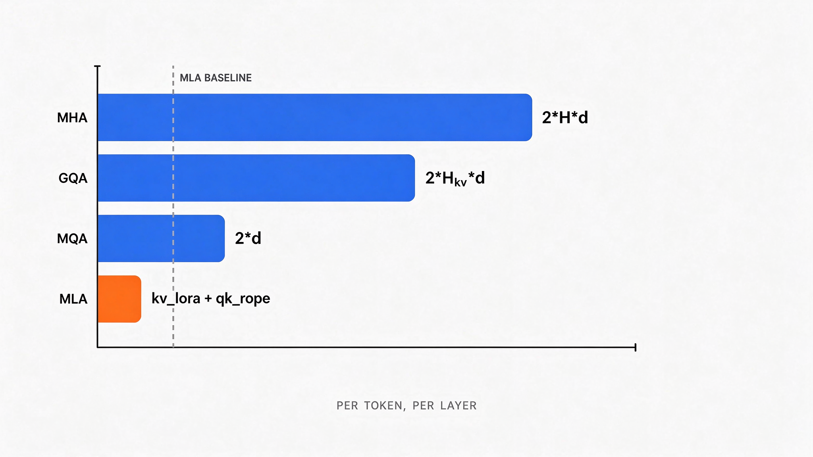

# LESSON 10 LLM Attention 架构及变体

> 这一课不从公式讲起，从**显存账本**讲起：每个 token 每层要存多少 KV，决定了模型能开多长上下文、能并发多少请求。所有变体都是在改这本账。

## TL;DR

- MHA → GQA → MQA 是"减少 KV 头数"一条线；MLA 是另一条线：**存低秩潜变量，用时再投影**。
- SWA 减少的是"每个 token 要看多少历史"；DSA 减少的是"要算哪些 token"。
- SGLang 用注册表 + factory 选择 backend，模型只依赖 `AttentionBackend` 接口。
- 混合注意力（Hybrid）让不同层用不同模式，backend 要能一层一层分派。

## 考点地图

- MHA / GQA / MQA / MLA 的 KV 显存公式分别是什么？
- MLA 为什么能同时做到"接近 MHA 的表达力"和"接近 MQA 的显存"？
- SWA 的窗口怎么影响 KV 池大小？
- DSA 的 indexer 在算什么？top-k 的 k 从哪来？
- SGLang 怎么决定用哪个 attention backend？
- 混合注意力模型在 SGLang 里怎么调度？

## 10.1 显存账本

设层数 `L`、头数 `H`、每头维度 `d`、KV 头数 `H_kv`、序列长度 `S`、batch `B`、每元素字节 `b`。

| 变体 | 每 token 每层 KV | 说明 |
|---|---|---|
| MHA | `2 * H * d` | K 和 V 各一份 |
| GQA | `2 * H_kv * d` | `H_kv < H`，多个 Q 头共享一组 KV |
| MQA | `2 * d` | 所有 Q 头共享一组 KV |
| MLA | `kv_lora_rank + qk_rope_head_dim` | 存压缩潜变量 + 位置部分 |

MLA 的关键：它存的不是展开后的 K/V，而是一个低秩向量。decode 时用上投影矩阵把这个向量还原成多头 K/V。所以**显存按潜维度算，计算按展开后算**。



## 10.2 MLA 的实现要点

`DeepseekV2AttentionMLA`（`models/deepseek_v2.py:2065`）的 forward 分三段：

```python
# deepseek_v2.py:2449
def forward(self, positions, hidden_states, forward_batch, ...):
    ...
# deepseek_v2.py:2470
def forward_prepare(self, ...):      # 投影出 q、压缩后的 kv
    ...
# deepseek_v2.py:2586
def forward_core(self, ...):         # 调 attention backend
```

三个容易问的点：

1. **为什么拆 prepare / core**：prepare 里的投影可以和 backend 的元数据准备重叠，也方便 CUDA Graph 分段捕获。
2. **RoPE 单独存**：`qk_rope_head_dim` 那部分不参与低秩压缩，单独存是为了位置编码的可加性。
3. **KV 池形状和其他模型不同**：所以 `FlashInferMLAAttnBackend`（`flashinfer_mla_backend.py:228`）是独立 backend，而不是复用普通 FlashInfer。

具体到形状：MLA 的 KV 只有 **1 个 head**，维度是 `kv_lora_rank + qk_rope_head_dim`（`deepseek_v2.py:2252` 的 `self.attn_mqa`）。DeepSeek-V3 配置下是 512+64=576 个元素/token/层；同等 GQA（8 头 × 128 维 × K/V）是 2048，约 3.6 倍差距。

还有一个工程细节：**MLA 的 prefill 经常不用吸收式 MLA**。当前缀为空、或前缀足够大且能塞进一个 chunk 时，会改用 `MHA_ONE_SHOT` / `MHA_CHUNKED_KV`，只有 decode 才稳定走 MLA。原因是 prefill 的 query 很长，吸收式要额外做两个 BMM，反而不如显式展开。

## 10.3 Backend 注册表

```python
# attention_registry.py:44
ATTENTION_BACKENDS = {}

# attention_registry.py:49
def register_attention_backend(name):
    def decorator(fn):
        ATTENTION_BACKENDS[name] = fn
        return fn
    return decorator
```

```python
# attention_registry.py:79
@register_attention_backend("flashinfer")
def create_flashinfer_backend(runner):
    ...
```

选择发生在 `ModelRunner` 初始化阶段：根据平台、模型结构（是否 MLA / 是否 SWA / 是否 DSA）、用户参数，挑一个 factory 建 backend。

| backend | 代表文件 | 适用 |
|---|---|---|
| `flashinfer` | `flashinfer_backend.py` | 通用 CUDA |
| `fa3` / `flashattention` | `flashattention_backend.py:169` | 长序列 |
| `trtllm_mla` | `flashinfer_mla_backend.py` 系列 | MLA 模型 |
| `aiter` | `aiter_backend.py` | ROCm |
| `dsa` | `dsa_backend.py` | DeepSeek Sparse Attention |
| `hybrid` | `hybrid_attn_backend.py:27` | 一层一种注意力 |

`AttentionBackend`（`base_attn_backend.py:85`）是抽象基类，核心方法是 `init_forward_metadata` 与 `forward`。模型只依赖这个接口。

## 10.4 SWA：滑动窗口

SWA 把"每个 token 看全部历史"改成"只看最近 W 个 token"。两个后果：

- **KV 池可以按窗口回收**：`swa_max_total_num_tokens` 与全量池分开算（第 05 课的 `MemoryPoolConfig` 里有这个字段）。
- **attention mask 变成带状**，backend 需要专门的 kernel。

SGLang 里 SWA 与全量层可以共存（`is_hybrid_swa`），所以池子也是两套。

## 10.5 DSA：稀疏注意力

DSA（DeepSeek Sparse Attention）多了一个 **indexer**：先给每个 query 选 top-k 个相关 token，再只对这些 token 做 attention。

```python
# dsa_backend.py:157
def prepare_kv_for_attention(...):
    # 为稀疏 attention 准备 KV 视图与索引
```

`DeepseekSparseAttnBackendKPoolMixin`（`dsa/dsa_backend_kpool.py:34`）负责 K 池的组织。工程上要关注：

| 问题 | 影响 |
|---|---|
| indexer 的 top-k 取多少 | 直接决定计算量 |
| indexer 自己的 KV 存哪 | 额外显存开销 |
| top-k 结果能否复用 | 影响 CUDA Graph 可行性 |

## 10.6 混合注意力

`HybridAttnBackend`（`hybrid_attn_backend.py:27`）对每一层分派到不同的子 backend。典型场景：

- 大部分层用全量 attention，少数层用 SWA。
- MLA 层与普通 GQA 层混排（某些 hybrid 模型）。
- 线性注意力层与 softmax 注意力层混排。

这要求 `ForwardBatch` 的元数据能同时描述多种模式，也是 `init_forward_metadata` 变复杂的原因。

## 10.7 设计取舍表

| 决策 | 选择 | 代价 | 替代 |
|---|---|---|---|
| 减 KV | GQA / MLA | 表达力或实现复杂度 | MHA（显存爆炸） |
| 减历史 | SWA | 长程依赖变弱 | 全量（显存线性涨） |
| 减计算 | DSA top-k | indexer 额外开销 | 全量 attention |
| backend 选择 | 注册表 + 运行时挑选 | 组合多、测试矩阵大 | 单一 backend（性能差） |
| 混合层 | 一层一分派 | 元数据复杂 | 全模型统一 |

## 10.8 动手验证

看当前用了哪个 backend：

```bash
sglang serve --model-path <model> --log-level info 2>&1 | grep -i "attention backend" | head
```

强制指定并对比：

```bash
sglang serve --model-path <model> --attention-backend flashinfer --port 30000
sglang serve --model-path <model> --attention-backend fa3 --port 30001
```

长上下文场景下 `fa3` 通常更好；MLA 模型必须用 MLA 专用 backend。

## 10.9 面试问答

**Q1：GQA 为什么能省显存？**

- 一句话：多个 Q 头共享一组 KV 头。
- 展开：KV 从 `2*H*d` 降到 `2*H_kv*d`，H_kv 常取 H/4 或 H/8。
- 追问"精度损失"：小于 MQA，通常可接受；再小就需要 MLA 这类结构。

**Q2：MLA 的核心思想？**

- 一句话：不存展开的 K/V，存低秩潜变量，用时再投影。
- 展开：每 token 只存 `kv_lora_rank + qk_rope_head_dim`，decode 时上投影还原多头。
- 追问"为什么能接近 MHA"：低秩假设下信息损失小，且位置部分单独保留。

**Q3：SWA 和 DSA 的区别？**

- 一句话：SWA 限历史范围，DSA 选相关 token。
- 展开：SWA 是固定窗口，实现简单；DSA 靠 indexer 动态选 top-k，计算更省但多一套索引开销。
- 追问"能一起用吗"：可以，混合注意力就是这类组合。

**Q4：SGLang 怎么选 backend？**

- 一句话：注册表 + 运行时按平台/模型/参数挑 factory。
- 展开：`ATTENTION_BACKENDS` 字典，`@register_attention_backend` 注册，ModelRunner 初始化时选择。
- 追问"选错了会怎样"：形状不匹配直接报错，或者性能大幅下降。

**Q5：混合注意力难在哪？**

- 一句话：元数据要同时描述多种 mask 和 KV 布局。
- 展开：`HybridAttnBackend` 一层一层分派，每层的窗口/稀疏参数不同。
- 追问"对 CUDA Graph 的影响"：不同层的图不能复用，捕获数量增加。

## 10.10 一页速记

```
账本   MHA 2Hd / GQA 2H_kv d / MQA 2d / MLA kv_lora_rank + qk_rope_head_dim
MLA    prepare(2470) → core(2586)，RoPE 单独存
注册   ATTENTION_BACKENDS(44) + register(49) + factory(79)
接口   AttentionBackend(85)：init_forward_metadata / forward
变体   SWA 限窗口、DSA 选 top-k、Hybrid 一层一分派
```

## 挂载点

- 上游：第 05 课的 `ModelConfig` 提供头数与层数；第 08 课的 KV 量化改变每元素字节数。
- 下游：第 11 课的 CUDA Graph 要按 backend 的元数据形状分桶；第 15 课的 TP 会切分头数。
