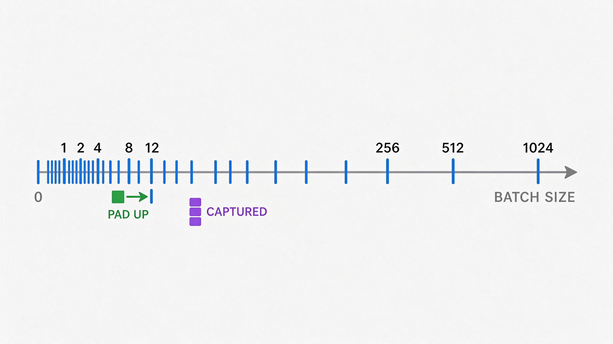

# LESSON 11 SGLang CUDA Graph

> decode 阶段每步只产出一个 token，GPU 计算只有几毫秒，但每步要 launch 几百个 kernel。**CPU 的 launch 开销会把 GPU 喂不饱**。CUDA Graph 就是把这串 launch 压成一次 replay。

## TL;DR

- 只有三种 backend：`FULL` / `BREAKABLE` / `DISABLED`（`cuda_graph_config.py:40`）。
- decode 按**请求数**分桶，prefill 按 **token 数**分桶，两者是两套桶。
- 桶不是连续的：小 batch 密、大 batch 疏，中间靠 `_pad_to_bucket` 上取整。
- replay 前要把真实 batch 填进静态 buffer（`load_batch`），replay 后把输出截回真实长度。
- 触发回退 eager 的条件很多（beam、动态 embeds、宽度不匹配等），所以"开了 graph"不等于"每步都走 graph"。

## 考点地图

- CUDA Graph 解决的是什么瓶颈？为什么 decode 比 prefill 更需要它？
- 为什么需要分桶？桶的大小怎么定？
- 一次 capture 里为什么要 warmup 两次？
- graph 的显存从哪来？为什么所有图共用一个 pool？
- 哪些情况必须回退 eager？
- prefill graph 和 decode graph 的本质区别？

## 11.1 瓶颈：CPU launch 追不上 GPU

decode 一步的计算量是 `bs × 1 token`，kernel 数量却和层数成正比（QKV、attention、O、MLP、norm、采样……）。当 batch 不大时，GPU 算完一个 kernel 只要几十微秒，而 Python + CUDA runtime 的 launch 也要几微秒——**launch 成了主路径**。

CUDA Graph 把"这一串 kernel + 依赖关系"录制下来，之后一次 `replay` 提交，CPU 只发一个命令。

代价：**所有形状必须固定**。于是引出分桶。

## 11.2 三种 backend

```python
# cuda_graph_config.py:40
class Backend(Enum):
    FULL = "full"            # 整段 forward 一张图
    BREAKABLE = "breakable"  # 可打断的图，允许段间回 CPU
    DISABLED = "disabled"
```

`PhaseConfig`（`cuda_graph_config.py:90`）分别描述 prefill 与 decode 两相：

| 字段 | 含义 |
|---|---|
| `backend` | 该相用哪种图 |
| `max_bs` | 该相最大批 |
| `bs` | 显式指定的桶 |
| `max_context_size` | 影响 prefill 桶上限 |
| `full_prefill_max_req` | FULL prefill 允许的最大请求槽位 |

默认值有平台差异：`default_prefill_backend`（`cuda_graph_config.py:119`）在 CUDA 上给 `BREAKABLE`，非 CUDA 直接 `DISABLED`。

> BREAKABLE 的意义：prefill 里有些 Python 逻辑（mask 构造、元数据）无法进图，BREAKABLE 允许在固定点"打断"回 CPU，再继续 replay。

## 11.3 分桶

```python
# base_cuda_graph_runner.py:75
def get_batch_sizes_to_capture(model_runner, captured_req_width=1, ...):
    capture_bs = list(get_exec().graph.cuda_graph_config.decode.bs)
    ...
    capture_bs = [bs for bs in capture_bs if bs * alignment_width % mul_base == 0]
    capture_bs = [bs for bs in capture_bs if bs <= num_max_requests]
    return capture_bs, compile_bs
```

三个过滤条件：

1. **对齐**：`bs × 每请求 token 宽度` 必须是 attention TP/CP 对齐宽度的倍数。
2. **上限**：不能超过 `req_to_token_pool.size`。
3. **编译子集**：开了 torch.compile 时，只有 `bs <= torch_compile_max_bs` 的桶才额外编译（第 12 课）。

桶的生成规则在 `cuda_graph_hook.py:596`：默认在小 batch 处很密（1、2、4、8、12），16–256 每 8，256–512 每 16，之后每 32。理由很直接——小 batch 的延迟敏感，padding 浪费一个槽位代价大；大 batch 反过来。

运行时不够精确怎么办？`_pad_to_bucket`（`base_cuda_graph_runner.py:188`）用二分找最近的桶，向上取整。



## 11.4 捕获：先 prefill 后 decode

```python
# cuda_graph_setup.py:406
def capture_cuda_graphs(...):
    # 建 EagerRunner → 捕 prefill → 捕 decode → finalize
```

两个子步骤：

| 函数 | 桶维度 | 说明 |
|---|---|---|
| `capture_prefill_graph`（`cuda_graph_setup.py:490`） | token 数 | 上限 `max_capture_requests * context_len` |
| `capture_decode_graph`（`cuda_graph_setup.py:746`） | 请求数 | 按 device 选 runner 类，前后测显存 |

单个形状的捕获在 `FullCudaGraphBackend.capture_one`（`full_cuda_graph_backend.py:144`）：

```python
# 伪代码
run_once(); run_once()          # 两次 warmup：让 kernel 加载、一次性初始化付完
with torch.cuda.graph(g, pool=global_pool):
    run_once()                  # 真正的捕获
```

**为什么 warmup 两次**：第一次会触发 Triton kernel 的 `cuModuleLoadData`（第 13 课），如果在 capture 里做，会往 capturing stream 上分配/卸载模块，直接让 capture 失败。

**捕获顺序是倒序的**：大 shape 先捕，小 shape 才能在同一个 pool 的空洞里分配；反过来会把内存切碎。

## 11.5 replay：填 buffer → 回放 → 截断

```python
# decode_cuda_graph_runner.py:2154
def execute(self, forward_batch):
    ...
    output = self.backend.replay(self._replay_graph_key, forward_batch)
    output = self._process_output_after_replay(output, forward_batch)
```

关键在 `load_batch`（`decode_cuda_graph_runner.py:1620`）：把真实 batch 的 input_ids、seq_lens、out_cache_loc 写进**静态 buffer**，并把不足一个桶的行 pad 掉。replay 之后，输出要按真实长度截断，否则采样会读到 padding 行的 logits。

这也是 graph 的隐式成本：每步多一次 H2D 拷贝和一次 slice。

## 11.6 什么时候回退 eager

`can_run_graph`（`decode_cuda_graph_runner.py:980`）里有十几条拒绝条件，常见的：

| 条件 | 原因 |
|---|---|
| beam search | 输出结构不是"每请求一个 token" |
| 动态 `replace_embeds` | 输入形状/内容不定 |
| `num_tokens_per_req != captured_req_width` | 投机解码宽度变了 |
| encoder_lens 含 0 | 混合 batch 的行宽不一致 |
| DP/TBO 约束不满足 | 各 rank 节拍不一致 |
| ngram batch 宽度不符 | 同上 |

`EagerRunner.can_run_graph` 恒为 False，所以"没有可用桶"时自然落回 eager。

> 面试点：**graph 命中率**是可以观测的指标。命中率低通常意味着 batch 形状抖动或桶配得太稀。

## 11.7 显存：一个 pool

```python
# runner_utils/pool.py:109
def get_or_create_global_graph_memory_pool(device, ...):
    # 进程级唯一 graph pool handle
```

所有形状共用同一个 pool。原因：每个 CUDAGraph 捕获时都从 allocator 借显存，只有共享 pool 才能让不同 shape 复用同一批空闲块。否则 30 个桶就是 30 份峰值显存。

代价：pool 一旦被某个大 shape 撑大，就不会缩回去。所以桶的上限要克制。

## 11.8 设计取舍表

| 决策 | SGLang 的选择 | 代价 | 替代 |
|---|---|---|---|
| 形状 | 分桶 + padding | 浪费算力 | 每步重捕（不可行） |
| 桶密度 | 小密大疏 | 配置复杂 | 等距（尾延迟差） |
| 捕获时机 | 启动期全部捕 | 启动慢 | 懒捕获（首请求抖动） |
| 内存 | 全局 pool | 峰值不回收 | 每图独立 pool（爆显存） |
| 回退 | 条件很多 | 行为不直观 | 强制 graph（正确性风险） |

## 11.9 动手验证

```bash
sglang serve --model-path <model> --log-level info 2>&1 \
  | grep -iE "capture|graph" | head -20
```

关闭 graph 对比吞吐：

```bash
sglang serve --model-path <model> --disable-cuda-graph --port 30000
```

小 batch、短输出的场景差异最大；大 batch 时 GPU 计算占主导，差异缩小。

## 11.10 面试问答

**Q1：CUDA Graph 解决什么瓶颈？**

- 一句话：把每步几百次 kernel launch 压成一次 replay，消除 CPU 侧开销。
- 展开：decode 每步计算量小、kernel 多，CPU launch 追不上 GPU；graph 录制后一次提交。
- 追问"为什么 prefill 不那么需要"：prefill 计算量大，launch 占比低。

**Q2：为什么要分桶？**

- 一句话：图的形状在捕获时固化，而 batch 每轮都变。
- 展开：桶把连续变化量化成有限形状，运行时上取整到最近桶。
- 追问"padding 的代价"：算力浪费，所以小 batch 桶要密。

**Q3：为什么 capture 前要 warmup？**

- 一句话：触发所有一次性的初始化（kernel 加载、workspace 分配）。
- 展开：Triton 的 `cuModuleLoadData` 在 capture 中执行会失败，必须先付掉。
- 追问"为什么要两次"：第一次可能只完成部分模块加载，第二次才稳定。

**Q4：graph 显存为什么共享 pool？**

- 一句话：让不同形状复用同一批空闲块。
- 展开：每个图捕获都从 pool 借，独立 pool 会让峰值随桶数线性增长。
- 追问"代价"：pool 峰值不回收，桶上限要克制。

**Q5：哪些情况回退 eager？**

- 一句话：形状或控制流无法在捕获时确定的情况。
- 展开：beam、动态 embeds、投机宽度不匹配、混合 batch、DP/TBO 节拍不一致。
- 追问"怎么观测"：看 graph 命中率；命中率低说明桶或负载形状有问题。

## 11.11 一页速记

```
backend  FULL / BREAKABLE / DISABLED（cuda_graph_config.py:40）
两相     PhaseConfig(90)：prefill 按 token，decode 按请求数
桶       get_batch_sizes_to_capture(75)：对齐过滤 + 上限；_pad_to_bucket(188)
捕获     capture_cuda_graphs(406) → prefill(490) → decode(746)
单形状   warmup×2 → torch.cuda.graph(pool) → capture_one(144)
回放     load_batch(1620) 填静态 buffer → replay → 截断 → execute(2154)
回退     can_run_graph(980) 十余条拒绝条件
显存     get_or_create_global_graph_memory_pool(109)
```

## 挂载点

- 上游：第 03 课的 `ModelRunner.forward` 选执行器；第 07 课的 chunk 长度影响 prefill 桶。
- 下游：第 12 课的 piecewise 图与 compile 桶；第 14 课的 draft 图继承 decode runner。
