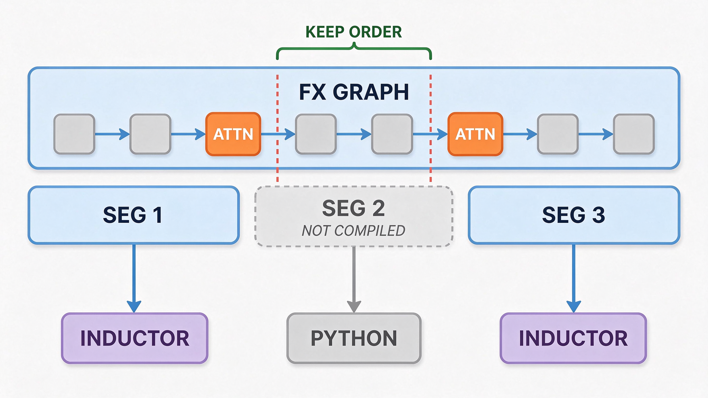

# LESSON 12 SGLang torch.compile

> torch.compile 在 SGLang 里不是"打开就变快"的开关，它是一套**切图 + 分段编译 + 分段图捕获**的流水线。理解它的关键不是 Dynamo，而是"为什么要切图"。

## TL;DR

- 三段：Dynamo 把 Python 变成 FX Graph，SGLang 的 `SGLangBackend` 负责切图，Inductor 把每段降到 Triton。
- `install_torch_compiled`（`compile.py:150`）不是立即编译，而是把 `forward` 换成 trampoline，**首次调用才编译**。
- 切图边界是 `split_ops`：attention、MoE A2A 这类"每轮元数据都变"的算子必须留在图外。
- dynamic shape 靠手动 `maybe_mark_dynamic`，不是 `dynamic=True`。
- 现状：`tc_piecewise` 这个 graph backend 已被移除，piecewise 编译路径主要用于 compile 桶。

## 考点地图

- Dynamo / FX / Inductor 各交付什么？
- SGLang 为什么要在 Inductor 之前切图？
- `install_torch_compiled` 的 trampoline 是怎么工作的？
- dynamic shape 标在哪里？不标会怎样？
- guard 失效后会发生什么？
- piecewise CUDA graph 和普通 CUDA graph 的关系？

## 12.1 三段流水线

```
Python forward
   │  torch._dynamo（字节码改写 + guard）
   ▼
FX GraphModule
   │  SGLangBackend.split_graph（按 split_ops 切段）
   ▼
若干子图
   │  Inductor（每段 → Triton kernel）
   ▼
编译产物 + CUDA Graph（可选）
```

SGLang 的插入点在中间：`SGLangBackend`（`compilation/backend.py:371`）是 Dynamo 的 backend，它在 `__call__` 里先 `split_graph`，再把每段交给 `PiecewiseCompileInterpreter`。

## 12.2 trampoline：为什么不是立即编译

```python
# compile.py:150
def install_torch_compiled(module, *, dynamic_arg_dims=None, backend_factory=None, ...):
    unbound_fwd = module.__class__.forward
    ...
    def trampoline(self, *args, **kwargs):
        if not state["compiled"]:
            _ensure_compiled(self, *args, **kwargs)   # compile.py:198
        return state["compiled_callable"](*args, **kwargs)
```

两个理由：

1. **编译需要真实输入**：dynamic dims 要在第一次调用时按实际参数标注。
2. **启动时间**：服务启动时不想等编译，把成本摊到首个请求。

`trampoline`（`compile.py:229`）还有一层判断：只有当前处于 piecewise CUDA graph 捕获上下文时才走编译版，否则原样执行。这保证了"编译失败/未命中"时不会把服务拖死。

## 12.3 切图：为什么必须切

attention 的 mask、KV indptr、tree 结构每轮都在变。如果整段 forward 都进图：

- 形状固化 → 每来一个新 batch 就要重编译；
- 元数据固化 → 结果直接错。

所以 SGLang 用 `@register_split_op`（`compilation_config.py:10`）把这类算子标成边界，`split_graph`（`compilation/backend.py:230`）在 FX 上按节点名切开：

```python
# 伪代码
for node in graph.nodes:
    if node.op == "call_function" and node.target in split_ops:
        # 以这个节点为界，把图切成两段
```

注意 `keep_original_order=True`：图里有 mutation，重排会改变语义。

切完之后，**段与段之间的 Python 代码留在图外每轮执行**，只有纯计算段进图。这就是"piecewise"的含义。



## 12.4 dynamic shape：主动标，不是开关

```python
# compile.py:129
def _mark_dynamic_forward_batch(forward_batch):
    for field in forward_batch 的所有 tensor 字段:
        torch._dynamo.maybe_mark_dynamic(t, dim)

# compile.py:78
def _mark_dynamic_on_value(val, dims):
    # 对 Tensor / IntermediateTensors 逐叶标注
```

为什么不用 `torch.compile(dynamic=True)`：那会把所有维度都动态化，包括本应固定的 hidden_size，反而让 Inductor 失去优化机会。SGLang 只标 token 维和 batch 维。

不标的后果：Dynamo 会对 dummy shape 起 guard，每来一个新 batch 就重编译一次，服务直接卡死。

## 12.5 分段图捕获

`CUDAPiecewiseBackend`（`cuda_piecewise_backend.py:49`）为每个子图做两件事：

1. 编译（Inductor）；
2. 对每个 shape 捕获 CUDA Graph。

```python
# 首次进入某 shape：先 eager 跑一次，第二次才捕图
if entry.num_finished_warmup < 1:
    entry.num_finished_warmup += 1
    return eager_run(...)
...
entry.cudagraph.replay()
```

一个容易忽略的兜底（`cuda_piecewise_backend.py:167`）：如果拿不到 capture stream（通常因为 Dynamo 重编译换了 backend 实例），就对该段退回 eager，并打一条 warning。**不崩，但掉性能**。

## 12.6 guard 与重编译

Dynamo 的 guard 是一组断言（shape、dtype、常量）。任何一条失效都会重新 trace：

```
guard 失效 → 重新 trace → 新的 backend 实例 → 没有 capture stream → 该段退回 eager
```

相关配置：

| 参数 | 作用 |
|---|---|
| `cache_size_limit` | 单个函数的编译缓存上限，超了就不再编译 |
| `fx_graph_cache` | 打开 FX 图级缓存，跨进程复用 |

Inductor 的 pass 也有缓存键：`InductorPass.hash_source`（`inductor_pass.py:64`）用源码 sha256 当 UUID，改了 pass 就让 cache 失效。这是"改了优化 pass 但性能没变"的常见原因——旧缓存还在。

## 12.7 现状：tc_piecewise 已移除

对用户可选的只剩 `FULL` / `BREAKABLE` / `DISABLED`；`TC_PIECEWISE` 常量还留在枚举里（`cuda_graph_config.py:44`），但从配置里传 `tc_piecewise` 会直接报错。也就是说"用 torch.compile 把整个 prefill 图捕获下来"这条路已经废弃，现在的用法是：

- decode/prefill 主路径用 CUDA Graph（第 11 课）；
- torch.compile 用于 `bs <= torch_compile_max_bs` 的桶做算子级优化。

读源码时不要被遗留的 piecewise 代码误导。

## 12.8 设计取舍表

| 决策 | 选择 | 代价 | 替代 |
|---|---|---|---|
| 编译时机 | 首次调用 | 首请求慢 | 启动期编译（启动慢） |
| 切图 | split_ops 边界 | 段间 Python 开销 | 整图编译（metadata 错） |
| dynamic | 手动标 token/batch | 需要维护 dim 映射 | dynamic=True（过度动态） |
| 图捕获 | 每段每 shape | 显存与启动成本 | 不捕（launch 开销） |
| 兜底 | 退回 eager | 性能不可预期 | 直接报错（可用性差） |

## 12.9 动手验证

```bash
sglang serve --model-path <model> --enable-torch-compile --port 30000
```

观察编译日志与重编译次数：

```bash
sglang serve --model-path <model> --enable-torch-compile --log-level info 2>&1 \
  | grep -iE "compil|guard|recompil" | head -20
```

如果看到大量 recompile，通常是 dynamic dim 没标对或输入形状抖动。

## 12.10 面试问答

**Q1：Dynamo / FX / Inductor 各做什么？**

- 一句话：Dynamo 抓图，FX 表示图，Inductor 生成 kernel。
- 展开：Dynamo 改字节码并加 guard；FX GraphModule 是可变换的中间表示；Inductor 降到 Triton/C++。
- 追问"SGLang 插在哪"：在 Dynamo 和 Inductor 之间，用自定义 backend 切图。

**Q2：为什么必须切图？**

- 一句话：attention 的元数据每轮都变，不能固化。
- 展开：mask、indptr、树结构进图就错；切段后段间 Python 每轮重算。
- 追问"代价"：段间有 Python 开销，段越多越明显。

**Q3：trampoline 的作用？**

- 一句话：把编译推迟到首次调用，并保证未编译时能原样执行。
- 展开：`install_torch_compiled` 只替换 `forward`，`_ensure_compiled` 在第一次调用时标 dynamic 并编译。
- 追问"为什么延迟"：dynamic dims 需要真实输入，启动期编译也会拖慢服务。

**Q4：dynamic shape 怎么标？**

- 一句话：只标 token 与 batch 维，其余保持静态。
- 展开：`maybe_mark_dynamic` 逐叶标注，`ForwardBatch` 的 tensor 字段统一处理。
- 追问"标多了会怎样"：Inductor 失去常量折叠机会，性能下降。

**Q5：guard 失效后发生什么？**

- 一句话：重新 trace，新 backend 实例没有 capture stream，该段退回 eager。
- 展开：所以形状抖动会导致"有时快有时慢"。
- 追问"怎么发现"：看 recompile 日志和 graph 命中率。

## 12.11 一页速记

```
三段   Dynamo → FX → Inductor；SGLang 在中间切图
入口   install_torch_compiled(150) → trampoline(229) → _ensure_compiled(198)
切图   register_split_op(10) → split_graph(230) → SGLangBackend(371)
动态   _mark_dynamic_on_value(78) / _mark_dynamic_forward_batch(129)
分段图 CUDAPiecewiseBackend(49)；无 capture stream 则 eager(167)
缓存   InductorPass.hash_source(64) 用源码 hash 做 UUID
现状   tc_piecewise 对用户不可选，只剩 FULL / BREAKABLE / DISABLED
```

## 挂载点

- 上游：第 11 课的桶决定 `compile_bs`；第 03 课的 `ForwardBatch` 是标注对象。
- 下游：第 13 课的 Inductor 产物就是 Triton kernel。
