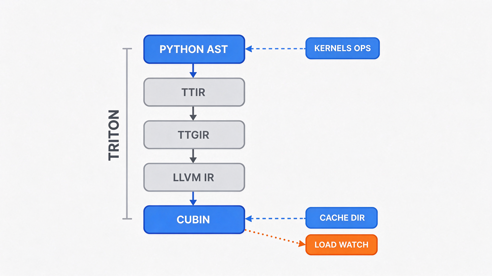

# LESSON 13 Triton 编译全流程

> Triton 的编译链不在 SGLang 里。SGLang 只做三件外围的事：**目录怎么放、cache 放哪、首次加载怎么监控**。把这三件事讲清楚，比背 IR 名字有用。

## TL;DR

- `@triton.jit` 的 Python AST → TTIR → TTGIR → LLVM → cubin 全由 Triton 自己完成，SGLang 不介入。
- 三个目录分工不同：`kernels/ops` 放 Triton/CuteDSL 算子，`kernels/jit` 是 CUDA C++ 扩展的 JIT 基建，`kernels/aot` 是预编译 wheel。
- MoE 的 tile 配置来自**离线 JSON 表**，不是 `@triton.autotune`，所以运行时不付搜索代价。
- cubin 在首次 launch 才 `cuModuleLoadData`，这段显存不在 allocator 账上，是 serving 期 OOM 的隐性来源。

## 考点地图

- Triton 从源码到 cubin 经过哪些 IR？
- Triton 的 cache key 包含什么？改什么会触发重编译？
- `kernels/jit` 和 Triton 的 JIT 是一回事吗？
- 为什么 MoE 用 JSON 调优表而不是 autotune？
- late kernel load 为什么会 OOM？
- 同一个算子为什么会有 Triton / C++ / AOT 三份实现？

## 13.1 编译链：谁在做什么

```
Python AST
   │ Triton frontend
   ▼
TTIR        tensor 级 IR
   │ layout / 优化
   ▼
TTGIR       tile 级 IR（带 layout）
   │
   ▼
LLVM IR
   │ NVPTX backend + ptxas
   ▼
cubin
```



每一层都可能因为 `constexpr` 参数不同而生成不同版本。所以"一个 kernel"在磁盘上可能是几十份 cubin。

SGLang 在这个链路里的位置是**观测者**：

| SGLang 做的事 | 位置 |
|---|---|
| 把 cache 目录指到自己的缓存根 | `environ.py:2827` |
| 组织算子源码目录 | `kernels/ops/` |
| 监控首次加载 | `triton_load_watch.py:94` |

## 13.2 三个目录别搞混

| 目录 | 内容 | 编译方式 |
|---|---|---|
| `python/sglang/kernels/ops/` | 按算子分组的 Triton / CuteDSL 源码 | `@triton.jit`，运行时编译 |
| `python/sglang/kernels/jit/` | CUDA C++ 扩展的 JIT 基建（`csrc/`、`include/`、`utils/compile`） | nvcc/ninja，两级内容寻址缓存 |
| `python/sglang/kernels/aot/` | `sgl_kernel` wheel 的源码树 | 提前编译，随包分发 |

判断方法：源码里有 `@triton.jit` 就在 `ops/`；有 `load_jit("...", csrc=...)` 就在 `jit/`；从 `sgl_kernel` import 的就是 `aot/`。

```python
# kernels/jit/utils/compile/loader.py:60
def load_jit(name, csrc=None, ...):
    # 计算 build_key → 选缓存目录 → 没有就编译 → 加载 .so
```

## 13.3 两套缓存

这是最容易混淆的点：**Triton 的 cache 和 `kernels/jit` 的 cache 是两套独立机制**。

| | Triton cache | JIT cache |
|---|---|---|
| key | 源码 hash + constexpr + triton 版本 + arch | `build_key`（编译前可算）+ `deps_key`（依赖闭包） |
| 位置 | `$SGLANG_CACHE_DIR/triton` | `kernels/jit` 自己的目录结构 |
| 入口 | Triton 内部 | `compute_build_key`（`cache.py:277`） |

`compute_build_key` 只包含"编译前就能确定"的信息：参数、编译 flag、目标架构、直接源文件。传递依赖的内容放在 `deps_key` 里，用来选最终叶子目录。这样改一个头文件不会让所有模块失效。

## 13.4 MoE：用 JSON 表代替 autotune

```python
# fused_moe_triton_config.py:55
def get_moe_configs(E, N, dtype, block_shape, device_name):
    # 文件名形如 E=8,N=4096,device_name=NVIDIA_H100,dtype=fp16,block_shape=[...].json
```

```python
# fused_moe_triton_config.py:264
def try_get_optimal_moe_config(...):
    # 在读到的表里选 |M - bs| 最小的 key
```

为什么不用 `@triton.autotune`：

1. autotune 在首次调用时枚举所有 config 并计时，**会阻塞 serving 且结果不稳定**。
2. MoE 的 tile 配置与 `M`（token 数）强相关，离线按 GPU 型号预生成更准。

代价：新卡、新模型、新量化格式首次跑时无表可用，走 `get_default_config`（`fused_moe_triton_config.py:180`）的启发式兜底，性能一般。这就是"第一次跑要自己 tune"的根因。

## 13.5 一个 kernel 的解剖

```python
# fused_moe_triton_kernels.py:313
@triton.jit
def fused_moe_kernel(
    A, B, C, topk_weights, topk_ids, sorted_token_ids, ...,
    BLOCK_SIZE_M: tl.constexpr, BLOCK_SIZE_N: tl.constexpr, BLOCK_SIZE_K: tl.constexpr,
    GROUP_SIZE_M: tl.constexpr, ...
):
    ...
```

三个要点：

1. **`constexpr` 是编译期常量**，也是 cache key 的一部分。改 tile 大小就是一次新编译。
2. `sorted_token_ids` 来自 `moe_align_block_size`（`moe_align_block_size.py:32`）：先按 expert 分桶、再按 block 对齐，kernel 才能连续读。
3. launch 前的 grid 计算在 `invoke_fused_moe_kernel`（`fused_moe_triton_kernels.py:785`），它会根据是否有 TMA 走不同分支。

上层入口是 `fused_experts`（`fused_moe.py:315`）：路由 → align → kernel → 合并。

## 13.6 late load：serving 期的隐性显存

cubin 不是加载时就进显存，而是**首次 launch 时** `cuModuleLoadData`。这块显存：

- 不在 PyTorch allocator 账上；
- 不受 `mem_fraction_static` 控制；
- 一旦显存已被 KV 池吃满，就会直接 OOM。

```python
# triton_load_watch.py:94
def _on_kernel_load(...):
    # serving 启动后若仍有 kernel 加载，且显存余量低，就告警
```

工程对策：启动期做覆盖性 warmup（把所有桶、所有特化跑一遍），或者把这类告警当 CI 失败处理。

## 13.7 设计取舍表

| 决策 | 选择 | 代价 | 替代 |
|---|---|---|---|
| 算子实现 | Triton 为主 | 首次编译开销 | CUDA C++（开发慢） |
| tile 配置 | 离线 JSON | 新卡无表 | autotune（阻塞服务） |
| 编译时机 | 首次调用 | 首请求抖动 | 启动期全编译（启动慢） |
| 缓存 | 两套独立 | 容易混淆 | 统一 cache（难做） |
| 分发 | ops / jit / aot 三种 | 需要判断用哪套 | 单一形态（覆盖不全） |

## 13.8 动手验证

看 Triton cache 目录：

```bash
ls $SGLANG_CACHE_DIR/triton 2>/dev/null | head
# 或
python -c "import os; print(os.environ.get('TRITON_CACHE_DIR'))"
```

统计一个 kernel 的编译变体数量（改 constexpr 后再跑，目录会变多）。

观察 late load 告警：开 `--log-level info`，服务就绪后发一个从未出现的 batch 形状，看是否触发告警。

## 13.9 面试问答

**Q1：Triton 从源码到 cubin 经过什么？**

- 一句话：AST → TTIR → TTGIR → LLVM IR → cubin。
- 展开：TTIR 是 tensor 级，TTGIR 引入 layout，LLVM 之后由 NVPTX + ptxas 生成机器码。
- 追问"SGLang 做什么"：只做目录、cache、监控，不改 IR。

**Q2：cache key 里有什么？**

- 一句话：源码 hash、constexpr 特化、Triton 版本、backend/arch、编译选项。
- 展开：所以改一个 tile 常量就是一次全新编译，与 Python 层缓存无关。
- 追问"缓存放哪"：`TRITON_CACHE_DIR` 被重定向到 `SGLANG_CACHE_DIR/triton`。

**Q3：`kernels/jit` 是 Triton 的 JIT 吗？**

- 一句话：不是，它是 CUDA C++ 扩展的 JIT。
- 展开：nvcc/ninja 编译，两级内容寻址缓存（build_key + deps_key）。
- 追问"怎么区分"：看源码里是 `@triton.jit` 还是 `load_jit`。

**Q4：MoE 为什么不用 autotune？**

- 一句话：autotune 会阻塞服务，且结果不稳定。
- 展开：离线按 GPU/量化格式生成 JSON 表，运行时只查表。
- 追问"没表怎么办"：走默认启发式，性能下降但不报错。

**Q5：late load 为什么危险？**

- 一句话：cubin 加载要 allocator 之外的显存。
- 展开：服务就绪后 KV 池已占满，新特化首次 launch 时可能直接 OOM。
- 追问"怎么防"：启动期全量 warmup，或把告警当失败。

## 13.10 一页速记

```
链路   AST → TTIR → TTGIR → LLVM → cubin（Triton 自己做）
目录   ops（Triton）/ jit（CUDA C++）/ aot（sgl_kernel）
缓存   TRITON_CACHE_DIR(2827)；JIT: compute_build_key(277)
MoE    get_moe_configs(55) → try_get_optimal_moe_config(264) → 默认(180)
入口   fused_experts(315) → moe_align_block_size(32) → fused_moe_kernel(313)
风险   late load（triton_load_watch.py:94）
```

## 挂载点

- 上游：第 12 课的 Inductor 产物也是 Triton kernel。
- 下游：第 14 课的树 mask kernel、第 16 课的 MoE kernel 都在这一层。
