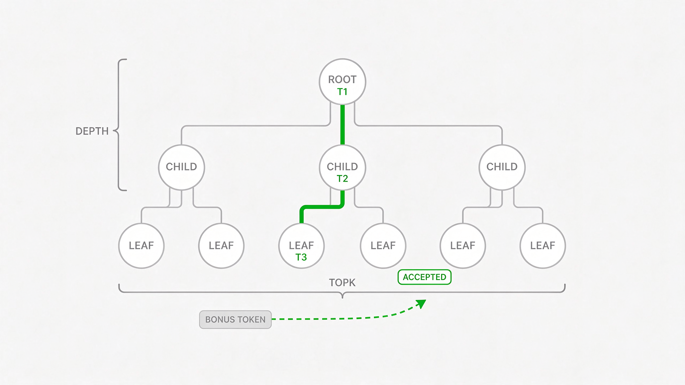

# LESSON 14 SGLang 推测解码

> 推测解码不是"用小模型直接出结果"，而是**小模型先猜一串，大模型一次验证**。加速比完全由"接受率"决定，而接受率由 draft 质量和树宽共同决定。

## TL;DR

- 三段：`draft` 猜树 → `verify` 一次前向验证整棵树 → accept 后 `draft_extend` 把接受链写回 draft 的 KV。
- 对外口径 `accept_lens = num_correct_drafts + 1`，那个 +1 是 bonus token，别算错。
- topk=1 时树退化成链，走快速路径；topk>1 才需要真正的 tree mask。
- draft 的整个多步循环可以捕成一张 CUDA Graph，但要求每请求宽度恒定。
- NGRAM 只是"draft 来源"不同，verify/accept 完全复用同一套。

## 考点地图

- 推测解码为什么能保证输出等价？
- draft-verify-accept 一轮里各做什么？
- tree attention mask 为什么不能复用 causal mask？
- 接受率怎么统计？accept_length 和 accept_rate 有什么区别？
- 为什么需要 draft_extend？
- 推测解码和 CUDA Graph 怎么结合？

## 14.1 一轮 decode 的三段

```python
# eagle_worker_v2.py:1589
def forward_batch_generation(self, batch, ...):
    # draft → verify → publish → draft_extend
```

| 阶段 | 入口 | 产出 |
|---|---|---|
| draft | `EagleDraftWorker.draft`（`eagle_worker_v2.py:726`） | 一棵候选 token 树 |
| verify | `EAGLEWorkerV2.verify`（`eagle_worker_v2.py:2162`） | 每个候选位置的 target logits |
| accept | `eagle_sample`（`eagle_utils.py:744`） | 接受长度与最终 token |
| draft_extend | `draft_extend`（`eagle_worker_v2.py:1086`） | 把接受链写进 draft KV |

**为什么能保证等价**：verify 用的是 target 模型的分布，接受判定采用拒绝采样（或贪心比较），被拒绝的位置由 target 自己重采样。数学上等价于直接从 target 采样，只是期望上一次前进多个 token。

## 14.2 树的形状

```python
# eagle_info.py:53
self.max_tree_depth = spec_steps + 1
```

- 深度 = 草稿步数 + 1（根节点）。
- 宽度 = `topk`。

topk=1 时树退化成一条链，接受判定只需顺序比较，走 `_chain_accept` 快速路径。topk>1 才需要构造祖先关系矩阵。



## 14.3 Tree mask：三种模式

```python
# eagle_utils.py:194
def default_tree_mask_mode():
    # CPU 用 QLEN_ONLY，GPU 用 FULL_MASK
```

| 模式 | 含义 | 显存 |
|---|---|---|
| `FULL_MASK` | 显式构造 N×N 祖先矩阵 | 最大 |
| `QLEN_ONLY` | 只用位置编码隐式表达 | 小 |
| `QLEN_ONLY_BITPACKING` | 位压缩 | 更小 |

FULL_MASK 的尺寸是 `seq_lens_sum * N + N * N * bs`。N=64、bs=256 时是几百 MB 级，所以 buffer 复用时要谨慎 memset。

`build_tree_kernel_efficient`（`eagle_utils.py:200`）一次产出三样东西：

1. `custom_mask`：树内可见性；
2. `positions`：每个候选的位置编码；
3. `retrieve_index / next_token / next_sibling`：树的 CSR 表示，供接受阶段遍历。

## 14.4 接受判定与统计

```python
# eagle_utils.py:1190
accept_lens = num_correct_drafts + 1
```

两个指标必须分开看：

| 指标 | 定义 | 反映什么 |
|---|---|---|
| `accept_length`（`metrics_reporter.py:967`） | 总接受 token / forward 次数 | 实际加速比 |
| `accept_rate` | `num_correct_drafts / (forward_ct * (draft_tokens - 1))` | draft 模型质量 |

近似关系：`accept_length ≈ 1 + rate * (N - 1)`。只看 rate 会高估收益，只看 length 分不清是 draft 差还是树太宽。

## 14.5 draft_extend：为什么不能省

verify 之后，draft 模型的 KV 还停留在"上一轮"的状态。如果直接进入下一轮 draft，它的 attention 会看到错误的历史。

`draft_extend`（`eagle_worker_v2.py:1086`）把**被接受的那条链**写进 draft 的 KV，保证下一轮 draft 的前缀连续。这一步不改变输出，但决定后续接受率。

## 14.6 与 CUDA Graph 的结合

`EAGLEDraftCudaGraphRunner`（`eagle_draft_cuda_graph_runner.py:102`）继承 decode runner，但绕过它的 `__init__`。捕获的是**整个 `speculative_num_steps` 步循环**，一次 replay 出整棵树。

前提条件（`can_run_graph`，`eagle_draft_cuda_graph_runner.py:378`）：

- 每请求宽度等于 `captured_req_width`；
- DP 各 rank 的决策一致；
- 没有动态分支。

不满足就回退 eager，性能下降但不影响正确性。

> 易错点：`draft_probs` 必须 `clone()` 出图。它指向 graph 私有 pool，replay 后那块内存会被下一次分配覆盖，读到脏数据会采出错误 token。

## 14.7 NGRAM：没有 draft 模型

`ngram_worker` 的 draft 来自 CPU trie 查表（`ngram_worker.py:252`）：用最近若干 token 在语料里匹配，命中就取出后续 token 当草稿。

它仍然强制输出 `bs * draft_token_num` 条，这样才能复用同一套 verify/accept kernel。**draft 来源可替换，验证路径不变**——这是这套设计的可扩展点。

## 14.8 设计取舍表

| 决策 | 选择 | 代价 | 替代 |
|---|---|---|---|
| draft 来源 | EAGLE / NGRAM | 需额外模型或语料 | 无（普通 decode） |
| 树宽 | topk 可调 | 显存与 verify 成本 | 链式（topk=1） |
| mask | 三模式 | 实现复杂 | 统一 FULL（显存大） |
| 图 | 整个 draft 循环 | 宽度必须固定 | eager（慢） |
| 接受判定 | 拒绝采样 | 需要概率 | 贪心（有偏） |

## 14.9 动手验证

```bash
sglang serve --model-path <target> --speculative-algorithm EAGLE \\
  --speculative-draft-model-path <draft> --speculative-num-steps 3 \\
  --speculative-eagle-topk 1 --speculative-num-draft-tokens 4 --port 30000
```

观察接受率：

```bash
sglang serve ... --log-level info 2>&1 | grep -i "accept" | head
```

调 `topk` 与 `num-steps`，看 `accept_length` 与吞吐的拐点。通常 topk 增大到某一值后收益递减，而 verify 成本线性上升。

## 14.10 面试问答

**Q1：推测解码为什么等价？**

- 一句话：验证阶段用 target 分布做拒绝采样，被拒位置由 target 重采。
- 展开：接受概率取 `min(1, p_target/p_draft)`，数学上与直接采样同分布。
- 追问"贪心模式呢"：逐位置比较 argmax，接受前缀，第一个不一致处取 target 的结果。

**Q2：tree mask 为什么不能用 causal mask？**

- 一句话：树里同层兄弟互相不可见，只有祖先链可见。
- 展开：必须显式构造祖先关系矩阵，causal mask 会让兄弟节点互相污染。
- 追问"三模式怎么选"：GPU 默认 FULL_MASK，CPU 用 QLEN_ONLY，位压缩用于显存紧的场景。

**Q3：accept_length 和 accept_rate 的区别？**

- 一句话：前者是每轮前进的 token 数，后者是草稿命中比例。
- 展开：`accept_length = correct + 1`，含 bonus token；rate 只数 draft 部分。
- 追问"为什么容易算错"：忘记 +1 会把加速比低估，把 rate 当 length 会高估。

**Q4：为什么需要 draft_extend？**

- 一句话：让 draft 的 KV 与已接受前缀保持一致。
- 展开：verify 只更新 target 的 KV；不 extend 的话下一轮 draft 看到的是旧历史。
- 追问"省略会怎样"：接受率逐步下降，但输出仍然正确。

**Q5：推测解码怎么和 CUDA Graph 结合？**

- 一句话：把整个多步 draft 循环捕成一张图，一次 replay 出整棵树。
- 展开：要求宽度固定、DP 决策一致；否则回退 eager。
- 追问"坑在哪"：`draft_probs` 在 graph pool 里，必须 clone 出来再用。

## 14.11 一页速记

```
三段   draft(726) → verify(2162) → accept(744) → draft_extend(1086)
树     max_tree_depth = spec_steps + 1；topk=1 退化为链
mask   FULL_MASK / QLEN_ONLY / QLEN_ONLY_BITPACKING
统计   accept_length(967) vs accept_rate；accept_lens = correct + 1(1190)
图     EAGLEDraftCudaGraphRunner(102)，宽度必须恒定(378)
NGRAM  CPU trie 出草稿(252)，verify 路径不变
```

## 挂载点

- 上游：第 03 课的 `run_batch` 里的 spec 分支；第 11 课的 decode 桶要按 draft 宽度调整。
- 下游：第 16 课的 MoE 在 verify 阶段要处理树状 batch。
