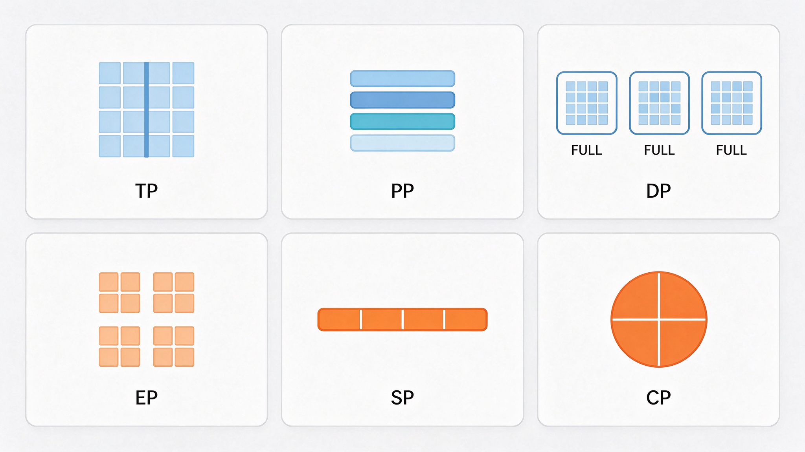

# LESSON 15 分布式推理原理

> 并行策略不是"越多越快"。每一种切法都换来一类通信，通信量决定了扩展性上限。这一课先把六种并行讲成一张表，再看代码怎么建组。

## TL;DR

- **TP 切权重矩阵**，每层一次 all-reduce，通信最频繁。
- **PP 切层**，只在 stage 边界传激活，但有流水气泡。
- **DP 复制模型**，不切权重，扩展吞吐；attention DP 时每卡独立调度。
- **EP 切专家**，MoE 专用，靠 all-to-all。
- **SP / CP 切序列**，长上下文场景，通信在 attention 内部。
- `GroupCoordinator` 把一个 rank 在六种维度上的"队友"封装成组。

## 考点地图

- TP / PP / DP / EP / SP / CP 各切什么？各通信什么？
- 为什么 TP 的通信量随隐藏层维度线性增长？
- PP 的流水气泡怎么算？怎么缓解？
- DP attention 和普通 DP 的区别？
- `GroupCoordinator` 里一个 rank 同时在几个组里？
- 什么模型必须用 EP？

## 15.1 六种并行

| 策略 | 切什么 | 通信 | 通信频率 | 典型场景 |
|---|---|---|---|---|
| TP | 权重矩阵的行/列 | all-reduce / all-gather | 每层 1–2 次 | 单机多卡、模型放不下 |
| PP | 层 | p2p 激活 | 每 microbatch | 跨机、超深模型 |
| DP | 数据（复制模型） | 梯度/权重同步（推理无） | 几乎为 0 | 扩吞吐 |
| EP | 专家 | all-to-all | 每 MoE 层 | MoE 模型 |
| SP | 序列维度 | all-gather / reduce-scatter | attention 内 | 长上下文 |
| CP | 上下文分块 | ring/树形 attention | attention 内 | 超长上下文 |



### TP 为什么通信频繁

```python
# linear.py:401
class ColumnParallelLinear(LinearBase):
    # 权重按输出维切分，每个 rank 算一部分列，输出需要拼接

# linear.py:1572
class RowParallelLinear(LinearBase):
    # 权重按输入维切分，每个 rank 算部分和，需要 all-reduce
```

一个 Transformer block 里通常有两次需要通信的位置：attention 的 O 投影之后、MLP 的 down 投影之后。层数 × 2 就是每 token 的 all-reduce 次数。

`QKVParallelLinear`（`linear.py:1094`）是特例：它要在 GQA 下正确分配 KV 头，所以切分逻辑比普通列并行复杂。

## 15.2 建组：一个 rank 属于多个组

```python
# parallel_state.py:271
class GroupCoordinator:
    # rank、size、通信组、all_reduce/all_gather/... 的封装
```

```python
# parallel_state.py:2596
def initialize_model_parallel(tensor_model_parallel_size=1, pipeline_model_parallel_size=1, ...):
    # 按 tp/pp/dp/ep 的笛卡尔积建出所有子组
```

一个 rank 同时在：TP 组、PP 组、DP 组、EP 组，可能还有 CP/SP 组。`GroupCoordinator` 的价值是把"我该和谁通信"这件事封装成一个对象，调用方不用算 rank。

`init_distributed_environment`（`parallel_state.py:2498`）负责更底层的事：初始化 `torch.distributed`、设置 device、确定 global rank。

## 15.3 通信原语

```python
# communication_op.py:23
def tensor_model_parallel_all_reduce(input_):
    return get_tp_group().all_reduce(input_)

# communication_op.py:82
def tensor_model_parallel_all_gather(input_, dim=-1):
    return get_tp_group().all_gather(input_, dim)
```

| 原语 | 语义 | 用在哪 |
|---|---|---|
| all-reduce | 所有 rank 求和后广播 | RowParallelLinear 之后 |
| all-gather | 收集所有 rank 的分片 | ColumnParallelLinear 之后（可选） |
| reduce-scatter | 求和后分片 | SP / 序列并行 |
| all-to-all | 全交换 | EP 的 dispatch/combine |
| broadcast | 一传多 | 请求分发、权重同步 |

推理里最常见的是 all-reduce：它同时承担"求和"和"广播"两个语义，实现上通常比 all-gather + 本地加更快。

## 15.4 PP：激活传递与气泡

PP 把层切成 stage，stage 之间只传激活。代价是流水气泡：

```
stage0: [m0][m1][m2][ ][ ][ ]
stage1: [ ][m0][m1][m2][ ]
stage2: [ ][ ][m0][m1][m2]
```

气泡比例约 `(PP-1) / (PP-1 + micro_batches)`。所以 PP 要配合足够多的 microbatch 才划算。

SGLang 的 PP 调度在 `scheduler_pp_mixin` 里，与非 PP 路径共用 `ScheduleBatch`，但每步只处理一个 stage 的批。

### rank 怎么排

同一个 TP 组是 **连续 rank**，PP 组是**跨步取**（步长等于 `tp_size`），这样同一 PP 组内 `tp_rank` 相同，正好把"同一份模型切片"串成流水。

TP 连续的理由很直接：每层都要 all-reduce，必须落在同一 NVLink 域内。

### all-reduce 不是只有 NCCL

`GroupCoordinator.all_reduce`（`parallel_state.py:710`）会按 dtype、字节数、是否在 graph 捕获中分派。满足条件时走 custom all-reduce（`parallel_state.py:787`），否则回落 NCCL/pynccl。

用 custom all-reduce 的条件（`custom_all_reduce.py:268`）：

| 条件 | 说明 |
|---|---|
| dtype 受支持 | 通常是 fp16/bf16 |
| 字节数 % 16 == 0 | 向量化要求 |
| weak contiguous | 避免隐式拷贝 |
| 2 卡或 full NVLink | 拓扑要求 |
| 不超过 max_size | 大张量反而更慢 |

任一条不满足就**静默回退**，所以"开了 custom all-reduce"不等于"每层都在用"。

### SP 到底省了什么

SP（序列并行）用 reduce-scatter + all-gather 替代一次 all-reduce，**通信总量并没有减少**。它省的是 LayerNorm / 残差的**计算与访存**：这些操作只在 `1/tp` 的 token 上做。

## 15.5 DP：两种含义

| 类型 | 含义 | 调度 |
|---|---|---|
| 普通 DP | 每卡完整模型，独立处理请求 | 请求级负载均衡（router） |
| DP attention | attention 按 DP 切，MLP 仍 TP | 各 rank 同步 batch 元数据 |

DP attention 是 DeepSeek 这类模型的常见配置：attention 头太多，TP 切不划算；而 MoE 部分需要 EP。此时调度器要保证各 DP rank 的 step 对齐，否则 collective 会挂住。

## 15.6 设计取舍表

| 决策 | 选择 | 代价 | 替代 |
|---|---|---|---|
| 单机扩展 | TP 优先 | 通信频繁 | PP（气泡） |
| 跨机扩展 | PP + DP | 气泡与调度复杂 | 单机堆卡（上限低） |
| MoE | EP | all-to-all | TP（专家切不匀） |
| 长上下文 | SP/CP | attention 内通信 | 单卡（放不下） |
| 调度 | 每 rank 独立 vs 同步 | 同步开销 | 独立（collective 易挂） |

## 15.7 动手验证

```bash
sglang serve --model-path <model> --tp-size 2 --port 30000
```

观察建组日志：

```bash
sglang serve --model-path <model> --tp-size 2 --log-level info 2>&1 \\
  | grep -iE "parallel|group|rank" | head -20
```

对比 TP=1 / TP=2 的吞吐：小模型上 TP=2 往往更慢，因为通信开销超过并行收益。

## 15.8 面试问答

**Q1：TP 和 PP 怎么选？**

- 一句话：单机内用 TP，跨机用 PP。
- 展开：TP 通信频繁，适合 NVLink；PP 只在 stage 边界传激活，适合低带宽互联。
- 追问"能混用吗"：能，常见是 TP×PP×DP 三维组合。

**Q2：TP 的通信量怎么估？**

- 一句话：每层两次 all-reduce，每次 `2 × (N-1)/N × hidden × dtype`。
- 展开：与 hidden size 和层数线性相关，与 TP 度弱相关（ring 实现下近似常数）。
- 追问"为什么 TP 大了不一定快"：通信占比上升，小 batch 时尤其明显。

**Q3：PP 的气泡怎么算？**

- 一句话：`(PP-1) / (PP-1 + micro_batches)`。
- 展开：microbatch 越多，气泡占比越低；但 microbatch 太小时单步效率下降。
- 追问"推理也要 microbatch 吗"：要，PP 推理同样需要填满流水。

**Q4：DP attention 特殊在哪？**

- 一句话：attention 按 DP 切，但每步要同步元数据。
- 展开：各 rank 的 batch 组成可能不同，collective 前必须对齐，否则挂死。
- 追问"为什么不用普通 DP"：MLA 头数多，TP 切分效率低。

**Q5：GroupCoordinator 解决什么问题？**

- 一句话：把"我在某个维度上的队友"封装成可调用的通信对象。
- 展开：一个 rank 同时属于 TP/PP/DP/EP 组，调用方不需要自己算 rank。
- 追问"建组顺序有讲究吗"：有，rank 排布决定通信是否跨机。

## 15.9 一页速记

```
六轴   TP 切权重 / PP 切层 / DP 复制 / EP 切专家 / SP、CP 切序列
建组   init_distributed_environment(2498) → initialize_model_parallel(2596)
封装   GroupCoordinator(271)
原语   all_reduce(23) / all_gather(82) / reduce_scatter / all_to_all
层     ColumnParallelLinear(401) / RowParallelLinear(1572) / QKVParallelLinear(1094)
气泡   (PP-1)/(PP-1+micro_batches)
```

## 挂载点

- 上游：第 05 课的权重加载要按 TP 切分；第 10 课的头数要除以 TP。
- 下游：第 16 课的 EP 是 MoE 专用的第七种切法；第 17 课在 EP 之上做负载均衡。
