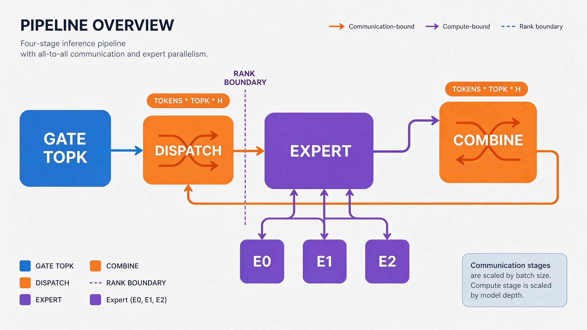

# LESSON 16 分布式推理与 EP 并行

> MoE 的并行和 dense 模型不是一回事。dense 切矩阵，MoE 切**专家**；切完之后每个 token 只去少数几个专家，于是产生"路由 + 全交换"这套新开销。

## TL;DR

- MoE 一层四步：gate/topk → dispatch → expert compute → combine。
- EP 把专家分到不同 rank，dispatch/combine 靠 all-to-all。
- `FusedMoE`（`fused_moe_triton/layer.py:350`）是通用实现，`DeepEPMoE`（`ep_moe/layer.py:64`）是 EP 专用实现。
- 通信量 ≈ `tokens × topk × hidden × dtype × 2`（去 + 回），与专家数无关，与 topk 线性相关。
- EP 的收益来自"专家放得下"，代价是 all-to-all 的延迟。

## 考点地图

- MoE 一层有哪几个阶段？各自的计算/通信特征？
- EP 和 TP 在 MoE 上有什么区别？
- all-to-all 的通信量怎么估？
- 为什么 topk 增大不一定变慢？
- FusedMoE 和 DeepEPMoE 怎么选？
- 负载不均衡会怎样？

## 16.1 四个阶段

```
hidden
  │ gate + topk
  ▼
routing weights + expert ids
  │ dispatch（按专家分桶、跨 rank 发送）
  ▼
expert compute（每个专家只算自己的 token）
  │ combine（按权重加权求和，跨 rank 收回）
  ▼
output
```



| 阶段 | 计算 | 通信 | 瓶颈 |
|---|---|---|---|
| gate/topk | 小 GEMM + topk | 无 | 延迟敏感 |
| dispatch | 排序/分桶 | all-to-all | 带宽 |
| expert compute | 大 GEMM | 无 | 算力 |
| combine | 加权求和 | all-to-all | 带宽 |

## 16.2 两种实现

```python
# fused_moe_triton/layer.py:350
class FusedMoE(torch.nn.Module):
    # 通用 MoE：专家在本 rank 内，按 local expert id 路由
```

```python
# ep_moe/layer.py:64
class DeepEPMoE(FusedMoE):
    # EP 专用：dispatch/combine 走 DeepEP 的 all-to-all
```

选择逻辑在 `get_moe_impl_class`（`ep_moe/layer.py:340`）：看 `--moe-a2a-backend` 与 EP 配置。

| 实现 | 适用 | 通信 |
|---|---|---|
| `FusedMoE` | 单卡或 TP | 无 all-to-all |
| `DeepEPMoE` | EP > 1 | DeepEP all-to-all |
| 其他 dispatcher | 特定硬件/传输 | mooncake、nixl、pplx 等 |

`token_dispatcher/` 目录下每个文件就是一种传输后端，接口一致，换后端不改模型代码。

### NORMAL 与 LOW_LATENCY

DeepEP 有两种 dispatch 模式，选错会差一个数量级：

| 模式 | 机制 | 适合 |
|---|---|---|
| `NORMAL` | layout + 可变长 all-to-all | prefill / 大 batch |
| `LOW_LATENCY` | 固定容量 masked buffer | decode / 小 batch |

`DeepEPMode.resolve`（`layers/moe/utils.py:355`）在 `AUTO` 下的规则：extend → NORMAL，decode → LOW_LATENCY。

LL 模式的 buffer 容量由 `num_max_dispatch_tokens_per_rank` 决定，默认 128 且上限 1024。超了就要改配置，否则直接断言失败。

### dispatch 的返回值必须传给 combine

`buffer.dispatch(...)` 返回一个不透明的 `handle`，`combine` 必须原样传回。它记录了"这一轮 token 被排成什么样"，丢了就无法把结果还原回原 rank。

### 没有 A2A 后端时怎么办

`StandardDispatcher`（`token_dispatcher/standard.py:168`）的处理很朴素：把不属于本 rank 的专家 id 映射成 `-1` 丢弃，每 rank 只算本地专家，最后对 EP 组做一次 all-reduce 求和。

因此要求**专家选择必须 rank-invariant**——所有 rank 看到的 topk_ids 一致，否则求和结果就错了。

## 16.3 路由：topk 是核心参数

```python
# topk.py:258
class TopKConfig:
    # top_k、renormalize、是否需要 output 格式转换
```

三个事实：

1. **topk 决定通信量**：每个 token 要发往 topk 个专家。
2. **topk 决定专家利用率**：topk 太小，热门专家排队；太大，通信和计算都涨。
3. **topk 的归一化方式影响数值**：`renormalize` 开关会让权重和从"原始 gate 值"变成"和为 1"。

## 16.4 通信量估算

设 token 数 `T`、topk `K`、隐藏维 `H`、每元素字节 `b`：

```
dispatch ≈ T * K * H * b
combine  ≈ T * K * H * b
总通信   ≈ 2 * T * K * H * b
```

注意它**与专家总数无关**，只与 topk 和 token 数有关。这解释了一个反直觉现象：增加专家数（扩大模型）不一定增加通信，但会增加显存和路由难度。

如果开 FP8 dispatch，`b` 减半，通信直接减半——这是 EP 场景下量化的重要动机。

## 16.5 EP 与 TP 的组合

| 组合 | 权重切分 | 通信 | 适用 |
|---|---|---|---|
| TP only | 所有专家都切 | all-reduce | 小 MoE、单机 |
| EP only | 专家分片 | all-to-all | 大 MoE、多机 |
| TP + EP | 专家内再切 | 两者都有 | 超大 MoE |

经验规则：**专家数 ≥ 8 且跨机时优先 EP**；单机内小 MoE 用 TP 更简单。

## 16.6 负载不均衡

路由是数据驱动的：热门专家可能收到 10 倍于平均的 token。后果：

- 某些 rank 算不完，其他 rank 空等（木桶效应）；
- all-to-all 的 buffer 按最坏情况分配，浪费显存。

这正是第 17 课 EPLB 要解决的问题。

## 16.7 设计取舍表

| 决策 | 选择 | 代价 | 替代 |
|---|---|---|---|
| 并行方式 | 大 MoE 用 EP | all-to-all 延迟 | TP（切不匀） |
| dispatch 精度 | 可 FP8 | 精度损失 | BF16（带宽翻倍） |
| topk | 模型给定 | 通信线性增长 | 动态 topk（实现复杂） |
| 后端 | DeepEP 为主 | 依赖特定库 | 通用 all-to-all（慢） |
| 负载 | 交给 EPLB | 额外重排开销 | 不管（长尾严重） |

## 16.8 动手验证

```bash
sglang serve --model-path <moe-model> --ep-size 8 --moe-a2a-backend deepep --port 30000
```

观察每层耗时与通信占比（开 profiler 或看日志）。对比 `--ep-size 1` 的吞吐，确认 all-to-all 开销是否被并行收益覆盖。

## 16.9 面试问答

**Q1：MoE 一层有哪几个阶段？**

- 一句话：gate/topk、dispatch、expert compute、combine。
- 展开：前两个决定"发给谁"，第三个是纯算力，最后按权重合并。
- 追问"哪个阶段最容易成为瓶颈"：跨机时是 all-to-all，单机时是专家 GEMM。

**Q2：EP 和 TP 的区别？**

- 一句话：TP 切每个专家的矩阵，EP 切专家本身。
- 展开：EP 下每个 rank 只有部分专家，token 要跨 rank 找专家。
- 追问"为什么 MoE 更适合 EP"：专家数量多，切开后每个 rank 的显存和计算都更均衡。

**Q3：all-to-all 通信量怎么估？**

- 一句话：`2 × tokens × topk × hidden × dtype_bytes`。
- 展开：去程 dispatch、回程 combine；与专家总数无关。
- 追问"怎么降"：FP8 dispatch、减少 topk、增大 batch 摊薄延迟。

**Q4：topk 增大为什么不一定变慢？**

- 一句话：专家并行度高时，多发的 token 可以并行处理。
- 展开：但通信量线性增长，跨机时会先撞带宽墙。
- 追问"怎么选"：看 accept 质量与通信成本的拐点，通常 2–8。

**Q5：负载不均衡的后果？**

- 一句话：木桶效应，最忙的 rank 决定整层延迟。
- 展开：buffer 按最坏情况分配，显存也浪费。
- 追问"怎么解"：EPLB 复制热门专家并重排。

## 16.10 一页速记

```
四阶段 gate/topk → dispatch → expert compute → combine
实现   FusedMoE(350) / DeepEPMoE(64)；选择 get_moe_impl_class(340)
路由   TopKConfig(258)：top_k + renormalize
通信   ≈ 2 × T × K × H × b
后端   token_dispatcher/{standard, deepep, mooncake, nixl, pplx}
问题   负载不均衡 → 第 17 课
```

## 挂载点

- 上游：第 15 课的 EP 组；第 08 课的量化决定 dispatch 精度。
- 下游：第 17 课在 EP 之上做专家重排与冗余。
