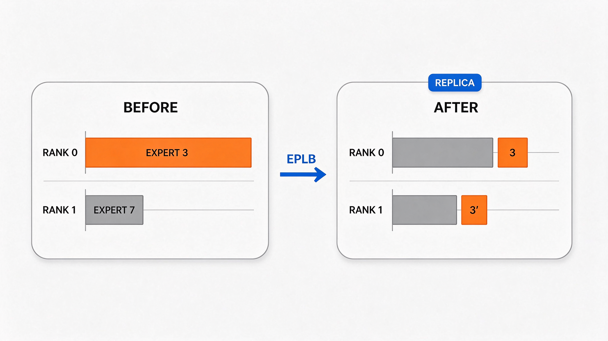

# LESSON 17 EPLB 专家负载均衡

> EPLB 解决的是 MoE 的路由偏斜：热门专家被挤爆，冷门专家闲着。核心手段就两个——**复制热门专家**、**把副本放到不同的 rank 上**。

## TL;DR

- 三段：统计（recorder）→ 求解（rebalance）→ 迁移（updater）。
- 冗余专家（redundant experts）是核心：热门专家复制多份，副本分担流量。
- 重排后必须**恢复权重**：新位置上的专家要从原位置拷贝参数。
- 触发时机由 `EPLBManager` 控制，通常在统计窗口结束时。
- 不均衡不解决，整层延迟由最忙的 rank 决定。

## 考点地图

- EPLB 解决什么问题？不解决会怎样？
- 冗余专家是怎么起作用的？
- 负载统计统计的是什么？在哪个粒度上？
- 重排算法在优化什么目标？
- 重排后权重怎么恢复？
- EPLB 和 EP 的组是什么关系？

## 17.1 问题：路由是数据驱动的

MoE 的 gate 按 token 选专家，而 token 分布不均匀。结果：

```
rank0: expert 3 收到 1200 token   ← 忙死
rank1: expert 7 收到  200 token   ← 闲着
```



EP 下每个 rank 只算自己的专家，所以整层延迟 = 最忙 rank 的延迟。复制热门专家可以把流量摊开。

## 17.2 统计

```python
# expert_distribution.py:135
class ExpertDistributionRecorder(ABC):
    # 记录每个 (layer, expert) 收到的 token 数
```

统计粒度是 **(layer, logical expert)**，不是物理副本。因为重排要在逻辑专家层面做决策，物理副本只是执行手段。

统计窗口通常是若干 step，窗口太短会被噪声主导，太长则反应迟钝。

## 17.3 求解

```python
# eplb_algorithms/deepseek.py:171
def rebalance_experts(hidden_states, num_replicas, num_groups, ...):
    # 返回新的物理布局
```

三个子问题：

| 子问题 | 函数 | 目标 |
|---|---|---|
| 分组打包 | `balanced_packing`（`deepseek.py:7`） | 把专家均匀装进 rank |
| 复制 | `replicate_experts`（`deepseek.py:55`） | 给热门专家加副本 |
| 全局重排 | `rebalance_experts`（`deepseek.py:171`） | 同时满足容量与均衡 |

目标函数通常是"最小化最大 rank 负载"，约束是每个 rank 的显存能放下的专家数。

## 17.4 布局与迁移

```python
# expert_location.py:74
class ExpertLocationMetadata:
    # logical expert ↔ (rank, local slot) 的映射
```

```python
# expert_location_updater.py:43
class ExpertLocationUpdater:
    def update(self, ...):
        # 计算哪些权重需要搬，发起 p2p 拷贝
```

迁移的难点：

1. **权重要搬**：新 slot 上的专家参数必须从原位置复制。
2. **要一致**：所有 rank 必须在同一时刻切换到新布局，否则路由会打到空 slot。
3. **要可恢复**：迁移中途失败不能留下半套布局。

`update_expert_location_with_recovery`（`eplb_manager.py:298`）就是为第 3 点准备的：先备份/校验，再切换。

## 17.5 触发与执行

```python
# eplb_manager.py:29
class EPLBManager:
    # 管理统计窗口、触发重排、调用 updater
```

一次完整的 EPLB：

```
统计窗口结束
   → 汇总各 rank 的 expert 计数
   → rebalance_experts 求新布局
   → ExpertLocationUpdater 搬迁权重
   → 广播新 metadata
   → 清空统计，进入下一窗口
```

### 默认是关的

| 参数 | 默认值 | 含义 |
|---|---|---|
| `enable_eplb` | False | 总开关 |
| `ep_num_redundant_experts` | 0 | 冗余专家数 |
| `eplb_rebalance_num_iterations` | 1000 | 每多少次 forward 尝试一次 |

而且物理专家数 = 逻辑专家数 + 冗余数，**必须能被 `ep_size` 整除**，否则启动即报错。

### 第二道闸门：利用率

步数到了也不一定重排。`_check_rebalance_needed`（`eplb_manager.py:225`）会看窗口平均利用率：

```
每层利用率 = avg(各 GPU 的 token 计数) / max(各 GPU 的 token 计数)
总利用率   = 先对各层取平均，再取最近 1000 步窗口的均值
```

（历史里同时维护 10 / 100 / 1000 三档窗口，`_get_global_average_utilization_rate`（`expert_distribution.py:1049`）实际取最长的那档，即 `window_sizes[-1]`。）

只有低于 `eplb_min_rebalancing_utilization_threshold` 才继续。**阈值默认 1.0，等价于不设阈值**——所以默认行为其实是纯步数触发。

### 权重怎么搬

`ExpertLocationUpdater` 的组织方式是：

1. 本地缺的专家 `irecv`，多出的 `isend`。
2. 源优先级：同 rank → 同节点 → 跨节点。
3. 收到的数据先进 **temp buffer**，再 copy 回权重切片——避免覆盖还没发走的副本。

如果某个专家在迁移中丢了，会记入 `p2p_missing_logical_experts`，随后从 DRAM 备份或磁盘定向重载（`eplb_manager.py:320`）。这是"可恢复"三个字的实际含义。

## 17.6 与 EP 的关系

| 概念 | 作用 |
|---|---|
| EP | 把专家分到不同 rank |
| EPLB | 决定"哪个专家放在哪个 rank、放几份" |
| 冗余专家 | EPLB 的执行手段 |

没有 EPLB 的 EP 也能跑，只是负载不均时性能差。有了 EPLB，EP 的 rank 数可以更激进。

## 17.7 设计取舍表

| 决策 | 选择 | 代价 | 替代 |
|---|---|---|---|
| 统计粒度 | (layer, logical expert) | 需要额外计数 buffer | 只统计全局（无信息） |
| 窗口 | 固定步数 | 反应滞后 | 每步（噪声大） |
| 冗余 | 复制热门专家 | 显存 | 不复制（长尾） |
| 迁移 | p2p 拷贝 | 暂停与带宽 | 重算（不可行） |
| 触发 | 阈值/周期 | 需要调参 | 固定周期（不灵活） |

## 17.8 动手验证

开 EPLB 并观察日志：

```bash
sglang serve --model-path <moe-model> --ep-size 8 --enable-eplb --port 30000
```

```bash
sglang serve ... --log-level info 2>&1 | grep -i "eplb\|rebalance" | head
```

对比开启前后的吞吐与各 rank 的利用率。如果流量本身很均匀，EPLB 的收益会很小，甚至因为重排开销而变慢。

## 17.9 面试问答

**Q1：EPLB 解决什么问题？**

- 一句话：MoE 路由偏斜导致 rank 间负载不均。
- 展开：最忙 rank 决定整层延迟，复制热门专家可以摊平。
- 追问"不解决会怎样"：木桶效应，扩 EP 也无效。

**Q2：冗余专家怎么起作用？**

- 一句话：给热门专家复制多份，副本分布到不同 rank。
- 展开：路由时把 token 分给副本，单 rank 流量下降。
- 追问"代价"：副本占显存，且要保证副本权重一致。

**Q3：统计粒度是什么？**

- 一句话：(layer, logical expert) 的 token 计数。
- 展开：逻辑专家层面做决策，物理副本只是执行。
- 追问"窗口多长"：太短噪声大，太长反应慢，通常按步数。

**Q4：重排后权重怎么恢复？**

- 一句话：按新布局做 p2p 拷贝，把参数搬到新 slot。
- 展开：`ExpertLocationUpdater` 计算搬迁计划；`update_expert_location_with_recovery` 保证失败可恢复。
- 追问"能在线做吗"：能，但要短暂暂停或双缓冲。

**Q5：EPLB 一定有效吗？**

- 一句话：取决于流量是否真的偏斜。
- 展开：均匀流量下重排开销大于收益；偏斜严重时收益显著。
- 追问"怎么判断"：看统计直方图与各 rank 利用率。

## 17.10 一页速记

```
三段   统计(135) → 求解(rebalance 171) → 迁移(updater 43)
算法   balanced_packing(7) / replicate_experts(55) / rebalance_experts(171)
布局   ExpertLocationMetadata(74)：logical ↔ (rank, slot)
执行   EPLBManager(29)；失败恢复 update_expert_location_with_recovery(298)
前提   EP 已开启；偏斜越严重收益越大
```

## 挂载点

- 上游：第 16 课的 EP 布局；第 05 课的 post-load 阶段挂 EPLB 初始化。
- 全书终点：到这里，请求链、缓存、调度、精度、图执行、分布式与负载均衡已经闭环。
