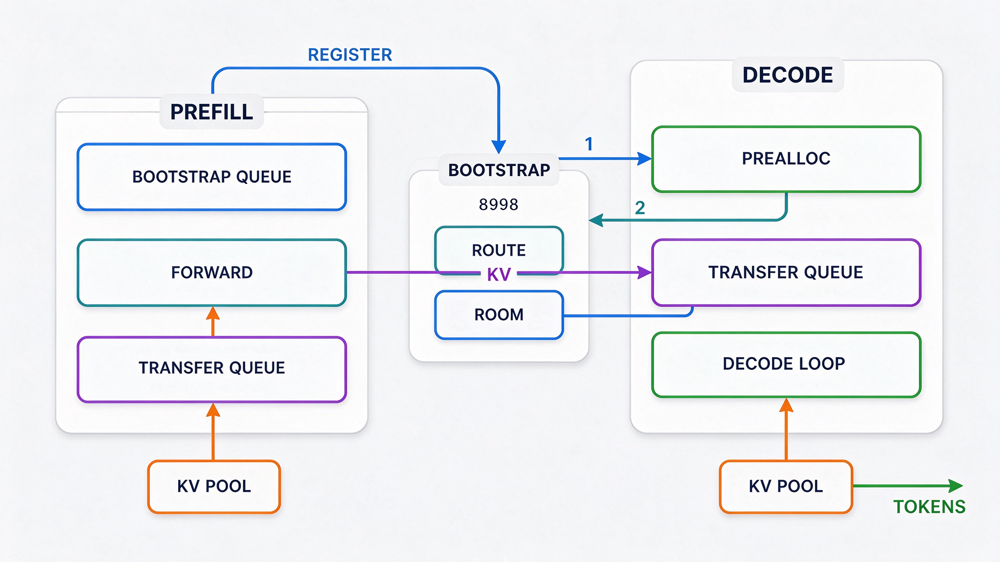
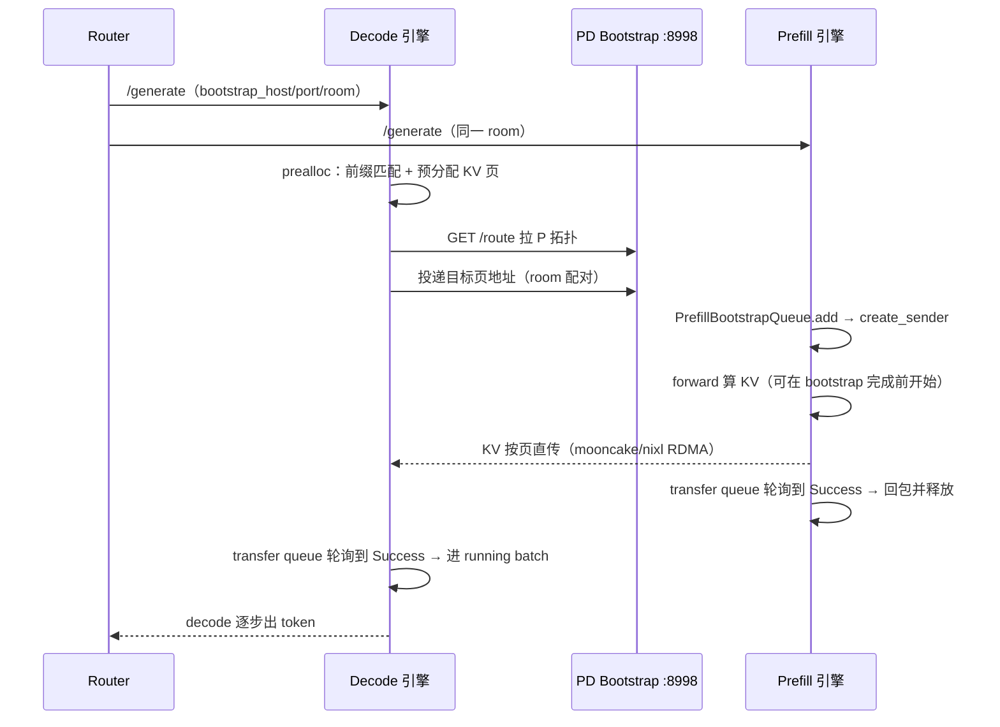

# LESSON 18 PD 分离（Prefill / Decode Disaggregation）

> 前面 17 讲把一次请求当成"一个引擎里的一条流水"。PD 分离把这条流水从中间切开：**prefill 一组机器、decode 一组机器，中间只传 KV**。这一课的重点不是"怎么配"，而是切开之后**谁在等谁**。

## TL;DR

- 切开的理由：prefill 是 compute-bound 的大 GEMM，decode 是 memory-bandwidth-bound 的单 token 循环，两者最优的并行度完全不同。
- 一条 PD 请求有**两个引擎、两个 batch、一个 64 位的 room id** 参与配对；配对信息是请求字段 `bootstrap_host / port / room`。
- 两侧各有三段队列：P 侧 `bootstrap → prefill → transfer`，D 侧 `prealloc → transfer → decode`。
- 传输状态机只有五态：`Bootstrapping → WaitingForInput → Transferring → Success/Failed`（`KVPoll`）。
- 最大代价是 **KV 过一次网络**，以及随之而来的新失败模式：连不上、传一半、校验不一致、D 侧 KV 被 retract 后要重算。

## 考点地图

- 为什么 PD 分离能同时改善 TTFT 和 TPOT？
- prefill 节点和 decode 节点的 TP/PP 为什么可以不一样？
- `bootstrap_host`、`bootstrap_port`、`bootstrap_room` 各是谁填的？
- P 侧为什么要有 `bootstrap` 和 `transfer` 两个队列？
- D 侧为什么要先 prealloc 再等 KV？
- KV 传输失败后，请求会怎么收场？
- `--disaggregation-decode-allocation-policy` 的 early / prefill_complete 差在哪？

## 18.1 为什么要把两段拆开

一次生成的两段负载性质完全不同：

| 阶段 | 计算形态 | 瓶颈 | 优化目标 | 最优并行 |
|---|---|---|---|---|
| Prefill | 一次处理整段 prompt，大 GEMM | 算力（compute-bound） | TTFT | 高 TP、甚至 PP/CP |
| Decode | 每步 1 token，读全部权重 + KV | 显存带宽（memory-bound） | TPOT | 大 TP/DP、大 batch |

混在一个引擎里，03 讲的"prefill 优先"就是拿 decode 的尾延迟换 TTFT：一条长 prompt 进来，所有 decode 请求都要等它把 prefill 算完。

拆开之后，两边可以各自选型。真实配置里这种差异很极端：同一份 GLM-5.3 权重，prefill 侧是 `tp8 + pp4 + attn_cp8`，decode 侧是 `tp32 + attn_dp32`——因为 P 要的是算力与长序列切分，D 要的是显存带宽与并发。

代价也很直接：

1. **KV 必须走一次网络**（节点内 NVLink 不再是默认路径）。
2. 多一层**配对与失败处理**：谁先来、谁等谁、传丢了怎么办。
3. 两侧的 `page_size`、KV dtype、TP 布局要能对上，否则传过去是错的。

## 18.2 三种角色与启动参数

`DisaggregationMode` 只有三个值（`disaggregation/mode.py:8`）：

| 值 | 含义 | 起什么 |
|---|---|---|
| `null` | 不分离 | 01/03 讲的普通引擎 |
| `prefill` | 只做 prefill，算完把 KV 发给 D | P 引擎 |
| `decode` | 只做 decode，等 KV 到了再算 | D 引擎 |

> 注意：P 和 D 不是"一个进程里两个角色"，而是**两套独立的 `sglang serve` 进程组**，各自有自己的 HTTP 端口、TP 组和显存池。`role_switch` 那套弹性伸缩属于另一个话题，不在这里。

关键参数（`arg_groups/fields/disagg.py`）：

| 参数 | 默认 | 作用 |
|---|---|---|
| `--disaggregation-mode` | `null` | 选 prefill / decode（55 行） |
| `--disaggregation-transfer-backend` | `mooncake` | KV 传输后端（65 行） |
| `--disaggregation-bootstrap-port` | `8998` | P 侧的会合点端口（81 行） |
| `--disaggregation-ib-device` | `None` | RDMA 网卡，可单卡、逗号列表或 per-GPU JSON |
| `--disaggregation-decode-allocation-policy` | `early` | D 侧什么时候预留 KV |
| `--disaggregation-enable-kv-checksum` | `False` | 传完做 Adler-32 校验（71 行） |
| `--optimistic-prefill-attempts` | `0` | 允许 P 不等 bootstrap 就先 forward 的次数 |

两边绝大部分参数必须一致或兼容：模型、`page_size`、KV dtype。TP/PP/DP 可以不同，这正是分离的意义。

## 18.3 两个 bootstrap，别搞混

SGLang 里叫 "bootstrap" 的东西有两个，职责完全不同：

| 名字 | 实体 | 干什么 |
|---|---|---|
| Engine info bootstrap | `EngineInfoBootstrapServer`（`entrypoints/engine_info_bootstrap_server.py:76`） | 每个 `ModelRunner` 启动后 PUT 自己的 transfer engine 注册信息；外部 `GET /get_transfer_engine_info?rank=` 取，用来做 RDMA 寻址 |
| PD bootstrap | `CommonKVBootstrapServer`（`disaggregation/common/conn.py:3244`） | P 侧的会合点：登记 rank 拓扑、按 room 配对请求 |

PD bootstrap 的路由很少（`disaggregation/common/conn.py:3304`）：

```python
self.app.router.add_route("*", "/route", self._handle_route)
self.app.router.add_post("/register_dp_rank", self._handle_register_dp_rank)
self.app.router.add_post("/query_dp_ranks", self._handle_query_dp_ranks)
self.app.router.add_get("/health", self._handle_health_check)
```

- `PUT /route`：P 的每个 rank 把自己登记进来（`register_to_bootstrap`，`disaggregation/common/conn.py:1765`），带 `attn_tp/cp/dp`、`pp`、`rank_ip/rank_port`、`page_size`、`kv_cache_dtype`、`kv_layout`。
- `GET /route`：D 侧来拉 P 的拓扑，决定把 KV 投给哪个 P rank。
- `/register_dp_rank`、`/query_dp_ranks`：多 DP 时决定"这个请求该找哪个 P DP rank"。
- `/health`：`8998` 上探活最快的方式。

请求侧的三个字段（`managers/io_struct.py:350`）：

```python
bootstrap_host: Optional[Union[List[Optional[str]], str]] = None
bootstrap_port: Optional[Union[List[Optional[int]], int]] = None
bootstrap_room: Optional[Union[List[Optional[int]], int]] = None
bootstrap_pair_key: Optional[Union[List[Optional[str]], str]] = None
```

`bootstrap_host/port` 指向 P 的会合点，`bootstrap_room` 是这次配对的键——由路由器分配（64 位空间，`[0, 2^63)`），P 和 D 拿同一个 room 才能认出"我们说的是同一条请求"。批量请求时这四个字段会被 `_normalize_bootstrap_params` 展开成等长列表（`io_struct.py:1040`）。

## 18.4 一条 PD 请求的时序





要记住的只有一句：**D 先准备"把 KV 放哪"，P 后算"KV 是什么"，中间用 room 对上号。**

> 上面画的是"两边都收到请求"的理想顺序。实际是路由器把同一份请求投给 P 和 D、并注入同一个 room；两边派发的先后由路由策略决定，P 早一点、D 晚一点都不影响配对，因为 room 才是唯一键。

## 18.5 P 侧：三段队列

入口在 `PrefillBootstrapQueue.add`（`disaggregation/prefill.py:560`）：

```python
def add(self, req: Req, num_kv_heads: int) -> None:
    if is_unadmitted_reject(req):
        self.scheduler.request_retirer.retire_unadmitted(req)
        return
    if self._check_if_req_exceed_kv_capacity(req):
        return
    self.create_sender(req, num_kv_heads)
    move([req], self.queue)
```

`create_sender`（510 行）按 room 建一个 sender，连到 `bootstrap_addr`；之后每轮由 `move_bootstrapped`（606 行）统一 poll：

```python
polls = poll_and_all_reduce_prefill_pp(...)   # PP 时
# 或 poll_and_all_reduce_attn_cp_tp_group(...)
for req, poll in zip(queue, polls):
    if poll == KVPoll.Failed:
        self.scheduler.handle_bootstrap_failure(req)
    elif poll == KVPoll.Bootstrapping:
        if not req.is_retracted and self.can_prefill_before_bootstrap(req):
            ...
```

两个细节值得记：

1. **poll 是整组共识**。TP/CP（PP 再加一层）都会 all-reduce，一个 rank 的 handshake 没完成，整组都不会放行——否则各 rank 会算出不同的 KV 偏移。
2. **默认必须 bootstrap 完成才 forward**。`can_prefill_before_bootstrap`（593 行）允许乐观执行，但 `--optimistic-prefill-attempts` 默认 0，等于关闭；`prefill_complete` 策略下这条限制被绕过。

prefill 算完后，`process_batch_result_disagg_prefill`（1149 行）把完成的请求塞进 `disagg_prefill_transfer_queue`；真正的 `sender.send` 在传输队列里按页分段发出（2050 行一带）。D 侧如果有前缀命中，P 只传缺的那段（`decode_prefix_len`），这也是 D 侧 radix cache 在 PD 里依然有用的原因。

真正的收尾在 `process_disagg_prefill_transfer_queue`（1410 行）：轮询到 `Success` 才给客户端回包并释放请求。PP 场景下 poll 还要取跨 stage 共识（`poll_pp_consensus`，`disaggregation/utils.py:313`），避免一个 stage 说成功、另一个说失败。

调度循环由 `SchedulerDisaggregationPrefillMixin`（675 行）提供，`event_loop_normal_disagg_prefill`（856 行）与普通循环同构，只是把 `get_next_batch_to_run` 换成了 PD 版本（818 行的 `get_next_disagg_prefill_batch_to_run`），并把多个队列拼进同一个 `ListKind` 集合。

## 18.6 D 侧：三段队列

第一段是 `DecodePreallocQueue.add`（`disaggregation/decode.py:1114`），它做三件事：

1. **前缀匹配**：`_match_prefix_and_lock` 在本机 radix tree 里找已有前缀，命中多少就少传多少。
2. **预分配**：按 token 预算在 KV 池里占好目标页——这就是 `early` 策略：KV 还没来，坑先挖好。
3. **建 receiver**：`_create_receiver_and_enqueue` → `_resolve_prefill_dp_rank` → `_init_receiver`（1426 行）。

```python
def _init_receiver(self, decode_req: DecodeRequest, prefill_dp_rank: int) -> None:
    decode_req.awaiting_prefill_dp_rank = False
    decode_req.kv_receiver.init(prefill_dp_rank)
    if (
        get_disagg().disaggregation_decode_allocation_policy == "prefill_complete"
        and decode_req.kv_receiver.conclude_state != KVPoll.Failed
    ):
        decode_req.req.disagg_prefill_dp_rank = prefill_dp_rank
        if decode_req.is_rebootstrap:
            self._submit_prefill_recompute(decode_req)
```

第二段是 `publish_pending_destinations`（2040 行）：把"KV 该落到哪"打包发给 P。目的地不一定是显存——`SGLANG_DISAGG_STAGING_BUFFER` 打开且模型不是 MLA 时，可以先落 staging/host buffer 再搬回设备（`--disaggregation-decode-host-receive-threshold` 默认 1.0，即关闭这条路径，且当前内置后端不一定支持 host 目的地）。

第三段是 `DecodeTransferQueue`（3303 行）纯轮询。`Success` 之后请求才被 `move_transferred` 抬进 running batch，开始 decode；在此之前它不在任何 forward batch 里。

`event_loop_normal_disagg_decode`（4066 行）每轮先 `prefetch_prefill_dp_rank_queries()`（提前解析 P rank），再 `ingest_requests()`，然后 `process_decode_queue()`。

## 18.7 传输层：传什么、谁传、怎么寻址

**传什么**：页粒度的 KV，不是 logits、不是 token。`KVArgs` 里每一层一组 `ptr / len / item_len`，外加 `state_types` 标明这是 MHA、MLA、SWA、DSA、Mamba 还是 block-scale 的哪种子池——所以 MLA 模型、混合注意力模型都能只传自己真正持有的那部分。

**谁传**：抽象在 `BaseKVManager`，公共实现是 `CommonKVManager`（`common/conn.py:311`），sender/receiver 成对创建。后端矩阵：

| backend | 场景 | 说明 |
|---|---|---|
| `mooncake`（默认） | 通用 RDMA | 生产最常用，支持 IB 设备映射 |
| `mooncake_tcp` | 没有 RDMA | 降级到 TCP，带宽明显低于 RDMA |
| `nixl` | NIXL/UCX 生态 | 支持 per-GPU 的 UCX_NET_DEVICES |
| `mori` | 特定硬件 | 第三方传输 |
| `ascend` | 昇腾 | NPU 路径 |
| `fake` | 测试/CI | 不真传，只走握手，用于跑通流程 |

**怎么寻址**：显存注册一次（engine info bootstrap 收集），之后只传页索引和偏移，由 backend 直接 RDMA 写到 D 的地址上。P 和 D 的 attention TP 宽度可以不同，代码按 `state_dim_per_tensor` 把每层张量按 head 切片后再拼——这是"P 用 tp8、D 用 tp32"能成立的前提。

**校验**：`--disaggregation-enable-kv-checksum` 打开后，P 对每个请求的 KV 页算 Adler-32，D 侧核对（`fields/disagg.py:71`）。不一致直接 abort，而不是静默重传。默认关，因为多一遍读 KV 的带宽。

## 18.8 失败、重试与 rebootstrap

`KVPoll` 五态（`disaggregation/base/conn.py:142`）：

```python
class KVPoll:
    Failed = 0
    Bootstrapping = 1
    WaitingForInput = 2
    Transferring = 3
    Success = 4
```

`Bootstrapping → WaitingForInput` 发生在 D 把预分配信息交上来之后（`mooncake/conn.py:3384`）：这时配对已完成，P 可以发、D 等着收；`Transferring` 才是数据真正在链路上。反过来说，P 即使先算完了，也不能越过状态机直接发。失败路径分两类：

| 阶段 | 处理 |
|---|---|
| bootstrap 失败 | `handle_bootstrap_failure`：请求退出队列、回错误 |
| 传输中失败 | `handle_inflight_transfer_failure`：同上，并按 PP 共识让所有 stage 一致 |
| 校验不一致 | abort，客户端收到错误（不会拿到坏 KV 继续算） |

还有一条容易被忽略的回路：**PD true retraction**。D 侧显存不够把请求踢掉（06 讲的 retract），KV 被释放后，前缀不能从本地恢复，只能让原 P 重算——所以 `DecodePreallocQueue.add(..., is_rebootstrap=True)`，在 `prefill_complete` 分配策略下由 `_submit_prefill_recompute`（`common/conn.py:1355`）向 P 的 `/generate` 投一条重算请求，走已经建好的通道把新 KV 传回来。这条路径要求 P 知道自己 HTTP 端口（`prefill_http_port` 随 `/route` 注册）。

## 18.9 设计取舍表

| 决策 | 选择 | 代价 | 替代 |
|---|---|---|---|
| 部署形态 | P/D 两组独立引擎 | 多一次网络 KV、多一套运维 | 混部（TTFT/TPOT 互相拖） |
| 配对方式 | 64 位 room + bootstrap 会合点 | 需要路由器配合注入 | 固定映射（不灵活） |
| D 侧分配 | `early` 先占坑 | KV 没来也占显存 | `prefill_complete` 后分配（省显存、慢） |
| 传输 | RDMA 页直传 | 依赖 IB 与注册 | TCP（带宽明显更低） |
| 落点 | 默认设备显存 | 受 D 侧空闲约束 | host staging（当前支持面有限） |
| 校验 | 默认关 | 坏了只能靠 abort 发现 | 全量 Adler-32（多读一遍 KV） |
| 乐观 prefill | 默认关 | 省一次等待 | 打开后 handshake 失败要回滚已算的 KV |

## 18.10 动手验证

最小双进程（单机两卡，各占一张，避免和普通服务抢卡）：

```bash
# P：只 prefill，开 8998
sglang serve --model-path Qwen/Qwen3-0.6B --disaggregation-mode prefill \
  --disaggregation-bootstrap-port 8998 --port 30001 --tp-size 1 --base-gpu-id 0

# D：只 decode
sglang serve --model-path Qwen/Qwen3-0.6B --disaggregation-mode decode \
  --port 30002 --tp-size 1 --base-gpu-id 1
```

先探活会合点，再手工构造一条带 room 的请求（生产里由路由器注入）：

```bash
curl -s http://127.0.0.1:8998/health          # 期望 OK
curl -s http://127.0.0.1:8998/route | head -c 400   # 看 P 的 rank 拓扑
```

```bash
# 送给 P（room 自己指定，实际由 router 分配）
curl -s http://127.0.0.1:30001/generate -H "Content-Type: application/json" \
  -d '{"text":"解释 KV Cache","sampling_params":{"max_new_tokens":8},
       "bootstrap_host":"127.0.0.1","bootstrap_port":8998,"bootstrap_room":12345}'
```

观察三件事：

- P 日志里出现 `Bootstrapping` 的轮询；只有 P 收请求时会一直卡在这个状态，直到 bootstrap 超时（想跑通必须给 D 也投一条同 room 的请求）；
- D 侧在 KV 到达前不会出现在 decode 的 running batch 里（`--log-level info` 看队列长度）；
- 把 D 停掉，P 的请求会走 `handle_bootstrap_failure` 直接回错，而不是挂死。

## 18.11 面试问答

**Q1：为什么 PD 分离能同时改善 TTFT 和 TPOT？**

- 一句话：把算力密集的 prefill 和带宽密集的 decode 放到各自最优的硬件与并行配置上，互不打断。
- 展开：混部时 prefill 优先会占住整个 step；分离后 D 的 step 节拍只由 decode 决定，P 的长 prompt 只是让 KV 晚到。
- 追问"代价"：KV 走网络，且 D 要为空 KV 预留显存（`early` 策略下）。

**Q2：P 和 D 的 TP 可以不一样吗？**

- 一句话：可以，按 KV head 切片传输。
- 展开：`KVArgs` 记录每层 layout，`state_dim_per_tensor` 描述按哪个维度切；D 用 32 卡、P 用 8 卡时，P 传过去的是 head 分片，D 侧再落到自己的布局。
- 追问"哪里会不兼容"：`page_size`、KV dtype、SWA/DSA 子池类型必须能对上。

**Q3：bootstrap 到底解决了什么问题？**

- 一句话：让两组完全独立的进程认出"同一条请求"，并交换寻址信息。
- 展开：room 是配对键，`/route` 登记 P 的 rank 拓扑，D 把目标页地址投进同一个 room，P 的 sender 才能发。
- 追问"为什么不用请求 id"：跨引擎的 rid 不共享，room 由路由器统一分配才唯一。

**Q4：D 为什么先 prealloc？**

- 一句话：KV 是"推到固定地址"的，地址必须先存在。
- 展开：`DecodePreallocQueue` 先做前缀匹配、占页，再 `publish_pending_destinations`；`early` 让传输和 P 的 forward 重叠。
- 追问"没 KV 来怎么办"：`prefill_complete` 策略改成 P 算完再分配，省显存但少了重叠。

**Q5：传输失败了请求会怎样？**

- 一句话：abort 回错，不返回半截结果。
- 展开：`KVPoll.Failed` → `handle_bootstrap_failure` / `handle_inflight_transfer_failure`，PP 下用共识保证所有 stage 一起失败。
- 追问"能重试吗"：普通失败不重传；只有 retract 后的 rebootstrap 会重新向 P 要一次 KV。

## 18.12 一页速记

```
模式    null / prefill / decode（mode.py:8）
配对    bootstrap_host + port(8998) + room；PUT /route 登记，GET /route 拉拓扑
P 侧    PrefillBootstrapQueue.add(560) → create_sender → forward → transfer queue(1410)
D 侧    DecodePreallocQueue.add(1114) → publish dest(2040) → DecodeTransferQueue(3303) → decode
状态    Failed/Bootstrapping/WaitingForInput/Transferring/Success（conn.py:142）
传输    页级 KV + 子池类型；mooncake/nixl/mori/ascend/fake；按 head 切片跨 TP
校验    --disaggregation-enable-kv-checksum（Adler-32，默认关）
失败    bootstrap/transfer 失败都 abort；retract 触发 rebootstrap 回原 P 重算
```

## 挂载点

- 上游：03 的请求主链（PD 只是把 Scheduler 换成 P/D 两个），06 的 retract（触发 rebootstrap），04 的 radix cache（D 侧命中可少传）。
- 相邻：15 的 TP/PP/DP 选型——PD 的本质是让 P 和 D 各自选型。
- 下游：19 的约束解码在 PD 下同样生效，grammar 状态跟着请求走，不跟着 KV 走。
