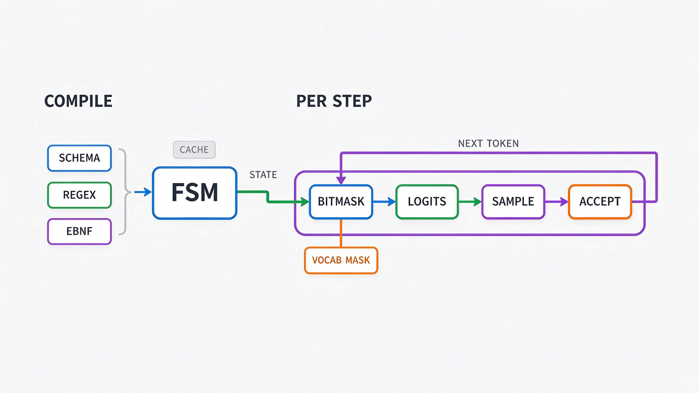

# LESSON 19 约束解码（Constrained Decoding）

> 约束解码不是"提示词里写'请输出 JSON'"。它是**每一步都把非法 token 的概率压成 0**：模型只能在高概率的合法 token 里挑。这一课讲 SGLang 怎么把 schema 编译成状态机、怎么在每步造 mask、以及推测解码下怎么"截断"。

## TL;DR

- 一条约束请求要过三个环节：**编译**（schema/regex/EBNF → 状态机）→ **每步 mask**（合法 token 位图 → logits）→ **推进**（接受 token 后 FSM 前进一步）。
- 编译是**异步 + 缓存**的：`Future` 提交到线程池，结果按字节数做 LRU（默认上限 1 GiB），每个请求再 `copy()` 出独立 matcher。
- `grammar_queue` 是继 `waiting_queue` 之后的**第三条队列**：编译没完成的请求不能进 prefill 批。
- 每步的 mask 是 CPU 生成、GPU 应用的：`int32` 位图按 batch×vocab 分配，一次 non-blocking H2D，Triton kernel 把非法位置写成 `-inf`。
- 编译失败**不会静默退化成无约束**，而是直接 abort 这条请求。

## 考点地图

- 约束解码和 "JSON mode" 的区别？
- 为什么要在采样前而不是采样后过滤？
- `json_schema / regex / ebnf / structural_tag` 分别落到哪个 `dispatch_*`？
- 编译为什么是异步的？缓存 key 是什么？
- mask 的显存/带宽开销怎么估？
- 推测解码一次接受多个 token，文法状态机怎么跟？
- overlap 模式下为什么必须"先推进 FSM，再生成下一批 mask"？

## 19.1 它解决什么问题

"提示词约束"只能提高概率，不能保证；后处理过滤会破坏分布、还得重采样。约束解码换了个思路：**把合法性检查前移到采样那一刻**。

```
xgrammar FSM（当前状态）
   │ fill_vocab_mask：哪些 token 能让状态继续合法
   ▼
bitmask（batch × vocab 位图）
   │ apply：非法 token 的 logits 置 -inf
   ▼
采样（top-k / top-p / greedy）
   │ accept_token：把选中的 token 吃进 FSM
   ▼
新状态 ──► 下一步
```



三个直接后果：

1. **输出一定可解析**：不依赖模型听话，JSON 一定能 `json.loads`。
2. **采样分布被改写**：本质是条件采样 `p(token | prefix ∈ L(grammar))`，这也是它和"事后过滤"最大的区别。
3. **代价在每步**：每生成一个 token 都要重新算一次 mask，成本随 batch 和 vocab 线性增长。

## 19.2 四种约束与请求入口

| 约束 | 语义 | 落到哪 |
|---|---|---|
| `json_schema` | 严格按 JSON Schema 输出 | `dispatch_json`（`base_grammar_backend.py:286`） |
| `regex` | 匹配正则 | `dispatch_regex` |
| `ebnf` | 上下文无关文法 | `dispatch_ebnf`（另有 `full_assistant_ebnf` 变体） |
| `structural_tag` | 固定框架 + 内嵌 schema，常用于工具调用 | `dispatch_structural_tag` |

OpenAI 兼容层的映射很直接（`entrypoints/openai/protocol.py:1369` 一带）：

```python
if response_format and response_format.type == "json_schema":
    sampling_params["json_schema"] = convert_json_schema_to_str(...)
elif response_format and response_format.type == "json_object":
    sampling_params["json_schema"] = '{"type": "object"}'
elif response_format and response_format.type == "structural_tag":
    sampling_params["structural_tag"] = ...
```

注意 `json_object` 只是"任意合法 JSON"，被翻译成 `{"type": "object"}`——**它不校验字段**，要字段约束必须用 `json_schema`。

工具调用走的是 `ToolCallConstraint`：`tool_choice=required` 或指定函数时，会把"函数名 + 参数 schema"编成 `structural_tag`。这条路和 `response_format` 互斥，同时给会直接报错（`protocol.py:1389`）。

## 19.3 Backend 家族

`--grammar-backend` 可选四个值（`arg_groups/choices.py:193`）：

| 值 | 引擎 | 适合 |
|---|---|---|
| `xgrammar`（默认） | xgrammar 的 FSM | JSON / regex / EBNF / structural tag，社区主流 |
| `outlines` | outlines 的 index 自动机 | regex 为主，老生态 |
| `llguidance` | llguidance | 需要它的 tokenizer/内核路径 |
| `none` | 不编译 | 关掉约束；此时带约束的请求直接 abort |

默认值在 `handle_grammar_backend` 里补成 `xgrammar`（`arg_groups/serving_hook.py:251`），所以不传也是约束可用的。

抽象层是 `BaseGrammarBackend`（195 行）。所有 backend 都实现同一组 `dispatch_*`，不支持的返回 `InvalidGrammarObject` 而不是抛异常：

```python
def dispatch_json(self, key_string: str) -> BaseGrammarObject:
    return self._not_supported("json", key_string)
```

这个设计决定了失败语义：**不支持 = 明确失败**，不是静默退化。`process_req_with_grammar` 一旦发现是 `InvalidGrammarObject`，直接 `set_finish_with_abort`。

## 19.4 编译：Future + 按字节 LRU

编译（尤其 xgrammar 建 token 表）是毫秒级到百毫秒级的 CPU 工作，不能塞进调度循环。SGLang 的做法是提交线程池，先返回 `Future`：

```python
# base_grammar_backend.py:323
value = self.cache.get(key)
if value:
    self.cache.move_to_end(key)
    copied_value = value.copy()
    return copied_value, True
value = self.executor.submit(self._init_value_dispatch, key, require_reasoning)
return value, False
```

三个要点：

1. **缓存 key 默认就是 `(类型, 文本)`**；一旦启用带 reasoning 的 strict 文法，`get_request_grammar_key`（`reasoner_grammar_backend.py:567`）会把"prompt 怎么结尾"和 thinking budget 也编进 key——同一份 schema 在强制思考/非思考下是两个文法。
2. **缓存按字节封顶**。`DEFAULT_CACHE_LIMIT_BYTES = 1 GiB`，`set_cache`（350 行）按 backend 报告的 `memory_size_bytes()` 计费并淘汰最旧条目；单条超预算时保留它自己（否则刚编译完就被丢）。
3. **每个请求 copy 一份 matcher**。`copy()` 共享编译产物 `ctx`，只复制可变状态，所以并发请求不会互相污染 FSM。

## 19.5 第三条队列：grammar_queue

请求进来先过 `GrammarManager.process_req_with_grammar`（`grammar_manager.py:157`），调用点在调度器的收请求路径（`scheduler.py:3800`）：

```python
if req.sampling_params.json_schema is not None:
    key = ("json", req.sampling_params.json_schema)
elif req.sampling_params.regex is not None:
    key = ("regex", req.sampling_params.regex)
...
value, cache_hit = self.grammar_backend.get_cached_or_future_value(key, req.require_reasoning)
req.grammar = value
if not cache_hit:
    req.grammar_key = key
    add_to_grammar_queue = True
```

命中缓存 → 调用方随即 `_add_request_to_queue`，进 `waiting_queue`；没命中 → 函数返回 `True`，请求被 `move` 进 `grammar_queue`，**先不进批**。

调度器每轮组 prefill 批之前先看这条队列（`scheduler.py:4628`）：

```python
if self.grammar_manager.has_waiting_grammars():
    ready_grammar_requests = self.grammar_manager.get_ready_grammar_requests()
    for req in ready_grammar_requests:
        self._add_request_to_queue(req)
```

`get_ready_grammar_requests`（220 行）是一个有限时长的轮询：`SGLANG_GRAMMAR_POLL_INTERVAL` 内反复查 `Future.done()`，超时按 `grammar_wait_ct` 计数，到上限就判失败。

这里有三个容易忽略的工程点：

- **ready 集合要跨 rank 求交**。PP0 内部先 all-gather ready/failed（TP/DP 组），再沿 PP 传下去；任一个 rank 认为失败就整体失败，否则各 rank 会对同一个请求生成不同的 FSM 状态。
- **超时 ≠ 文法非法**。排队时间也算在轮询预算里，所以超时只报"预处理超时"，不做"schema 有问题"的结论。
- **abort 的请求也要从队列里取出来**，否则会永远占着队列位置（代码里 `req.finished() or req.grammar is None` 的分支就是干这个的）。

## 19.6 每步：从 FSM 到位图到 logits

每步采样前，`ModelRunner.sample` 调一次 `update_regex_vocab_mask`（`model_runner.py:2213`）：

```python
# sampling_batch_info.py:389
def update_regex_vocab_mask(self):
    if not self.grammars:
        self.grammar_mask = None
        return
    first_grammar = next(g for g in self.grammars if g)
    vocab_mask = first_grammar.allocate_vocab_mask(
        vocab_size=self.vocab_size, batch_size=len(self.temperatures), device=self.device
    )
    entries = [GrammarRow(row=row, grammar=g) for row, g in enumerate(self.grammars)
               if g and not g.finished and not g.is_terminated()]
    first_grammar.fill_vocab_mask_batched(entries, vocab_mask)
    vocab_mask = first_grammar.move_vocab_mask(vocab_mask, self.device)
    self.grammar_mask = GrammarMask(first_grammar, vocab_mask)
```

四步各有讲究：

| 步骤 | 做什么 | 关键点 |
|---|---|---|
| allocate | 分配位图 | `pin_memory` + 全 `-1`（默认全允许）， dtype 为 32 位打包 |
| fill | 逐行填合法位 | 空行（已完成/已终止/无 grammar）保留全允许 |
| move | H2D 拷贝 | non-blocking，和计算重叠 |
| apply | 改 logits | Triton/内核把非法位置写成 `-inf`（`xgrammar_backend.py:147`） |

开销估算：每行 `ceil(vocab/32)` 个 `int32`，即 `vocab/8` 字节。vocab 128k、batch 256 时，位图约 4 MB/步——比模型权重小得多，但它是**每步都要传一次**的，长 decode 下这条 H2D 会显形。

`GrammarMask.apply`（`sampling_batch_info.py:432`）夹在两步 logits 变换之间：

```python
def apply_logits_bias(self, logits):
    self._apply_pre_grammar_logits_transforms(logits)   # 惩罚项
    if self.grammar_mask is not None:
        self.grammar_mask.apply(logits)                 # 约束
    self._apply_post_grammar_logits_transforms(logits)  # logit_bias
```

顺序不能反：惩罚/bias 先算，再统一压非法位，最后才做用户自定义 bias。反过来会出现"bias 把非法 token 抬回 0"的漏洞。

## 19.7 推进 FSM：常规路径与推测解码

采样出 token 之后要喂回状态机，这是 `accept_token`（`xgrammar_backend.py:97`）：

```python
def accept_token(self, token: int):
    if not self.is_terminated():
        self.current_token = token
        accepted = self.matcher.accept_token(token)
        if not accepted:
            raise ValueError(f"Tokens not accepted: {token}\nAccepted tokens: {self.accepted_tokens}")
        self.accepted_tokens.append(token)
```

`raise` 不是防御性代码——如果 mask 正确，非法 token 根本采不出来；能采出来说明 mask 和 FSM 不同步，属于必须暴露的 bug。

推测解码下情况变复杂，一次 verify 会接受 k 个 draft token，但文法可能只允许前 m 个：

```python
# batch_result_processor.py:1042
def _accept_grammar_tokens(self, req, tokens):
    """Advance the grammar over the accepted token(s), stopping at the token ..."""
```

`advance_grammar_fsm`（1079 行）把这条接受串**截到文法合法的最长前缀**，剩下的丢弃——这等价于"推测解码的收益被文法打折"，但换来的是 KV 与 FSM 始终一致。`try_accept_tokens` / `rollback`（`xgrammar_backend.py:115`、`111`）就是为这种"试探 + 回滚"准备的。

## 19.8 overlap 与 CUDA Graph 的约束

约束解码给 overlap 加了一条硬依赖：**下一批的 mask 依赖上一批的 FSM 推进**。

- 普通模式下，顺序天然成立：`process_batch_result` 推进 FSM，下一步再建 mask。
- overlap 模式下，`run_batch` 只 launch 不等结果，所以代码里专门留了 `_advance_pending_grammar`（`scheduler.py:2349`）：

```python
# The next batch's grammar bitmask needs this result's FSM advance.
```

- CUDA Graph 也不能"图里改 FSM"。位图是每步新填的输入张量，graph 只负责 replay；一旦某步的 batch 形状落在桶外，会退回 eager（第 11 课）。

还有一个跨请求的细节：**grammar 状态跟着请求走，不跟着 KV 走**。PD 分离（第 18 课）里传过去的只有 KV 和 token，FSM 不会跟着传：P 侧在 prefill 收尾、采样首个 token 时也要推进 grammar（`_apply_prefill_grammar`，`batch_result_processor.py:904`），D 侧从这条 token 之后继续推进。所以 P/D 的 tokenizer、vocab 和 grammar backend 必须一致，否则两侧算出的 mask 对不上。

## 19.9 设计取舍表

| 决策 | 选择 | 代价 | 替代 |
|---|---|---|---|
| 约束时机 | 采样前改 logits | 每步一次 mask 生成 + H2D | 事后过滤（分布被破坏、要重试） |
| 编译 | 线程池 + Future | 请求要等（进第三条队列） | 同步编译（卡调度循环） |
| 缓存 | 按字节 LRU（1 GiB） | 命中率随 schema 多样性下降 | 不缓存（每个请求重编译） |
| 失败语义 | 编译失败即 abort | 客户端要改 schema 重试 | 静默退化成无约束（输出不可解析） |
| mask 格式 | 位图 + Triton apply | 需要内核支持 | 逐 token 打分（慢一个量级） |
| 推测解码 | 接受串按文法截断 | draft 收益打折 | 不截断（KV/FSM 不一致） |
| 后端 | 默认 xgrammar | 依赖第三方 FSM 实现 | outlines / llguidance（生态不同） |

## 19.10 动手验证

服务端（默认已是 xgrammar，显式写上便于确认）：

```bash
sglang serve --model-path Qwen/Qwen3-0.6B --grammar-backend xgrammar --port 30000
```

JSON Schema：

```bash
curl -s http://127.0.0.1:30000/v1/chat/completions -H "Content-Type: application/json" -d '{
  "model": "Qwen/Qwen3-0.6B",
  "messages": [{"role":"user","content":"给我一个人的信息"}],
  "response_format": {"type":"json_schema","json_schema":{"name":"person","schema":{
     "type":"object","properties":{"name":{"type":"string"},"age":{"type":"integer"}},
     "required":["name","age"]}}},
  "max_tokens": 64
}' | python -c "import sys,json; c=json.load(sys.stdin)['choices'][0]['message']['content']; print(c); json.loads(c); print('OK')"
```

`json.loads` 不抛异常，就说明约束生效了。

正则（`/generate` 直连，参数名是 `regex`）：

```bash
curl -s http://127.0.0.1:30000/generate -H "Content-Type: application/json" \
  -d '{"text":"给出一个 IPv4 地址：","sampling_params":{"max_new_tokens":24,
       "regex":"(25[0-5]|2[0-4]\\d|1\\d\\d|[1-9]?\\d)(\\.(25[0-5]|2[0-4]\\d|1\\d\\d|[1-9]?\\d)){3}"}}'
```

三个可观察现象：

- 同一份 schema 连续发两次，第二次明显更快（编译缓存命中）；
- 换成 `--grammar-backend none`，带 schema 的请求会直接报错而不是自由发挥；
- 给一份语法错误的 schema，请求会 abort 并带编译错误信息。

## 19.11 面试问答

**Q1：约束解码和 JSON mode 有什么本质区别？**

- 一句话：JSON mode 只是"语法合法"，schema 约束是"结构与字段都合法"。
- 展开：`json_object` 被翻译成 `{"type":"object"}`，只保证能解析；`json_schema` 编成完整 FSM，逐字段约束。
- 追问"实现上差多少"：前者状态机极小，后者 token 表大、编译贵，缓存收益也更明显。

**Q2：为什么 mask 要在采样前做？**

- 一句话：保证采样分布本身就落在合法集合里。
- 展开：把非法 logits 置 `-inf` 后，top-k/top-p 只会从合法 token 里挑，不需要重采样。
- 追问"先采样再过滤不行吗"：会破坏分布、可能连续失败，长输出下几乎不可用。

**Q3：编译为什么异步？**

- 一句话：编译是 CPU 密集的毫秒~百毫秒级工作，不能卡住调度 step。
- 展开：`get_cached_or_future_value` 返回 `Future`，请求挂在 `grammar_queue`，每轮 prefill 前 poll 一次。
- 追问"超时怎么办"：按 `grammar_wait_ct` 判失败并 abort，不猜测 schema 是否非法。

**Q4：mask 的开销怎么估？**

- 一句话：每步 `batch × vocab / 8` 字节的位图，加一次 H2D 和一次 kernel。
- 展开：`int32` 按 32 位打包；128k vocab、256 batch 约 4 MB/步；长 decode 下这条拷贝会显形。
- 追问"怎么优化"：共享 grammar 缓存、合并同 schema 的请求、减少 batch 内不同 grammar 的数量。

**Q5：推测解码下文法怎么处理？**

- 一句话：接受串按文法截断到最长合法前缀。
- 展开：`_accept_grammar_tokens` 逐个试 `accept_token`，第一个不合法就回滚，剩余 draft 丢弃。
- 追问"会影响收益吗"：会，强约束下 draft 命中率下降；但这是保证正确性的必要代价。

## 19.12 一页速记

```
入口    process_req_with_grammar(157) → key=(type, text)+结束方式
编译    get_cached_or_future_value(323) → Future；set_cache(350) 按字节 LRU 1 GiB
队列    grammar_queue → has_waiting_grammars(4628) → get_ready_grammar_requests(220)
mask    update_regex_vocab_mask(389) → allocate/fill/move → GrammarMask.apply(432)
推进    accept_token(97) / try_accept_tokens / rollback；推测解码截断(1042)
顺序    惩罚 → mask → logit_bias；overlap 必须先 advance_grammar_fsm(1079)
失败    InvalidGrammarObject → abort（不静默退化）
后端    xgrammar（默认）/ outlines / llguidance / none
```

## 挂载点

- 上游：03 的主链（grammar_queue 是 `waiting_queue` 之前的第三条队列），06 的组批（每轮 prefill 前先收 grammar）。
- 相邻：14 的推测解码——接受串要被文法截断；18 的 PD 分离——FSM 在 D 侧重构。
- 下游：工具调用/结构化输出是最典型的落地场景，`structural_tag` 与 `ToolCallConstraint` 都在这一层。
